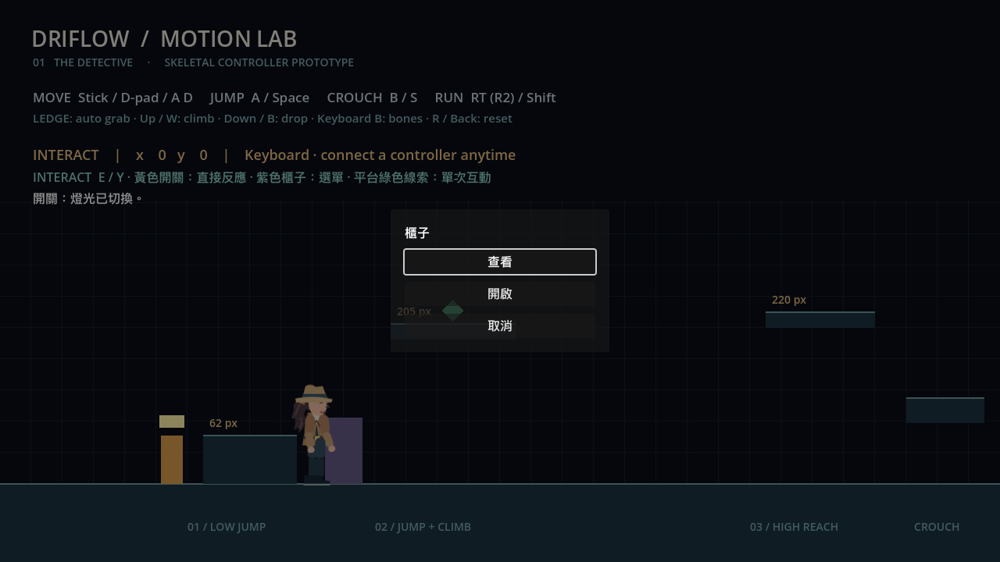
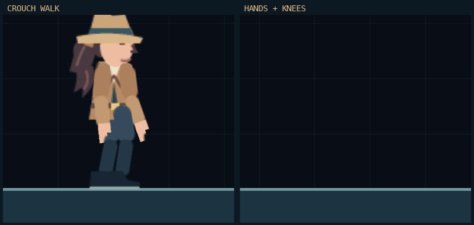

# Driflow — 女偵探操控原型

用 Godot 4.6.2 開啟 project.godot，按 F6 或 F5 執行。

| 動作 | Xbox／標準映射控制器 | 鍵盤 |
|---|---|---|
| 移動 | 左搖桿／方向鍵 | A、D／左右 |
| 跳躍 | A（底部按鈕） | Space |
| 蹲下／蹲走 | 按住 B（右側按鈕） | 按住 S／下 |
| 手膝爬行 | 按住 LT（L2）＋方向 | 按住 C＋方向 |
| 奔跑 | 按住 RT／R2 | Shift |
| 回起點 | Back／Select | R |
| 顯示骨架 | — | B |
| 物件互動 | Y（上方按鈕） | E |
| 互動選單 | 方向鍵／A 確認／B 取消 | 上下／Enter／Esc，或滑鼠 |

無方向時起跳水平速度歸零；移動中跳躍保留移動。空中可改方向、鬆開方向會煞停，並非鎖定拋物線。短按小跳、長按高跳；100ms 土狼時間、120ms 跳躍緩衝。低天花板下不允許站起或起跳。這些數值是原型預設，仍需手感驗證。

## 角色與替換

原創風衣女偵探：帽子、棕色馬尾、領帶、風衣、長褲與靴子。參考方向已確認為《銀松鎮》（Silver Pines）；此版仍是簡化分件原型，未達該作的美術精緻度。馬尾為兩節獨立骨架，帶阻尼擺動、轉身與落地回彈，可分別替換 ponytail.svg 和 ponytail_tip.svg。

scenes/rig.tscn 是實際 Skeleton2D + 22 個 Bone2D，各部件有 Artwork Sprite2D。打開場景，選取 Artwork 的 Texture 替換 PNG／SVG，並調整 position、offset、scale，保持關節位置。art/ 內是可直接修改的向量佔位素材。這是剛性分件骨骼動畫，沒有網格蒙皮；將來可在相同骨架上增加 Polygon2D 權重蒙皮。

scripts/rig.gd 用程序驅動姿勢、步態、呼吸、落地緩衝和頭部補償；目前是可玩動作草稿，還不是人工精修的最終動畫。控制器與視覺分離：player.gd 管物理，rig.gd 管動畫。速度、加速度、跳躍高度與緩衝可在 player.gd 的 export 參數調整。controls.gd 集中維護映射，支援 Godot 已識別的控制器，未知裝置可能需自訂映射。

## 驗證

執行：Godot --headless --log-file /tmp/driflow-test.log --path . --script res://tests/smoke.gd
測試落地、垂直跳、走跳、蹲下碰撞、頭頂阻擋、模擬 RT 軸和實際骨架數量。實體手把與主觀動畫自然度仍需你試玩。

## 原地轉身（更新）
站定或蹲定時，輕點反方向會改變面向，100ms 內不產生水平位移；放開即取消待開始的步行。持續按住超過 100ms 才開始走。快速交替左右輕點會留在原地。同向起步不等待。走跑中反向、空中轉向、方向＋跳躍，以及按住奔跑鍵，都不等待。player.gd 的 turn_delay 可調整此時間。

轉身目前使用約 100ms 的側身收窄／展開視覺過渡，加上馬尾慣性；不是完整正面／背面轉身逐格動畫。新增測試涵蓋輕點零位移、鬆開取消、連續切換、長按起步、移動反向與跳躍不延遲。

## 抓邊與攀上（更新）
空中靠近面向一側的平台頂緣，手部高度落在偵測範圍時自動抓邊，進入 HANG。按上／W／控制器方向上或搖桿上，約 1.02 秒爬上平台；按下／S／控制器 B 放手。放手有 0.35 秒禁止重抓，避免黏回去。平台頂部及攀爬路徑需要容納站立角色，頂部空間不足時留在懸掛狀態。攀爬不關閉碰撞，途中受阻會中止。測試場景中間的懸空平台可練習左右兩側抓邊。此版針對靜態平台，尚不支援移動平台跟隨；抓邊姿勢為程序動畫草稿，手掌以雙節 IK 固定支撐點，骨盆按拉起、跨邊、站起三段位移；前腳先跨過邊緣踩穩，後腳跟上，落腳後鞋底維持水平並固定在平台上。仍是程序動畫原型，重量感與細節需要依真人參考繼續精修。


## 攀爬畫面驗證

`tests/smoke.gd` 另驗證左右抓邊、支撐手掌誤差小於 1px、踩穩後鞋底誤差小於 0.5px、跨邊鞋底淨空、攀爬後走動、動態阻擋中止、放手與第三平台垂直跳抓邊。

以圖形渲染器擷取左右攀爬的 60fps 逐格 PNG（不能使用 `--headless`）：

```sh
Godot --log-file /tmp/driflow-climb-visual.log --path . --fixed-fps 60 --script res://tests/climb_visual.gd -- /tmp/driflow-climb-frames
```

輸出包括懸掛、完整攀爬與站穩後的過渡。檢查時應同時觀看正常速度與慢速循環；接觸點測試通過，只代表幾何條件成立，不代表人體動作已達精修品質。`project.godot` 仍使用原有 Motion Lab 主場景，無須改動啟動設定。


## 開發文件

- [程式、骨架與文件維護指南](docs/DEVELOPMENT.md)：目錄與呼叫結構、修改入口、耦合數值及驗證方式。
- [2026-11-05 攀爬動畫開發日誌](docs/devlogs/2026-11-05-climb.md)：本次根因、改動、驗證、使用者回饋與後續。
- [2026-11-05 物件互動開發日誌](docs/devlogs/2026-11-05-interactions.md)：全域機制、程式結構、控制器整合、測試、平台更新合併與後續。

文件的 Notion 閱讀版歸入 Game Lab；repo 原始檔及 `.agents` 仍是實作與規則來源。

Notion 閱讀版：[開發日誌](https://app.notion.com/p/40fc42073e3381fa8d17fea22743c49d)／[維護指南](https://app.notion.com/p/40fc42073e3381db838cf7b1696b274a)。


## 測試平台佈局（2026-11-05 更新）

平台空隙改為 120px、320px，讓低跳與兩座攀爬台有各自的接近空間。地面 y=620；完整跳躍腳底約上升 97px，因此 205px、220px 高台無法直接跳上，但可從地面按住跳躍抓邊，再按上攀爬。左右兩側的地面跳抓與攀上均已驗證。

| 區域 | 矩形 (x, y, width, height) | 用途 |
| --- | --- | --- |
| 低跳台 | (260, 558, 120, 62) | 離地 62px，可直接跳上 |
| 攀爬台 | (500, 415, 160, 20) | 離地 205px，跳起抓邊後攀上 |
| 高抓邊台 | (980, 400, 140, 20) | 離地 220px，需更完整的跳躍高度 |
| 蹲行天花板 | (1160, 494, 100, 32) | 保留 94px 地面通道，供蹲行練習 |
| 爬行天花板 | (1235, 526, 25, 26) | 右側通道末端降低至 68px，需手膝爬行 |

後續調整請改 `scripts/lab.gd` 頂部的 `GROUND_Y`、`LOW_PLATFORM`、`CLIMB_PLATFORM`、`HIGH_PLATFORM`、`CROUCH_CEILING`；回歸測試和左右擷取會從這些資料推算接近位置、落點與鏡頭。兩高台之間全速跳躍可能抓住下一台邊緣，但仍需攀上，不能直接落到台面。


## 距離式物件互動（2026-11-05）



實際遊戲畫面：按動作鍵後開啟櫃子選單，玩家可查看、開啟或取消；背景仍維持原關卡。

原有 Motion Lab 已加入黃色開關、紫色櫃子與平台上的綠色線索。靠近時按 E／手把 Y，分別示範直接反應、自訂選單與單次拿取。選單開啟時暫停玩家移動輸入，關閉後恢復；空中、懸掛與攀爬時不接受互動。

新增物件只需加入 `InteractableComponent` 子節點，在 Inspector 調整半徑與反應模式，連接 `interacted(actor, action_id)` 訊號。可在 `scenes/interaction_props.tscn` 編輯現有範例；獨立範圍測試台為 `scenes/interaction_demo.tscn`（F6）。

完整設定、程式結構、控制器接點與測試命令見 [物件互動指南](docs/INTERACTIONS.md)。

新增物件可照指南的「新增物件的完整操作：Crate 範例」：建立節點、掛組件、設定距離、連接訊號、直接變色測試，再改為自訂選單；包含可複製程式與常見問題。[Notion 開發日誌](https://app.notion.com/p/40fc42073e3381089418ff23b6833ac7) 與既有 Notion 維護指南已補充互動紀錄；完整設定以本機指南為準。


互動指南與開發日誌已補上實際畫面、互動流程、場景／程式結構、輸入防護及測試配圖；[配圖與再製方式](docs/visuals/interaction/README.md)。


## 真人參考與可替換骨架（2026-11-05）

攀爬改為約 1.02 秒：拉起 → 伸肘推撐 → 前腳踩穩 → 骨盆移過支撐腳 → 站起。骨架新增腰背、頸及左右肩，連同本輪獨立手掌共 22 節；上衣與下擺分件可獨立換 PNG／SVG，手掌、鞋底、衣服接點有可編輯標記。

[真人參考、完整骨架與素材替換指南](docs/CLIMB_REFERENCE.md) 包含來源、尺寸、節點結構及修改方法。擷取腳本可加 `--clean`，每張圖固定推進一個物理步長並附時間資料，供正常與慢速比對。


## 基本動作調整（2026-11-05）

蹲下／站起連續過渡，蹲走速度 85px/s，短步抬腳並固定支撐腳；手掌和膝蓋著地爬行為獨立姿勢（46px/s），對側手膝錯開前進。按住 C／LT 進入爬行，放開在淨空足夠時起身；低頂下保留能容納的姿勢。爬行時先放開 C／LT、起身後再跳，避免突然從四點支撐彈起。

跳躍腿部由起跳姿勢過渡到收腿、滯空保持與落地準備，不再使用地面步態相位。站立 Capsule 高 132、蹲下 Rectangle 高 88 寬 26、爬行 Rectangle 高 64 寬 132；縮小碰撞前會參考可見帽頂，避免姿勢還沒低下就進入天花板。

新增可替換的 FrontHand／BackHand、hand.svg 與 KneeContact 標記，仍可逐件換 PNG／SVG。完整修改入口、結構、參考、參數與擷取方式見 [基本動作與替換指南](docs/LOCOMOTION.md)；[開發日誌](docs/devlogs/2026-11-05-locomotion.md)。

```sh
Godot --headless --log-file /tmp/driflow-locomotion.log --path . --script res://tests/locomotion_smoke.gd
Godot --log-file /tmp/driflow-locomotion-visual.log --path . --fixed-fps 60 --script res://tests/locomotion_visual.gd -- /tmp/driflow-locomotion-frames
```


Notion 閱讀版：[基本動作與附件指南](https://app.notion.com/p/40fc42073e33815099c4d3a01ad72962)／[本輪開發日誌與動作預覽](https://app.notion.com/p/40fc42073e33810a8f8ce8e19c2243a8)。


## 手關節修正（同日後續）

上一版預覽的手臂存在反折；已分離手臂／腿部IK彎曲方向、讓放鬆手掌跟隨前臂，拆開 WristContact／PalmContact，並保持原有 HandContact 查詢相容。骨架仍22節，獨立Artwork換圖保留。動作檢查1659項及攀爬／互動回歸通過；更新方法見 docs/LOCOMOTION.md 的「後續修正」。




### 同日後續：起跳蓄力與蹬腿

原地起跳新增約67ms的快速下沉／伸腿，移動跳約33ms；蹲姿直接伸腿，土狼起跳直接觸發。Boot新增可編輯ToeContact=(12,13)，仍22骨節，Artwork換圖保留。修改入口為player.gd的jump_anticipation／moving_jump_anticipation，以及rig.gd的begin_takeoff／apply_takeoff_pose。新jump_smoke.gd45項檢查及既有攀爬／互動回歸通過；完整結構、輸入取消、擷取命令與時序見docs/LOCOMOTION.md「起跳發力修訂」。最新預覽為jump-push.gif與jump-phases.png，先前檔案保留歷史。


### 同日後續：伸手、扣邊與承重銜接

新增接觸前肩前弧線抬手、前後手先後接近與看向邊緣；catch約0.16s內分時固定掌心、緩衝肩／骨盆與腿，接著才開始原1.02s攀爬。接觸時的Up／W及catch期間的要求會排入climb_requested；start_climb返回true可能是接受佇列，應另檢查實際狀態。真正抓取再核對頂面相對腳底<=130px與原碰撞路徑，兩座高台實際跳抓皆回歸通過。

新tests/reach_smoke.gd的560檢查通過，reach_visual.gd含兩高度左右鏡像及完整chain。完整程式分工、參數、22節換圖契約、測試與擷取命令見docs/LOCOMOTION.md和CLIMB_REFERENCE.md「伸手與扣邊修訂」。最新圖為reach-catch.gif、reach-phases.png；先前預覽保留歷史。


### 同日後續：正常步行不再固定壓低骨盆

原版一移動就把骨盆降7px，跑步降11px，造成半蹲感。現在走路改為承重腿伸直與小幅週期移重，配合腳跟落地、鞋底承重和前腳掌推進；固定垂直鏡頭下站走平均身高差由約6.2px降至1.2px。移動速度維持220／380px/s。

Boot新增HeelContact=(-12,13)，與SoleContact=(0,13)、ToeContact=(12,13)共同校準鞋底；仍22骨節，Artwork可換圖。主流程為rig.gd的ground_foot_pose／solve_ground_foot與骨盆週期，取代舊normal_legs；調整步幅、支撐比例時要一起查身高與接觸誤差。

新walk_height_smoke1230檢查及既有跳躍、抓邊、攀爬、低姿勢與互動回歸通過。完整結構、參數、相位越界／走跑切換處理和重製命令，見docs/LOCOMOTION.md「步行身高修訂」。最新圖為upright-walk.gif、walk-phases.png，先前預覽保留歷史。


## 人體附件前後順序修訂（2026-11-05）

已將20個Artwork設為明確的相對Z：遠臂0、遠腿1、馬尾2、近腿3、衣身4、頭5、帽6、近臂7。22骨節與獨立換圖能力保留，轉向鏡像不交換遠近；衣襬蓋住腿根。修改Inspector位置、完整層表、結構與像素回歸方式見[人體附件繪圖順序](docs/RENDER_ORDER.md)。本次54項圖形遮擋測試與既有動作／互動回歸通過。
