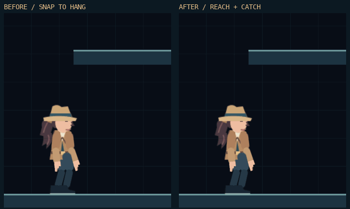

# Driflow｜真人攀爬參考、骨架與素材替換

更新日期：2026-11-05。適用 Godot 4.6.2 的 Motion Lab；主動作仍由 GDScript 程序關鍵點與 IK 驅動，沒有使用動作捕捉或 AnimationPlayer。本篇分清楚來源示範、為遊戲所做的改編與可替換素材的契約。

## 真人來源與使用方式

| 來源 | 本次核對內容 | 取用範圍 |
| --- | --- | --- |
| [Climbing Hut：Move of the Moment — The Mantel](https://www.climbinghut.com/post/move-of-the-moment-the-mantel) | 已開啟真人照片 1、3、5，閱讀全篇分解 | 肩膀移到掌心上方形成推撐，抬腳後把重量交給腿 |
| [Movement Fix／Ryan Ford：Learning the Climb Up](https://themovementfix.com/learning-the-climb-up/)／[影片](https://www.youtube.com/watch?v=VT9A4eGMRAQ) | 已確認真人影片與教學頁；未逐格量測影片時間 | 懸掛、拉起、推撐的流程參考；此片含蹬牆輔助，不能整套照搬 |
| [Howcast／Ann Kaczka：Muscle-Up or Climb-Up](https://howcast.com/videos/476338-how-to-do-a-muscle-up-or-climb-up-parkour/) | 已讀教練示範逐字稿與影片入口 | 區分有牆面借力的 climb-up，與腳下無支點的 dead-hang 拉起／推撐 |

這些來源是動作研究參考；沒有下載、重製或打包真人影片／照片作為遊戲素材。畫面中的平台是懸空薄板，腳下沒有可蹬的牆，因此本次採「手臂拉起 → 掌心向下推撐 → 上腳 → 骨盆移過腳 → 腿伸直」的改編，不添加踩空氣的蹬牆動作。以下數值是依本角色比例設計的遊戲時序，不是從真人量出的生物力學數據。

## 本次主動作與時序

總時長 `player.gd: climb_duration = 1.02` 秒。進度 0–1 對應這段攀爬的時間，並非接近平台或起跳的時間。

| 階段 | 正規化進度 | 設計目的 |
| --- | --- | --- |
| 起始承重 | 0–0.08 | 小幅啟動肩部，避免突然上升 |
| 拉起 | 0.08–0.42 | 骨盆暫留邊緣外；胸口靠近掌心，手肘彎曲 |
| 轉為推撐 | 0.42–0.60 | 向下推掌，手肘逐漸伸開；前腳先抬過邊緣再放上 |
| 上腳及移重 | 0.60–0.76 | 前腳固定，骨盆移入平台；手掌逐漸放開，仍保持支撐交接 |
| 後腳跟上／站起 | 0.76–1 | 骨盆先到支撐腳上方，再伸腿；後腳 0.84 起固定 |

前手釋放窗 0.60–0.76，後手 0.52–0.66；前腳 0.60、後腳 0.84 起固定。定義集中於 `rig.gd` 頂部具名常數，接觸測試直接讀取它們。主姿勢使用單調三次 Hermite 補間，保持相鄰姿勢的速度連續，減少每經過一個關鍵點就停止的感覺；接觸點固定仍是明確的保持區間。

## 人體架構：22 骨節，素材維持可替換

攀爬階段從 16 增至 20 個 Bone2D，新增 `Spine`、`Neck`、`FrontShoulder`、`BackShoulder`；基本動作階段再加入 `FrontHand`、`BackHand`，目前 22 節。角色仍使用獨立 Sprite2D 的剛性分件；沒有把整個角色烘焙成一張不可編輯的動圖。帽子、頭、雙臂、雙腿、靴子、馬尾都保留原本的替換方式。

```text
DetectiveRig
└── Skeleton2D
    └── Hip
        ├── BackThigh → BackShin → BackBoot → SoleContact
        ├── Spine                         腰部／下擺控制
        │   ├── Artwork                   coat_lower.svg
        │   └── Torso                     上胸／上衣控制
        │       ├── Artwork               coat_upper.svg
        │       ├── CoatJoin              上下衣銜接標記
        │       ├── BackShoulder
        │       │   ├── Artwork           肩部補片
        │       │   └── BackArm → BackForearm → BackHand / HandContact
        │       ├── Neck
        │       │   └── Head
        │       │       ├── Hat
        │       │       └── Ponytail → Tip
        │       └── FrontShoulder
        │           ├── Artwork           肩部補片
        │           └── FrontArm → FrontForearm → FrontHand / HandContact
        └── FrontThigh → FrontShin → FrontBoot → SoleContact
```

腿、頭、手臂等其餘 Artwork 為簡化圖形而省略。`HandContact`、`SoleContact`、`CoatJoin`、`KneeContact` 均為 Marker2D，不計入 22 個骨節。腰部控制讓下擺與上胸有相對角度，頸部與頭部共同補償前傾，兩側肩部可小幅調整受力姿勢。上下衣由 `CoatJoin` 對齊，避免軀幹前移時下擺留在原地而分離。

## 如何替換素材

1. 在 Godot 開啟 `res://scenes/rig.tscn`，選取要換的骨節下 `Artwork` Sprite2D。
2. 將自己的 PNG／SVG 指定到 `Texture`。動畫不會在執行時重新指定貼圖，替換會保留。
3. 先保持預設骨節位置，只調 Artwork 的 position、offset、scale，讓肩、肘、膝與踝的接縫接上。材質可以改，無須重寫動畫。
4. 若要修改身體比例，才修改 Bone2D 子關節的位置與 rest transform；一併調整手掌、鞋底與衣服的接觸標記，再跑測試。
5. 手掌及鞋底標記保持骨節的局部 +Y 軸；目前 IK 以這個方向解算。任意移到側向或改名，需要同步 IK 邏輯。
6. 若修改碰撞比例，仍需同步 `player.gd` 的站立 Capsule／蹲下及爬行 Rectangle、抓邊高度帶與懸掛偏移；貼圖大小不會自動改碰撞。

新服裝部件的預設規格：

| 部件 | 預設圖檔／尺寸 | Artwork 位置 | 替換時注意 |
| --- | --- | --- | --- |
| 上衣 | `art/coat_upper.svg`，44×28 | Torso/Artwork：中心 (0,14) | 圖片上緣對應上胸骨節，腰接點由 CoatJoin 控制 |
| 下擺 | `art/coat_lower.svg`，44×22 | Spine/Artwork：中心 (0,9) | 與上衣預設重疊 4px，避免旋轉出現空隙 |
| 左右肩補片 | 預設沿用 `upper_arm.svg` | 各 Shoulder/Artwork：(0,2)，scale (0.7,0.3) | 可各自改成獨立肩部 PNG，並調整縮放 |
| 手腕 | Forearm/WristContact：(0,27) | 無貼圖的 Marker2D | 末節 IK 長度讀取這個標記，掌心另由 Hand/PalmContact 設定 |
| 鞋底 | Boot/SoleContact：(0,13) | 無貼圖的 Marker2D | 腳踝至鞋底偏移直接讀取這個標記 |
| 衣服接點 | Torso/CoatJoin：(0,26) | 無貼圖的 Marker2D | 若上下衣改尺寸，調整此點與下擺 Artwork 對齊 |

`art/torso.svg` 保留為原始完整服裝參考，這版場景已改用 `coat_upper.svg`、`coat_lower.svg`，修改舊完整圖檔不會自動重切兩張分件。建議先依預設畫布換風格，再決定是否改比例。

角色的既有部件仍位於 `art/head.svg`、`hat.svg`、`upper_arm.svg`、`forearm.svg`、`thigh.svg`、`shin.svg`、`boot.svg`、`ponytail.svg`、`ponytail_tip.svg`，逐件指定 Texture 即可。前後手臂預設共用素材，但可在不同 Artwork 各自指定不同圖片。

## 程式修改入口

- 骨架與素材掛載：`scenes/rig.tscn`。
- 一般步態／攀爬姿勢：`scripts/rig.gd`；新增骨節的復位也在一般 `animate()` 中，避免攀爬結束後保留受力姿勢。
- 肩到掌的取得方式：`rig.get_arm("Front")` 或 `rig.get_arm("Back")`，避免業務程式重複綁住長節點路徑。
- 曲線：`climb_curve()`、`ledge_key()`；骨盆／胸口／鞋底的關鍵點在 `animate_ledge()`。
- 手腳接觸：`solve_limb()`、HandContact／SoleContact；上下衣對齊：CoatJoin。
- 碰撞、狀態及總時長：`scripts/player.gd`。平台配置與互動系統沿用現有版本。

## 驗證與連續畫面

```sh
/Applications/Godot.app/Contents/MacOS/Godot --headless --log-file /tmp/driflow-smoke.log --path /Users/clydewang/GITHUB/godot-games/games/Driflow --script res://tests/smoke.gd
/Applications/Godot.app/Contents/MacOS/Godot --headless --log-file /tmp/driflow-interaction.log --path /Users/clydewang/GITHUB/godot-games/games/Driflow --script res://tests/driflow_interaction.gd
/Applications/Godot.app/Contents/MacOS/Godot --log-file /tmp/driflow-climb-visual.log --path /Users/clydewang/GITHUB/godot-games/games/Driflow --fixed-fps 60 --script res://tests/climb_visual.gd -- /tmp/driflow-climb-frames --clean
```

預期 `MOTION TESTS: PASS`、`DRIFLOW INTERACTION TESTS: PASS`、`CLIMB VISUAL CAPTURE: PASS (both sides)`。`--clean` 只隱藏擷取畫面中的標籤與互動道具，不改正常遊戲場景；不加它可看完整場景。B 鍵的骨架顯示現在也可在懸掛／攀爬時切換。

擷取器每張圖只推進一次物理步長，另存 `right_timing.json`／`left_timing.json`，記錄秒數、進度與骨盆位置。不能在等待渲染時讓角色繼續自動跑物理，否則漏掉的步長會使比較片看起來突然加速。GIF 使用 50fps、20ms 格距，由 60Hz 原始幀重取樣，避免 16.7ms 被 GIF 的 10ms 時間單位截斷。

回歸測試除原有移動、跳抓、碰撞與互動外，也檢查伸肘推撐、前腳接觸時掌心尚未離邊、骨盆先移到支撐腳上方、上下衣接點誤差、22 骨節及可替換的 Artwork。這些是製作約束與幾何檢查，不是人體質量分布的物理模擬，也不是對自然度的客觀評分。

## 技術棧與下一步

Skill：先讀 `godot_expert`，復盤依 `self_improving_agent`；文字同步使用 `notion-knowledge-capture`。工具：Godot 4.6.2 CLI、GDScript、Skeleton2D／Bone2D／Marker2D／Sprite2D、原生 SVG；網路搜尋與瀏覽器核對真人來源，Python Pillow 組合遊戲擷取幀。遊戲 runtime 沒有新增外部函式庫或遠端依賴。

復用：核對真人來源與場景支撐條件 → 修改姿勢與必要骨節 → 校準可替換素材及接觸標記 → 跑 smoke／互動測試 → 固定步長擷取左右畫面 → 正常、0.5、0.25 倍速比對 → 更新文件與日誌。

仍受剛性分件、單一側面視角與原型美術限制；若下一輪需要更細的胸腰形變，再增加必要骨節或局部蒙皮，同時保留獨立素材入口。不得為追求細節而取消可替換能力。


Notion 閱讀版：[真人攀爬參考與可替換人體骨架](https://app.notion.com/p/40fc42073e33812ab305cd5de84c7d42)。


## 手掌與膝部替換增補

目前 Forearm/WristContact=(0,27)，與 FrontHand／BackHand Bone2D 的樞紐對齊。hand.svg（12×6）Artwork 中心改為 (1,1)，Hand/PalmContact=(0,4) 是掌面底部。Forearm/HandContact 現為跟隨掌心的相容查詢標記，不再是腕部長度。將手掌和前臂圖分開替換；前臂預設 SVG 保留袖口／腕部，已移除原本一體的末端手形。掌面平放時最下緣相對手腕 y=4，別把貼圖畫到支撐面下方。

膝部的 KneeContact 掛在各 Shin，位置 (5,0)；跪地時脛骨向後近水平，這個點落到地面。小幅大腿等比縮放模擬側視投影（0.75–1.10），不是重新指定 Texture。修改比例應同步實際骨節長度、接觸標記和碰撞，重跑左右爬行與攀爬；詳見 [LOCOMOTION.md](LOCOMOTION.md)。攀爬推撐階段的獨立手掌會轉為平放，放手後回到放鬆方向。


Notion 閱讀版：[基本動作與附件指南](https://app.notion.com/p/40fc42073e33815099c4d3a01ad72962)／[本輪開發日誌與動作預覽](https://app.notion.com/p/40fc42073e33810a8f8ce8e19c2243a8)。


### 同日後續：起跳蓄力與蹬腿

原地起跳新增約67ms的快速下沉／伸腿，移動跳約33ms；蹲姿直接伸腿，土狼起跳直接觸發。Boot新增可編輯ToeContact=(12,13)，仍22骨節，Artwork換圖保留。修改入口為player.gd的jump_anticipation／moving_jump_anticipation，以及rig.gd的begin_takeoff／apply_takeoff_pose。新jump_smoke.gd45項檢查及既有攀爬／互動回歸通過；完整結構、輸入取消、擷取命令與時序見docs/LOCOMOTION.md「起跳發力修訂」。最新預覽為jump-push.gif與jump-phases.png，先前檔案保留歷史。


## 伸手與扣邊修訂：接觸前抬臂、接觸後承重

2026-11-05 同日後續。使用者指出舉手攀附仍不細膩；原本try_grab_ledge成功後直接切成animate_ledge(0)，缺少接觸前抬手，以及接觸後的肩膀／骨盆緩衝。

### 流程與修改入口

```text
player.gd 物理更新
├── find_ledge_candidate()   共用平台側面／頂面碰撞幾何
├── update_reach()           預測可達邊緣，驅動接觸前抬臂
├── try_grab_ledge()         真正抓取前再查頂面高度與碰撞安全
│   └── rig.begin_catch()   先記錄世界姿勢，再固定物理根節點
└── update_ledge()
    ├── HANG：catch_elapsed < catch_duration → animate_catch()
    ├── HANG：承重完成 → 穩定懸掛；處理climb_requested
    └── CLIMB：原1.02s攀爬與完整碰撞路徑

rig.gd
├── begin_reach() / animate_reach()  肩前弧線、兩手延遲、視線
├── begin_catch() / animate_catch()  世界姿勢銜接、掌心固定與承重
├── solve_arm_contact()             腕部可行角度與掌心目標
└── finish_ledge_pose()             懸掛／攀爬共用馬尾次要運動
```

- 預測：前方reach_distance=64px、垂直偵測窗口190px；以當前垂直速度／剩餘跳高過濾不可達目標。這是預測窗口，不是把手臂變長。
- 抬臂：前手0–0.14s，後手0.025–0.18s。手腕沿肩前弧線移動，避開IK通過肩部的奇點；先抬肩／屈肘，再向上展臂，頸／頭略向邊緣看。後手保留小幅接近偏移，扣邊才合攏。
- 實際抓取：頂面相對腳底高度必須<=grab_height=130px，再執行原有clear_at與test_move。不能把側面掃描高度直接當頂面可達高度，否則會在手未碰到時吸附。
- 扣邊：前手約0.035s、後手0.025–0.07s完成最後接近與轉掌；之後掌心固定在世界邊緣。catch_duration=0.16s內，骨盆小幅承重下沉、肩胸緩衝、腿跟隨，保留接近慣性並逐步消散。
- catch仍屬ledge_mode="HANG"，物理根節點固定且碰撞持續啟用；骨架從接觸前的世界姿勢過渡。承重完成後才開始原本CLIMB；攀爬1.02s不包含前面的catch時間。

### 指令與邊界

接觸當幀已按住Up／W，或catch期間按下攀爬，會記住climb_requested，承重完成後接續。start_climb()現在只有HANG時接受要求；返回true可能表示已排入佇列，應檢查ledge_mode確認是否已進入CLIMB，不能只看返回值宣稱攀爬完成。真正開始前仍要通過目標空間與路徑預檢。

放手／重置會清除待攀爬意圖。目標消失或不可達時撤回伸手，短跳不會對無法碰到的高台揮手；drop期間與冷卻期不重抓。互動仍只在允許的地面狀態啟動。互動測試依catch_duration等待承重，再驗證實際CLIMB與完成。

### 骨架與替換

沿用既有22節的Shoulder／Arm／Forearm／Hand、頸與胸腰控制；Artwork Texture與WristContact／PalmContact／SoleContact／ToeContact不改。這輪增加的是動作路徑、時間、姿勢快照與承重交接，沒有逐指抓握動畫；手指仍隨手掌分件。若後續拆手指，需保留每件Artwork及相應接點，再補接觸與鏡像回歸。

### 驗證與重製

新增tests/reach_smoke.gd：560檢查通過，涵蓋兩個平台高度×兩朝向實際地面跳抓、多幀抬手連續性、肘／腕角、掌心承重固定、衣服接縫、提早輸入交接、非HANG拒絕攀爬、放手取消、目標消失和不可達短跳。既有MOTION、起跳45檢查、基本動作1659檢查、Driflow互動21檢查、通用互動42檢查通過。

```sh
/Applications/Godot.app/Contents/MacOS/Godot --headless --fixed-fps 60 --quit-after 5000 --path /Users/clydewang/GITHUB/godot-games/games/Driflow --script res://tests/reach_smoke.gd --log-file /tmp/driflow-reach-test.log
/Applications/Godot.app/Contents/MacOS/Godot --path /Users/clydewang/GITHUB/godot-games/games/Driflow --fixed-fps 60 --disable-render-loop --disable-vsync --audio-driver Dummy --accessibility disabled --script res://tests/reach_visual.gd --log-file /tmp/driflow-reach-visual.log -- /tmp/driflow-reach-frames
```

reach_visual.gd從地面錄製兩高度×兩朝向，另有提早按攀爬、承重後接續爬上的chain；沒有從空中傳送到HANG充當舉手驗證。60Hz逐步明確離屏繪製，timing.json保存模式、伸手／承重時間、骨盆與掌心座標。GIF從60Hz重取樣50fps，正常20ms／格、四分之一速80ms。

自審涵蓋接觸前後世界座標、只在真正可達時抓取、相容HandContact代理、左右IK方向、catch後姿勢與原攀爬首幀銜接、指令佇列取消及互動狀態。其他遊戲與原有素材替換能力保留；未commit／push。

技術棧：Godot4.6.2 GDScript／CharacterBody2D、PhysicsRayQuery、Bone2D／Marker2D／Sprite2D、雙節IK、CLI測試與renderer、Pillow組PNG／GIF、Notion MCP日誌。Skill：godot_expert、self_improving_agent、notion-knowledge-capture。復用：調預測與可達限制 → 肩前抬臂路徑 → 世界姿勢快照 → 分時掌心固定與承重 → 指令交接 → 兩高度兩朝向及取消回歸 → 正常／慢速對照 → 同步文件。





### 同日後續：正常步行不再固定壓低骨盆

原版一移動就把骨盆降7px，跑步降11px，造成半蹲感。現在走路改為承重腿伸直與小幅週期移重，配合腳跟落地、鞋底承重和前腳掌推進；固定垂直鏡頭下站走平均身高差由約6.2px降至1.2px。移動速度維持220／380px/s。

Boot新增HeelContact=(-12,13)，與SoleContact=(0,13)、ToeContact=(12,13)共同校準鞋底；仍22骨節，Artwork可換圖。主流程為rig.gd的ground_foot_pose／solve_ground_foot與骨盆週期，取代舊normal_legs；調整步幅、支撐比例時要一起查身高與接觸誤差。

新walk_height_smoke1230檢查及既有跳躍、抓邊、攀爬、低姿勢與互動回歸通過。完整結構、參數、相位越界／走跑切換處理和重製命令，見docs/LOCOMOTION.md「步行身高修訂」。最新圖為upright-walk.gif、walk-phases.png，先前預覽保留歷史。


## 人體附件前後順序修訂（2026-11-05）

已將20個Artwork設為明確的相對Z：遠臂0、遠腿1、馬尾2、近腿3、衣身4、頭5、帽6、近臂7。22骨節與獨立換圖能力保留，轉向鏡像不交換遠近；衣襬蓋住腿根。修改Inspector位置、完整層表、結構與像素回歸方式見[人體附件繪圖順序](RENDER_ORDER.md)。本次54項圖形遮擋測試與既有動作／互動回歸通過。
