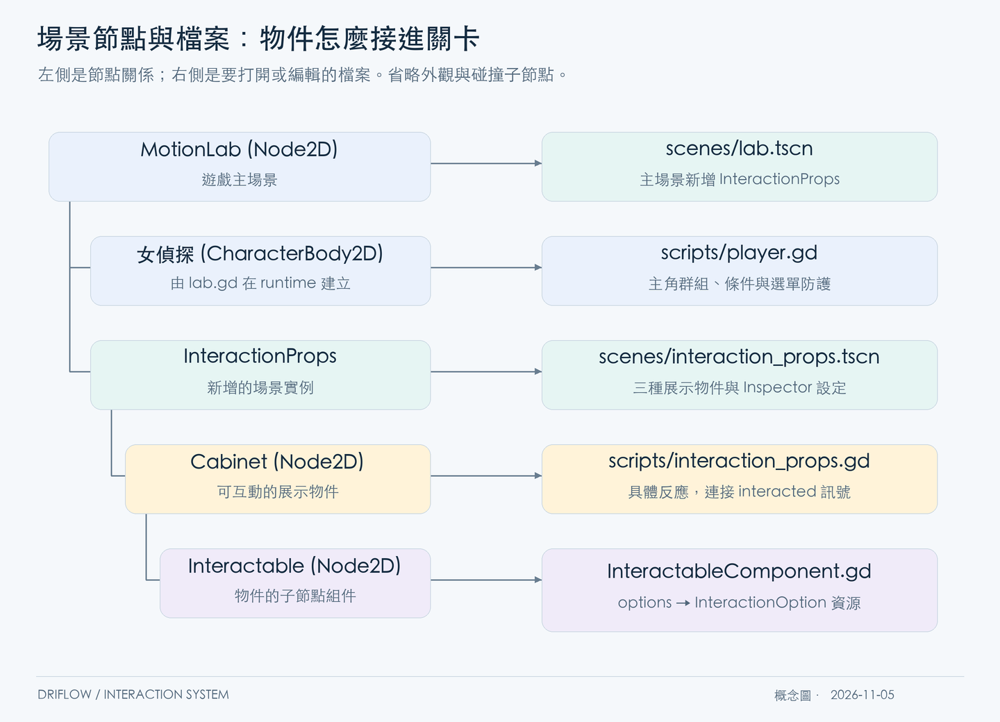
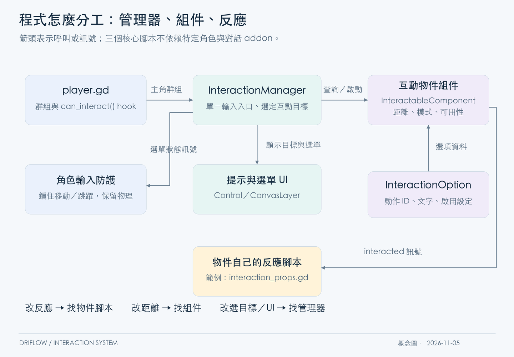
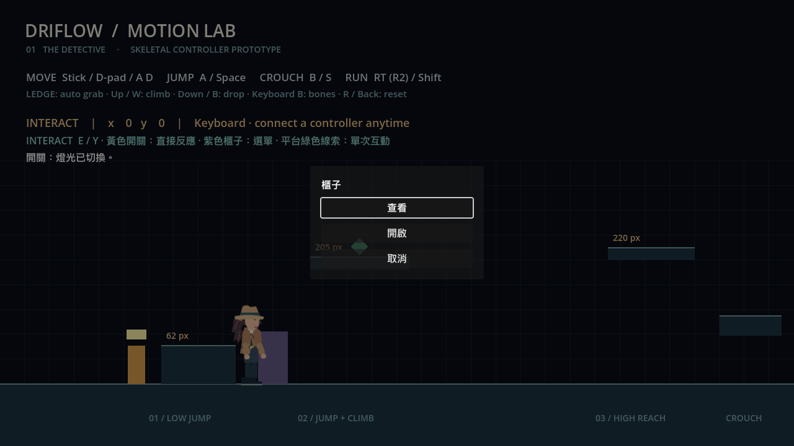
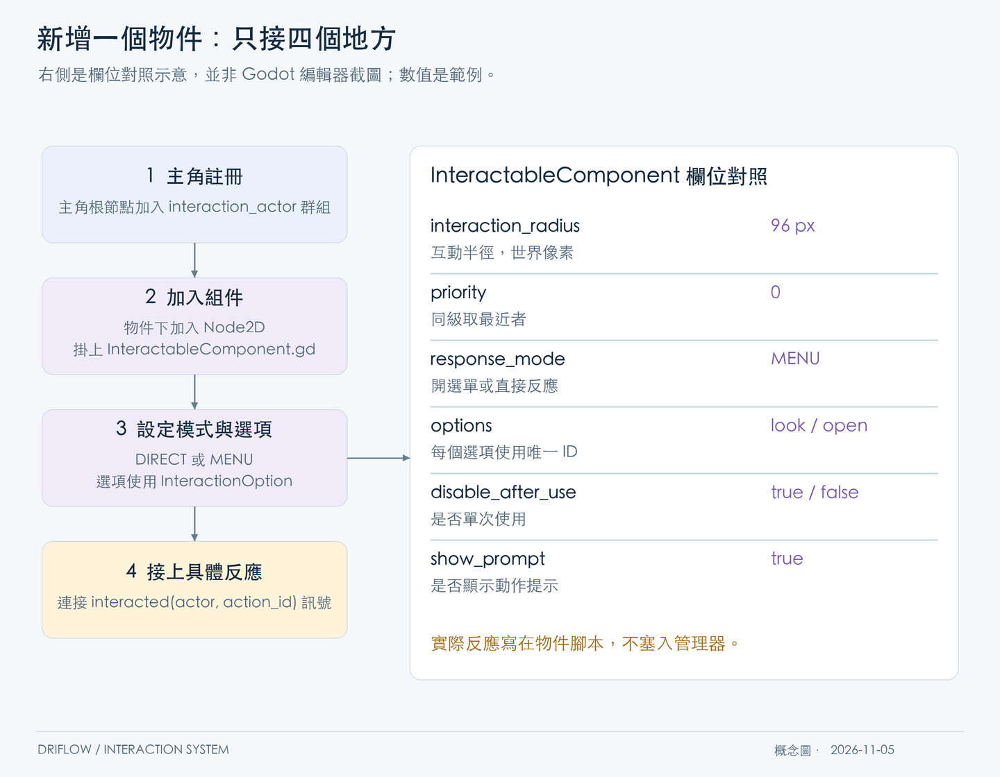
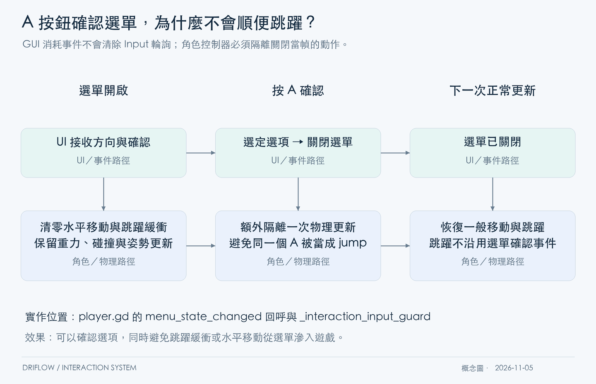
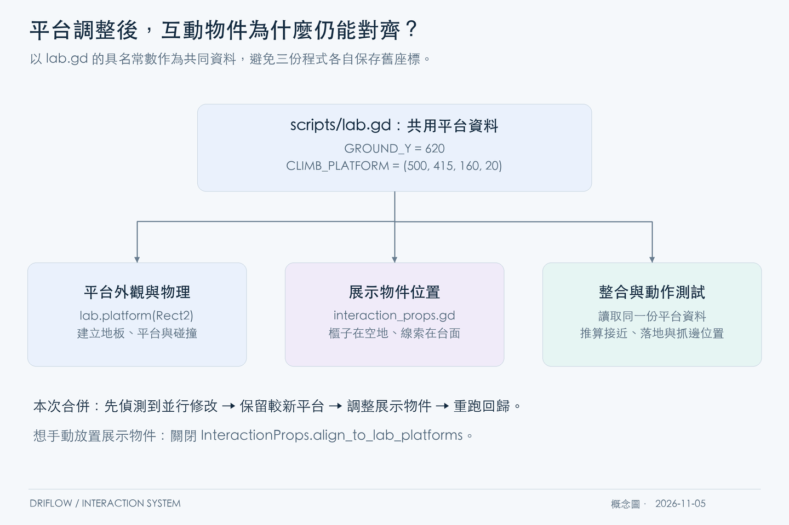

# Driflow｜程式、骨架與文件維護指南

適用版本：2026-11-05 的女偵探 Motion Lab。實際專案根目錄為 `/Users/clydewang/GITHUB/godot-games/games/Driflow`；以下相對路徑均從這裡開始。Godot 的 `res://` 也從 Driflow 根目錄開始，不是 monorepo 根目錄。

本指南記錄如何修改現有程式與文件，不表示要立即重構原型。repo 檔案與 `.agents` 是規則來源；Notion 為人類閱讀版及導航。

## 1. 專案與文件結構



結構圖：場景節點與應編輯的檔案對照；角色由 lab.gd 在 runtime 建立，展示物件以場景實例加入。

```text
godot-games/
├── AGENTS.md                         monorepo 規範
├── .agents/
│   ├── rules/core_directives.md       共用行為準則
│   └── skills/godot_expert/SKILL.md   Godot 可重用規則／陷阱
└── games/
    ├── 2d-avg/                       另一個獨立專案，本次不改
    ├── udemy-frogger/                另一個獨立專案，本次不改
    ├── udemy-metroid/                另一個獨立專案，本次不改
    └── Driflow/
        ├── project.godot             引擎／視窗／渲染／主場景
        ├── README.md                 啟動、操作、限制、驗證與文件入口
        ├── scenes/
        │   ├── lab.tscn              主場景，掛 lab.gd
        │   └── rig.tscn              可編輯的角色骨架和 Artwork
        ├── scripts/
        │   ├── controls.gd           鍵盤／控制器 InputMap
        │   ├── lab.gd                在執行時建立平台、玩家與狀態文字
        │   ├── player.gd             物理、移動、抓邊與攀爬狀態
        │   └── rig.gd                一般步態、攀爬關鍵點、IK、馬尾
        ├── art/
        │   ├── torso.svg / head.svg / hat.svg
        │   ├── upper_arm.svg / forearm.svg
        │   ├── thigh.svg / shin.svg / boot.svg
        │   └── ponytail.svg / ponytail_tip.svg
        ├── tests/
        │   ├── smoke.gd              無頭功能與接觸測試
        │   └── climb_visual.gd       左右攀爬圖形擷取
        └── docs/
            ├── DEVELOPMENT.md       本指南，維護目前正確的修改方法
            └── devlogs/
                └── 2026-11-05-climb.md  當日事實、決策、驗證與後續
```

`.godot/` 是 Godot 匯入快取；`.svg.import` 是素材匯入描述，不是動畫程式。不要在生成快取裡修 bug。此原型的玩家、碰撞形狀與平台由程式建立，並沒有獨立 `player.tscn`；在編輯器直接看 `lab.tscn` 時不會看見完整執行場景。

## 2. 執行關係與責任



結構圖：管理器、主角、互動組件、選項資源與物件反應的責任邊界。訊號由組件發送，選項資源只提供資料。

```text
project.godot → scenes/lab.tscn → scripts/lab.gd
                                  ├─ controls.gd.setup() 建立 InputMap
                                  ├─ platform() 建立 StaticBody2D
                                  └─ 建立 CharacterBody2D + player.gd
                                       ├─ 建立站立 Capsule／蹲下及爬行 Rectangle 碰撞
                                       └─ 載入 scenes/rig.tscn
                                            └─ rig.gd 驅動 Bone2D / Artwork
```

`player.gd` 決定角色在世界哪裡、是否抓邊、能否攀上；`rig.gd` 決定看起來如何移動。僅改視覺骨架不會改碰撞。攀爬時碰撞根節點沿預先掃描的安全路徑移動，骨盆及手腳則依平台世界座標生成姿勢，兩者不需要使用相同插值曲線。

目前使用 `ledge_mode = "" / "HANG" / "CLIMB"` 表示抓邊子流程；一般 `state` 是供顯示使用的字串，不是 AnimationTree 狀態機。`animate_ledge(dt, facing, progress, grip_world)` 的 `progress` 為 0–1，`grip_world` 是平台邊緣世界座標；`facing` 為 +1／-1。

## 3. 想改什麼，從哪裡下手

| 需求 | 修改位置 | 要一起檢查 |
| --- | --- | --- |
| 走、跑、蹲速度／加速度／跳躍高度 | `scripts/player.gd` 頂部 export 參數 | 垂直跳、走跳、空中煞停、頭頂與土狼時間 |
| 原地轉身等候時間 | `player.gd` 的 `turn_delay` | 反向輕點無位移；持續按住能起步 |
| 鍵盤或手把配置 | `scripts/controls.gd` 的 keys、buttons、軸映射 | 同步 `lab.gd` 提示及 `README.md` 操作表 |
| 平台位置／場景文字 | `scripts/lab.gd` 頂部的具名 Rect2 常數、`label_at()` | smoke／擷取由同一份平台資料推算座標；調整後重驗實際可達性 |
| 抓邊高度與距離 | `player.gd` 的 `try_grab_ledge()` | 上下界、兩側鏡像、第三平台垂直跳 |
| 攀爬總時長／碰撞路徑 | `player.gd` 的 `climb_duration`、`start_climb()`、`update_ledge()` | 骨架時序、目標空間預檢、途中阻擋 |
| 攀爬姿勢／手腳釋放順序 | `rig.gd` 的 `animate_ledge()`、`ledge_key()` | 支撐點可達距離、落腳淨空與固定 |
| 手臂／腿部接觸解算 | `rig.gd` 的 `solve_limb()` | 兩節長度、彎曲方向、左右鏡像 |
| 外觀或肢體比例 | `scenes/rig.tscn` 與 `art/*.svg` | 關節位置、IK 末節長度、碰撞及測試 |
| 視窗、主場景、渲染 | `project.godot`，優先透過 Project Settings | 啟動場景與畫面；不要為調姿勢修改它 |
| 使用方式改變 | `README.md` | 指令能實際執行，數值與鍵位一致 |
| 修改方法／架構改變 | `docs/DEVELOPMENT.md` | 樹狀結構、呼叫關係、參數與復用步驟 |
| 本次開發經過 | 新增 `docs/devlogs/YYYY-MM-DD-topic.md` | 已做／建議分開，寫實際驗證與限制 |

### 範例 A：只調整攀爬時間

`player.gd` 目前為：

```gdscript
@export var climb_duration: float = 1.02
```

例如試作較慢節奏，可改成 `0.95`；這是調整示例，沒有套用。姿勢關鍵點使用正規化進度，通常不必等比例改所有關鍵點，但仍要重新看連續動作。

目前 smoke 會依 `climb_duration × physics_ticks_per_second` 計算完整流程應有的幀數，容許 2 幀邊界差異；不再使用固定 40 幀門檻。`climb_visual.gd` 的擷取長度已根據攀爬時長和物理更新率計算。

### 範例 B：改跨邊、收腿與站起

主要修改 `rig.gd` 的 `animate_ledge()`。`ledge_key()` 使用時間陣列與 Vector2 陣列對應補間；數量必須一致、時間遞增。座標以平台邊緣為原點：x 正方向朝平台內，y 正方向向下。最後再乘 `facing` 轉成世界方向，所以不要只為左側另寫一套相反座標。

目前關鍵數值如下，均是現有實作，不是理想人體動作標準：

| 對象 | 正規化進度 | 相對位置／行為 |
| --- | --- | --- |
| 骨盆 | 0、0.08、0.26、0.42、0.54、0.60、0.76、0.90、1 | (-16,70)、(-18,68)、(-27,40)、(-35,10)、(-28,-13)、(-18,-25)、(25,-34)、(24,-57)、(22,-61) |
| 前腳固定 | 0.60 起 | 平台相對 (27,0) |
| 後腳固定 | 0.84 起 | 平台相對 (17,0) |
| 前手釋放 | 0.60 → 0.76 | 上腳後逐步放開 |
| 後手釋放 | 0.52 → 0.66 | 另一隻手維持支撐 |
| 移重後站起 | 0.76 → 1 | 骨盆先到前腳上方，再伸腿 |


修改順序：先改骨盆與軀幹，確保支撐手在兩節可達範圍；再安排膝與鞋底先抬過表面、再跨入平台；最後調放手與站起節奏。`solve_limb()` 的距離 clamp 只是避免數學失效，不會讓超出手臂長度的目標變成真實接觸。

`player.gd` 的碰撞終點目前在平台內 22px；`rig.gd` 最終骨盆 x=22、前腳 x=27、後腳 x=17，彼此對應站姿兩腿偏移 ±5px。若改攀上深度，要同步這幾處與測試期望，否則會在攀爬結束時出現跳位。

### 範例 C：替換角色素材或骨架

用 Godot 開啟 `scenes/rig.tscn`，選取對應的 `Artwork` Sprite2D 替換 Texture，保持關節銜接。只改外觀而不改比例，通常可保留骨架；若改長度，就必須同步 IK 和碰撞。

```text
DetectiveRig (Node2D, rig.gd)
└── Skeleton2D
    └── Hip
        ├── BackThigh → BackShin → BackBoot → SoleContact
        ├── Spine (Artwork: coat_lower.svg)
        │   └── Torso (Artwork: coat_upper.svg; CoatJoin)
        │       ├── BackShoulder → BackArm → BackForearm → BackHand / HandContact
        │       ├── Neck → Head → Hat / Ponytail → Tip
        │       └── FrontShoulder → FrontArm → FrontForearm → FrontHand / HandContact
        └── FrontThigh → FrontShin → FrontBoot → SoleContact
```

每個骨節的 Artwork 子節點省略於上圖。完整骨架目前為 22 個 Bone2D。這是 Sprite2D 剛性分件，不是網格蒙皮。更名骨節時須搜尋 `rig.gd` 和測試中的 `get_node()` 路徑，並同步更新。

長度與碰撞的耦合：

- 上臂長由前臂節點 offset（目前 22px）推得；前臂長度由 `WristContact`（預設局部 y=27px）傳入 `solve_limb()`，測試讀取該標記的世界座標。
- 大腿到膝 25px、膝到踝 23px；鞋底與踝的偏移由 `SoleContact`（預設局部 y=13px）讀取，需與 `boot.svg` 及 Artwork position 對齊。
- 站立碰撞 Capsule 高 132、半徑 13，中心 y=-66；蹲下 Rectangle 為 26×88、中心 y=-44；爬行為 132×64、中心 y=-32。切換時尺寸逐步變化，縮小高度另受可見帽頂限制。外觀比例改變不會自動更新這些值。
- `try_grab_ledge()` 掃描肩到指尖區間，懸掛時根節點在平台外 16px、下方 130px；比例改變後應重驗。
- 改骨骼數量時同步 smoke 的 22 骨節檢查，而不是把檢查直接移除。

### 範例 D：修改控制與平台

`controls.gd.setup()` 在執行時建立 InputMap；動作名稱被 `player.gd` 直接讀取。現有動作包括 left、right、jump、crouch、run、reset、bones、climb、drop。

S／下鍵同時映射 crouch 與 drop；地面蹲下、懸掛時放手。B 鍵是鍵盤骨架顯示，但手把 B 是 crouch，懸掛時也會釋放。改鍵位時同步畫面文字及 README，不要只改 Project Settings 的一部分 InputMap；既有動作存在時，`setup()` 的建立分支會跳過該動作。

平台在 `lab.gd` 頂部用具名 Rect2 常數定義，不是場景中的手工節點。`tests/smoke.gd`、`tests/climb_visual.gd` 已共用這些資料，推算抓邊起點、平台落點、頂部阻擋和鏡頭；不再重複保存舊平台的絕對座標。修改幾何後仍必須驗證地面起跳的實際可達性，不能只以懸空傳送到 HANG 的測試代替。

## 4. 開啟、執行與驗證

用 Godot 4.6.2 導入 `/Users/clydewang/GITHUB/godot-games/games/Driflow/project.godot`，F5 啟動主場景。F6 執行目前場景，只有目前選的是 `lab.tscn` 時才等同完整 Motion Lab。

以下 macOS 命令使用本機已驗證的 Godot 路徑。跨電腦請替換執行檔及專案絕對路徑。

```sh
/Applications/Godot.app/Contents/MacOS/Godot --headless --log-file /tmp/driflow-smoke.log --path /Users/clydewang/GITHUB/godot-games/games/Driflow --script res://tests/smoke.gd
```

預期包含 `MOTION TESTS: PASS`，且沒有 GDScript Parse／Runtime Error。不能只看程序 exit code；曾發生腳本解析失敗卻未以失敗碼結束。

視覺擷取必須使用圖形模式，不加 `--headless`：

```sh
/Applications/Godot.app/Contents/MacOS/Godot --log-file /tmp/driflow-climb-visual.log --path /Users/clydewang/GITHUB/godot-games/games/Driflow --fixed-fps 60 --script res://tests/climb_visual.gd -- /tmp/driflow-climb-frames
```

預期 `CLIMB VISUAL CAPTURE: PASS (both sides)` 且輸出目錄有 `right_*.png`、`left_*.png`。先檢查檔案確實存在及不是全黑，再觀看連續幀；PASS 只表示擷取流程與最終落地成功，不等於全部畫面品質合格。擷取腳本現在會檢查目錄建立及每次 `save_png()` 的回傳碼，失敗即中止，不會誤報 PASS。

數值驗收：尚未釋放的支撐手距邊緣 <1px，踩穩後鞋底距指定落點 <0.5px，鞋底跨邊時高於表面，途中碰撞會中止，退出攀爬後能恢復走動。

視覺驗收：正常速度看發力與重量；0.5／0.25 倍速看重心、支撐切換、滑手滑腳、肢體跳位；左右兩側都檢查。實體手把體驗、真人參考對齊與商業品質動畫本次未完成。

## 5. 如何修改與維護文件

| 文件 | 應保存的內容 | 更新方式 |
| --- | --- | --- |
| `README.md` | 新人如何開啟、如何操作、目前限制、測試命令、文件入口 | 保持精簡；鍵位、時間、啟動方式變更時立即同步 |
| `docs/DEVELOPMENT.md` | 現有結構、各檔責任、修改入口、耦合數值、驗證步驟 | 以目前可用的實作為準；建議方案明確標成尚未實作 |
| `docs/devlogs/YYYY-MM-DD-topic.md` | 當次目標、根因、決策、改動、測試、使用者回饋與後續 | 每次新增一篇；事後更正加日期註記，不改寫過去為已完成 |
| `.agents/skills/godot_expert/SKILL.md` | 換專案仍適用的 Godot／GDScript 經驗 | 先判斷是否通用；保留技能既有內容，不存個人機器專屬設定 |
| 根目錄 `AGENTS.md` | 跨遊戲的 monorepo 邊界及基礎設施規範 | 只有真正影響整個 repo 才改 |
| Notion | 日誌與指南的人類閱讀版、關聯與附件 | 先確認 repo 實作，再同步；不是 Agent 規則來源 |

本原型保留現有 `scripts/`、`scenes/`、`art/`、`tests/` 佈局；互動核心位於 `scripts/interaction/`，不使用 2d-avg 的 `src/` 或 Popochiu `game/` 目錄。若未來需要正式功能目錄，先評估範圍再遷移，並同步所有 `res://`、load/preload、測試與文件樹。

日誌最小結構：摘要與範圍 → 起始版本 → 根因 → 實作與理由 → 檔案清單 → 驗證證據與限制 → 技術棧／Skill／工具／依賴 → 復用步驟 → 版本狀態與待辦。Notion 以同樣章節呈現，使用既有資料庫屬性，不假設欄位名稱。

## 6. 安全修改、補丁與交接

1. 先確認 `pwd` 與 `git status --short`。本次指定的主 checkout 和 Codex worktree 是不同位置；不要在缺少 Driflow 的工作樹憑空覆寫另一份來源。
2. 查看目標檔已有修改，保存局部 diff 或快照。`games/Driflow/` 目前未追蹤時，普通 `git diff` 看不到它的內容，不代表沒有程式。
3. 一次只改一個目的；修改視覺、物理、InputMap 時，同步相應測試與文件。
4. 先跑相關功能測試，再做左右圖形擷取；保留可比較的前後畫面。
5. 讀取補丁確認基準，再用 `git apply --check PATCH` 檢查；`git apply --reverse --check PATCH` 可協助判斷是否已套用。不要反覆盲套同一補丁。
6. 只有確認正確基準與差異後才套用；檢查沒有混入其他遊戲。提交時只選取本次確定範圍。
7. 交接記錄實際路徑、Godot 版本、修改檔案、已通過測試、待改善項目，以及 commit／push 是否存在。

本次沒有 git commit／push。來源快照（本次僅存本機、尚未上傳 Notion）是當下的備份，不會自動跟著本機修改更新；不要把附件解壓覆蓋已繼續開發的專案。較新版本應比較差異後再合併。

## 7. 下一輪動畫品質改善建議（尚未實作）

先選相近體型與平台高度的真人側面攀爬參考，再分析拉起、承重手切換、前腳踩實、骨盆越邊、後腳跟上。先以簡單輪廓完成關鍵姿勢與時間，再處理衣物與次要擺動。

可考慮把主要姿勢放入 Godot AnimationPlayer 時間軸，IK 維持手腳接觸，player.gd 保留碰撞與狀態。屆時要安排明確更新順序，避免 AnimationPlayer 與 `rig.gd` 同時寫同一骨骼屬性。必要時增加肩背／腰部的骨架或變形能力；不能把「多幾根骨頭」當成自然動作保證。

本次已加入真人參考及 20 骨節細分，仍使用程序關鍵點、剛性 SVG 分件。AnimationPlayer 與網格蒙皮尚未導入；精修仍需要反覆播放與動畫專業判斷。

## 8. 技術棧、工具與復用

- Godot 4.6.2、GDScript；CharacterBody2D、Skeleton2D／Bone2D、Sprite2D、SVG、`canvas_items`、OpenGL 相容渲染。
- 無第三方 addon 依賴；Godot 首次需正常導入素材。圖形擷取需要可用的桌面顯示環境。
- 修改前讀 repo 規範與 `godot_expert`；復盤使用 `self_improving_agent`，Notion 同步使用 `notion-knowledge-capture`。
- Godot CLI 負責測試與擷取，Git／雜湊負責比對；Python Pillow 僅用於把已擷取的 PNG 組成比較圖與 GIF，不參與遊戲 runtime。
- 復用：開啟專案 → 理解本指南的責任邊界 → 修改對應檔案 → smoke → graphical capture → 動態比對 → 同步 README／指南／日誌 → 保存版本。

延伸資料：

- [Godot 動畫時間軸](https://docs.godotengine.org/en/stable/tutorials/animation/introduction.html)
- [Animation Mentor：從參考分析動作的發力與重量](https://www.animationmentor.com/blog/animation-tips-tricks-what-makes-or-breaks-a-good-body-mechanics-shot/)
- [本次開發日誌](devlogs/2026-11-05-climb.md)


## Notion 閱讀入口

- [程式、骨架與文件維護指南](https://app.notion.com/p/40fc42073e3381db838cf7b1696b274a)
- [2026-11-05 攀爬動畫開發日誌](https://app.notion.com/p/40fc42073e3381fa8d17fea22743c49d)

Notion 已附上姿勢比較 PNG 與慢速 GIF。完整原始碼 ZIP 目前只保存在本機，尚未上傳。


## 平台配置修訂：2026-11-05

平台空隙改為 120px、320px，讓低跳與兩座攀爬台有各自的接近空間。地面 y=620；完整跳躍腳底約上升 97px，因此 205px、220px 高台無法直接跳上，但可從地面按住跳躍抓邊，再按上攀爬。左右兩側的地面跳抓與攀上均已驗證。

| 區域 | 矩形 (x, y, width, height) | 用途 |
| --- | --- | --- |
| 低跳台 | (260, 558, 120, 62) | 離地 62px，可直接跳上 |
| 攀爬台 | (500, 415, 160, 20) | 離地 205px，跳起抓邊後攀上 |
| 高抓邊台 | (980, 400, 140, 20) | 離地 220px，需更完整的跳躍高度 |
| 蹲行天花板 | (1160, 494, 100, 32) | 保留 94px 地面通道，供蹲行練習 |
| 爬行天花板 | (1235, 526, 25, 26) | 通道末端淨空 68px |

後續調整請改 `scripts/lab.gd` 頂部的 `GROUND_Y`、`LOW_PLATFORM`、`CLIMB_PLATFORM`、`HIGH_PLATFORM`、`CROUCH_CEILING`；回歸測試和左右擷取會從這些資料推算接近位置、落點與鏡頭。兩高台之間全速跳躍可能抓住下一台邊緣，但仍需攀上，不能直接落到台面。


## 2026-11-05 補充：距離式物件互動



實際遊戲畫面：按動作鍵後開啟櫃子選單，玩家可查看、開啟或取消；背景仍維持原關卡。



操作示意：主角群組 → 加入組件 → 設定模式與選項 → 連接反應。欄位面板是對照示意，不是編輯器截圖。



輸入時序：選單開啟、A 確認關閉、恢復操作三個階段；額外隔離一次物理輸入，避免確認同時觸發 jump。



資料依賴圖：平台、展示物件與測試讀取同一份 lab.gd 平台常數；保留另一個對話更新的幾何配置。

詳見 [物件互動指南](INTERACTIONS.md)。新的執行關係為：

```text
project.godot → InteractionManager Autoload
scenes/lab.tscn → 原有 lab.gd → 原有女偵探 player.gd + rig.gd
               └─ scenes/interaction_props.tscn
                    ├─ scripts/interaction_props.gd（具體反應）
                    └─ InteractableComponent + InteractionOption（Inspector 設定）
```

新增核心腳本在 `scripts/interaction/`，獨立示範在 `scenes/interaction_demo.tscn` + `scripts/interaction_demo.gd`。`player.gd` 僅新增互動群組、`can_interact()`、選單輸入鎖與關閉當幀防護；攀爬動畫仍由原本 `rig.gd` 負責。`tests/interaction_smoke.gd` 驗證通用互動核心，`tests/driflow_interaction.gd` 驗證實際女偵探與原關卡，修改後也需跑 `tests/smoke.gd` 保護既有動作。

本次互動紀錄已同步到 Notion 開發日誌及既有維護指南的補充章節；完整設定以本機 INTERACTIONS.md 為準。

- [本機互動開發日誌](devlogs/2026-11-05-interactions.md)
- [Notion 互動開發日誌](https://app.notion.com/p/40fc42073e3381089418ff23b6833ac7)


## 文件配圖與維護方式

重要機制優先搭配實際遊戲畫面、流程圖、責任／場景結構圖或狀態時序圖。圖應放在對應文字旁，附上用途與限制，區分真實截圖、概念示意與設定範例。變更程式後同步檢查圖中的函式名、箭頭方向、數值與狀態，不把舊圖當成最新證據。

本次配圖位於 `docs/visuals/interaction/`，PNG 供 Markdown／Notion 閱讀，SVG 與來源腳本供維護。詳細操作見 [配圖維護說明](visuals/interaction/README.md)。目前 Notion 開發日誌與維護指南皆已插入配圖；repo 仍是實作與規則來源。


## 真人參考與細分骨架：2026-11-05 更新

目前為 20 骨節，新增 Spine、Neck 與左右 Shoulder；胸腰分件、掌心／鞋底／衣服接點與素材替換方法，以 [真人參考與素材替換指南](CLIMB_REFERENCE.md) 為完整入口。原有互動系統及平台配置保留。

注意：手臂取得改用 `rig.get_arm("Front")`／`rig.get_arm("Back")`；手腕、鞋底長度由接觸 Marker2D 讀取，不再在 IK 中重複硬編碼 27px／13px。`tests/climb_visual.gd` 現在檢查存圖結果，並提供 `--clean` 與固定步長時間資料；先前「尚未檢查 save_png 回傳」的提醒已解決。


本次 Notion 完整入口：[真人攀爬參考與可替換人體骨架](https://app.notion.com/p/40fc42073e33812ab305cd5de84c7d42)。


## 基本動作與骨架增補：2026-11-05

目前骨架為 22 節：在原先 20 節上加入 FrontHand／BackHand，手掌有獨立 hand.svg；兩側 Shin 下有 KneeContact（Marker2D，不計骨節）。完整目前結構、素材尺寸、姿勢／碰撞關係與修改範例見 [LOCOMOTION.md](LOCOMOTION.md)。本段更新前面攀爬階段的歷史 20 節描述，攀爬時序維持 1.02s。

- 物理與姿勢：player.gd 的 low_pose、update_posture()、fits_shape()、visual_height()。0／1／2 分別為站、蹲、手膝支撐；不要只改圖形而忘了頂部／側面淨空。
- 地面接觸：rig.gd 的 ground_contact() 使用世界支撐點；solve_ground_foot() 解算鞋底，crawl_leg() 解算膝部，point_hand() 控制掌面。
- 滯空：animate() 空中分支只用垂直速度與起跳姿勢；phase 僅地面前進時更新。不要再把 sin(phase) 混入空中膝蓋。
- 預設：蹲走 85、爬行 46px/s；posture_speed=4.0、crawl_transition_speed=2.8。按住 C／LT 進入爬行，S／手把 B 仍為蹲下。
- 新增 tests/locomotion_smoke.gd、tests/locomotion_visual.gd；回歸仍須跑 smoke、兩份互動測試及左右攀爬擷取。

文件結構增加 docs/LOCOMOTION.md、docs/devlogs/2026-11-05-locomotion.md、docs/visuals/locomotion/；前者維護目前做法，日誌記錄本次決策與證據，配圖由實際 Godot 連續幀產出。每次更動操作，同步 controls.gd、lab.gd、README 與 Notion 閱讀版。沒有搬動既有互動核心。


Notion 閱讀版：[基本動作與附件指南](https://app.notion.com/p/40fc42073e33815099c4d3a01ad72962)／[本輪開發日誌與動作預覽](https://app.notion.com/p/40fc42073e33810a8f8ce8e19c2243a8)。


### 手肘修正後的腕掌結構

手臂IK分支使用bend_sign=-1，腿維持+1。Forearm/WristContact=(0,27)提供腕部末節長度；Hand/PalmContact=(0,4)提供承重點；Forearm/HandContact為跟隨掌心的相容查詢代理。手掌Artwork中心現在(1,1)，換圖及調整比例以LOCOMOTION.md「後續修正」為準。不要再用執行時HandContact.position.y當骨長。新增arm_visual.gd以20fps輸出放大驗證畫面。


### 同日後續：起跳蓄力與蹬腿

原地起跳新增約67ms的快速下沉／伸腿，移動跳約33ms；蹲姿直接伸腿，土狼起跳直接觸發。Boot新增可編輯ToeContact=(12,13)，仍22骨節，Artwork換圖保留。修改入口為player.gd的jump_anticipation／moving_jump_anticipation，以及rig.gd的begin_takeoff／apply_takeoff_pose。新jump_smoke.gd45項檢查及既有攀爬／互動回歸通過；完整結構、輸入取消、擷取命令與時序見docs/LOCOMOTION.md「起跳發力修訂」。最新預覽為jump-push.gif與jump-phases.png，先前檔案保留歷史。


### 同日後續：伸手、扣邊與承重銜接

新增接觸前肩前弧線抬手、前後手先後接近與看向邊緣；catch約0.16s內分時固定掌心、緩衝肩／骨盆與腿，接著才開始原1.02s攀爬。接觸時的Up／W及catch期間的要求會排入climb_requested；start_climb返回true可能是接受佇列，應另檢查實際狀態。真正抓取再核對頂面相對腳底<=130px與原碰撞路徑，兩座高台實際跳抓皆回歸通過。

新tests/reach_smoke.gd的560檢查通過，reach_visual.gd含兩高度左右鏡像及完整chain。完整程式分工、參數、22節換圖契約、測試與擷取命令見docs/LOCOMOTION.md和CLIMB_REFERENCE.md「伸手與扣邊修訂」。最新圖為reach-catch.gif、reach-phases.png；先前預覽保留歷史。


### 同日後續：正常步行不再固定壓低骨盆

原版一移動就把骨盆降7px，跑步降11px，造成半蹲感。現在走路改為承重腿伸直與小幅週期移重，配合腳跟落地、鞋底承重和前腳掌推進；固定垂直鏡頭下站走平均身高差由約6.2px降至1.2px。移動速度維持220／380px/s。

Boot新增HeelContact=(-12,13)，與SoleContact=(0,13)、ToeContact=(12,13)共同校準鞋底；仍22骨節，Artwork可換圖。主流程為rig.gd的ground_foot_pose／solve_ground_foot與骨盆週期，取代舊normal_legs；調整步幅、支撐比例時要一起查身高與接觸誤差。

新walk_height_smoke1230檢查及既有跳躍、抓邊、攀爬、低姿勢與互動回歸通過。完整結構、參數、相位越界／走跑切換處理和重製命令，見docs/LOCOMOTION.md「步行身高修訂」。最新圖為upright-walk.gif、walk-phases.png，先前預覽保留歷史。


## 人體附件前後順序修訂（2026-11-05）

已將20個Artwork設為明確的相對Z：遠臂0、遠腿1、馬尾2、近腿3、衣身4、頭5、帽6、近臂7。22骨節與獨立換圖能力保留，轉向鏡像不交換遠近；衣襬蓋住腿根。修改Inspector位置、完整層表、結構與像素回歸方式見[人體附件繪圖順序](RENDER_ORDER.md)。本次54項圖形遮擋測試與既有動作／互動回歸通過。
