# 距離式物件互動

適用於 Driflow 女偵探 Motion Lab，已接到現有平台跳躍控制器。使用 Godot 4.6、GDScript、Node2D 群組、InputMap 與 Control UI；互動核心沒有 Dialogic、Popochiu 或玩家移動腳本依賴。

## 先試用

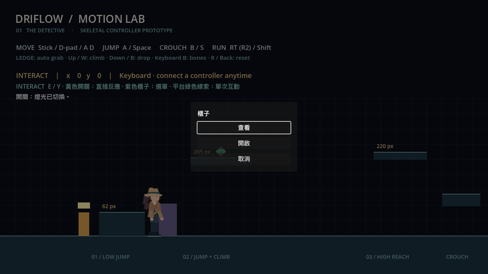

實際遊戲畫面：按動作鍵後開啟櫃子選單，玩家可查看、開啟或取消；背景仍維持原關卡。

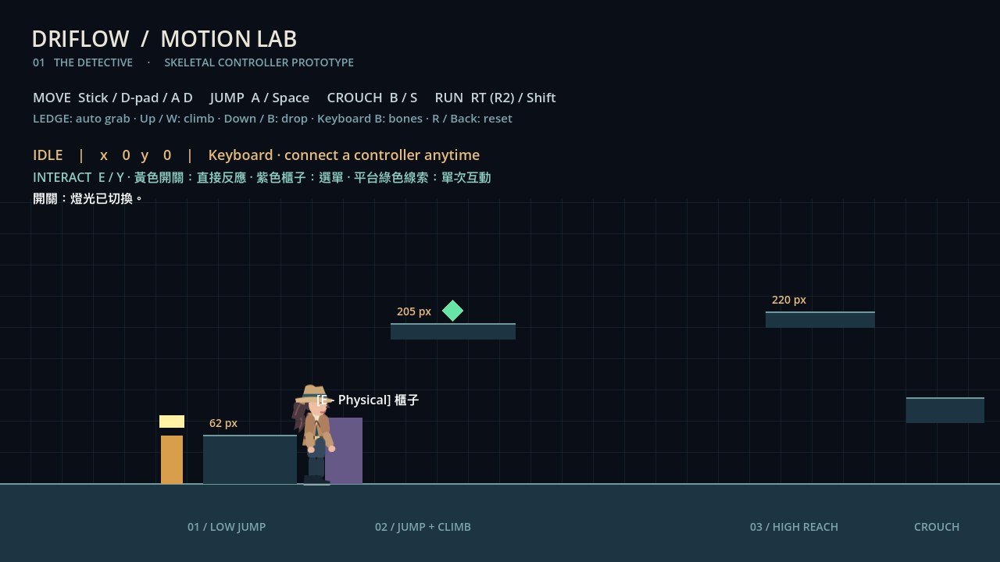

實際遊戲畫面：女偵探走近櫃子後，出現 E 動作提示；此時尚未執行櫃子反應。

在 Godot 開啟 `/Users/clydewang/GITHUB/godot-games/games/Driflow/project.godot`，按 **F5** 執行原有 Motion Lab。場景中已有三個可互動物件：

- 黃色開關（地面 x=220）：靠近後按 E／手把 Y 切換燈光。
- 紫色櫃子（地面 x=440）：靠近後按 E／Y 開啟選單；上下選擇，Enter／A 確認，Esc／B 取消，也可用滑鼠。
- 綠色線索（平台 x=580、y=415）：跳躍／攀爬到平台、站穩後可拿取一次。

角色移動與跳躍沿用原設定。選單開啟時鎖住玩家移動和跳躍，保留重力及碰撞；關閉後恢復。懸掛、攀爬、空中不接受互動。手把 A 同時對應跳躍與選單確認，控制器會隔離關閉當幀的輸入，避免確認選單時起跳。

另有 `res://scenes/interaction_demo.tscn` 可按 F6 執行獨立測試台，方向鍵移動藍色方塊，圓圈顯示各物件範圍。正式 Motion Lab 的物件預設不顯示除錯圓圈；選取組件時仍能在編輯器看到範圍。

## 把物件變成可互動

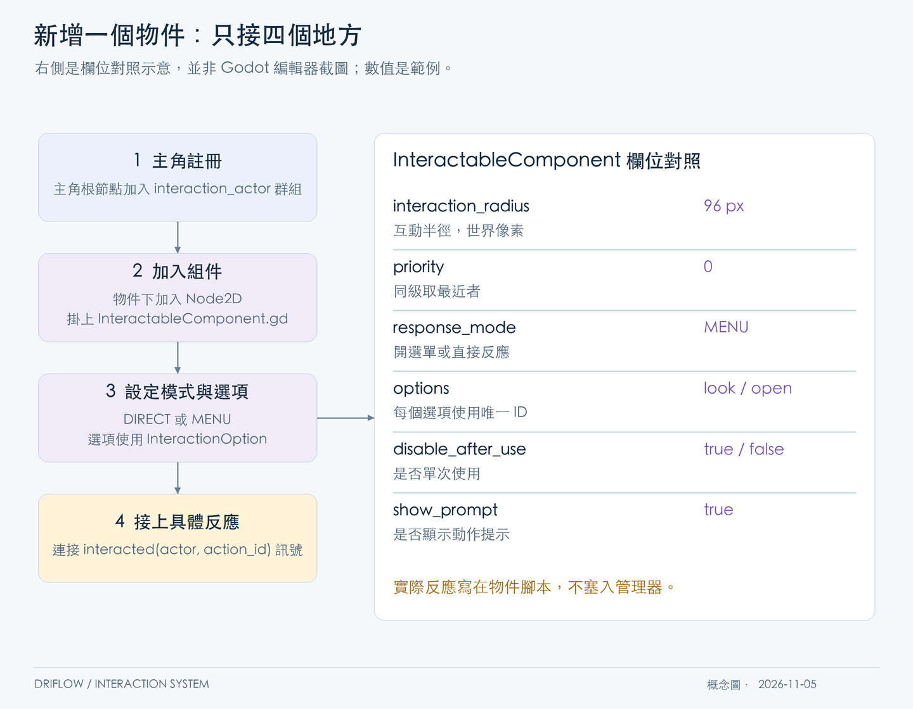

操作示意：主角群組 → 加入組件 → 設定模式與選項 → 連接反應。欄位面板是對照示意，不是編輯器截圖。

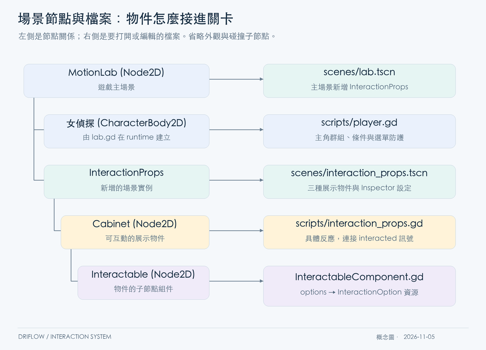

結構圖：場景節點與應編輯的檔案對照；角色由 lab.gd 在 runtime 建立，展示物件以場景實例加入。

1. 在主角根節點加入 `interaction_actor` 群組。既有 `scripts/player.gd` 已自動加入；換成其他控制器時，只需在編輯器加入此群組。每個啟用場景保留一個主角，其他 NPC 不加入此群組。
2. 在物件下面新增 Node2D，掛上 `scripts/interaction/InteractableComponent.gd`。組件的位置就是距離圓心，可以移到門把或人物腳邊；不需要 CollisionShape2D。
3. 在 Inspector 設定 `interaction_radius`（世界座標像素）、`display_name`、`response_mode`。
4. 連接組件的 `interacted(actor, action_id)` 訊號至物件或關卡腳本，執行動畫、開門、對話、道具取得或其他反應。

```text
Door (Node2D 或 StaticBody2D，負責外觀／碰撞／實際反應)
├── Sprite2D
├── CollisionShape2D（物理碰撞需要時才加）
└── Interactable (Node2D + InteractableComponent.gd)
```

直接反應範例：將 `response_mode` 設為 `DIRECT`，保持 `direct_action_id = interact`。

```gdscript
func _on_interacted(_actor: Node2D, _action_id: StringName) -> void:
    $AnimationPlayer.play("open")
```

選單範例：將 `response_mode` 設為 `MENU`，展開 `options` 陣列，新增 `InteractionOption` 資源。每個選項設定唯一的 `action_id`、顯示用的 `label` 和 `enabled`。空白、null 或禁用的選項不會顯示；沒有可用選項的物件不會成為互動目標。

```gdscript
func _on_interacted(_actor: Node2D, action_id: StringName) -> void:
    match action_id:
        &"look":
            show_description()
        &"open":
            open_door()
```

`disable_after_use` 用於一次性線索；停用不會自動刪除外觀或保存進度，請在訊號回呼中處理。重新載入場景會還原初始值，持久化應由既有存檔／旗標系統負責。

## 新增物件的完整操作：Crate 範例

這份教學示範在現有 Driflow 關卡加入一個可互動箱子。距離判定、提示、按鍵與選單由組件及全域管理器提供；具體反應由箱子自己的腳本決定。

### 1. 建立物件與外觀

在場景新增 `Node2D`，命名為 `Crate`。新增 `Sprite2D` 子節點並指定 Texture，再新增 `Node2D` 子節點，命名為 `Interactable`：

```text
Crate (Node2D，掛 crate.gd)
├── Sprite2D（指定物件圖片）
└── Interactable (Node2D，掛 InteractableComponent.gd)
```

若需要物理阻擋，可以用 StaticBody2D 與 CollisionShape2D 組成物件；互動距離本身不需要碰撞形狀。將新物件放在主角可以站穩靠近的位置。

### 2. 套用互動組件

在 FileSystem 找到 `res://scripts/interaction/InteractableComponent.gd`，拖到新增的 `Interactable` 子節點。物件原有腳本繼續掛在 `Crate` 上。

`Interactable` 的位置就是距離圓心，可移到箱子正面或門把附近。距離從主角根節點的腳底算到這個位置，單位為世界座標像素。

### 3. 設定 Inspector

| 欄位 | 本例設定 | 用途 |
| --- | --- | --- |
| display_name | 箱子 | 靠近時的物件名稱 |
| interaction_radius | 100 | 半徑 100 世界像素 |
| response_mode | DIRECT | 先測試直接反應 |
| direct_action_id | interact | 對應下方程式的動作 ID |
| enabled | true | 啟用互動 |
| show_prompt | true | 顯示 E／動作按鍵提示 |
| debug_draw_radius | true | 遊戲執行時顯示測試圓圈；完成測試後可關閉 |
| disable_after_use | false | 本例允許重複切換；一次性物件才改 true |

編輯器內會顯示範圍圓圈；執行中是否顯示，由 debug_draw_radius 決定。

### 4. 連接 interacted 訊號

先替 `Crate` 掛上自己的腳本（例如 `res://scripts/crate.gd`）。選取 `Interactable`，到右側 Signals／訊號面板，雙擊 `interacted`，連接到 `Crate`，建立 `_on_interactable_interacted` 回呼。

下列範例同時支援直接互動與選單動作。`Sprite2D` 節點名稱需與場景一致：

```gdscript
extends Node2D

var activated := false

func _on_interactable_interacted(
    _actor: Node2D, action_id: StringName
) -> void:
    match action_id:
        &"interact", &"use":
            activated = not activated
            $Sprite2D.modulate = (
                Color(1.0, 0.75, 0.3)
                if activated else Color.WHITE
            )
        &"look":
            print("這是一個可互動的箱子。")
```

按動作鍵時，箱子會在橘色與原白色調製值之間切換。正式物件可把這段反應換成開門、動畫、線索取得或劇情呼叫。

若不使用編輯器連線，也可以在 Crate 腳本的 `_ready()` 中用 `$Interactable.interacted.connect(_on_interactable_interacted)` 連接；選擇其中一種方式即可。

### 5. 執行直接互動測試

儲存場景與腳本，按 F5，讓主角站穩、走進半徑，按 E／手把 Y。箱子應變色；再按一次恢復。這一步確認距離、輸入、訊號與物件反應已接通。

### 6. 改成選單式互動

將 response_mode 改為 MENU。展開 options 陣列，加入兩個元素；每個元素建立一份 InteractionOption 資源，再填入：

| action_id | label | enabled |
| --- | --- | --- |
| look | 查看 | true |
| use | 使用 | true |

沿用上面的同一份 Crate 腳本：選「查看」會在 Godot Output 顯示文字；選「使用」會切換顏色。上下方向選擇、Enter／A 確認、Esc／B 取消，也可滑鼠操作。

每個 action_id 使用唯一且非空的值。選 MENU 卻沒有可用選項時，組件不會成為互動目標。

### 7. 保存成可重用物件

將 Crate 分支保存為獨立場景，例如 `res://scenes/props/crate.tscn`。之後可把這個場景拖進其他關卡，再調整各實例的位置與互動半徑。若不同實例需要不同反應，可使用各自的物件腳本或場景設定；若要分別修改共用的選項資源，先將該資源設為 Make Unique／唯一化。

### 新關卡與排查

同一個 Driflow 專案已有 InteractionManager Autoload，不需要每個場景再加一次。現有玩家控制器已註冊 interaction_actor 群組；全新關卡仍需建立玩家與控制初始化，單獨的空場景不會自動生成主角。

| 現象 | 先檢查 |
| --- | --- |
| 沒有提示 | 物件／組件是否可見且 enabled；主角是否在 interaction_actor 群組、站穩並可互動；圓心與半徑是否正確 |
| 走近時選到另一件物品 | 兩者的 priority 與距離；同級選最近者 |
| 提示正常但物件沒反應 | interacted 是否已連接；回呼名稱、節點路徑與 action_id 是否一致 |
| MENU 沒反應 | options 是否有 enabled 且 action_id 非空的 InteractionOption |
| 第一次後不再觸發 | disable_after_use 是否開啟 |
| 空中／抓邊／攀爬或起跳蓄力時不能用 | 目前玩家 can_interact() 的狀態限制；先站穩、結束該動作後再互動 |

欄位與四步接法的圖解見本文件「把物件變成可互動」章節。這些設定以目前程式為準，核心參考為 `scripts/interaction/InteractableComponent.gd`、`InteractionOption.gd` 與 `scripts/player.gd`。


## 全域規則與角色控制的接點

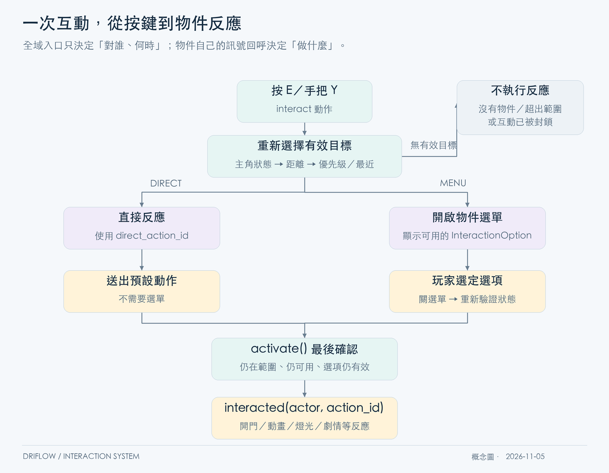

概念圖：按鍵 → 重新選擇有效目標 → 直接反應或選單 → 最後驗證 → 發送物件反應訊號。

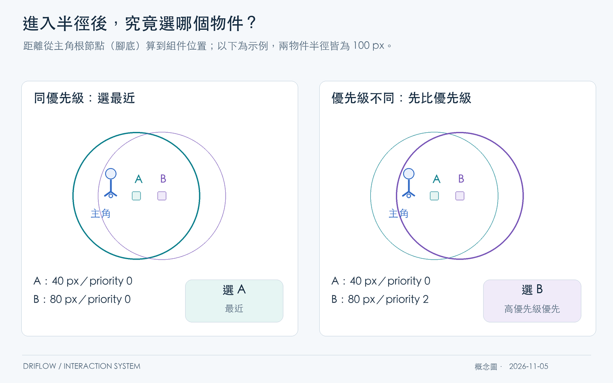

距離示意：兩個物件都在範圍內時，同級選最近；較高 priority 可以優先於較近物件。示例半徑均為 100 px。

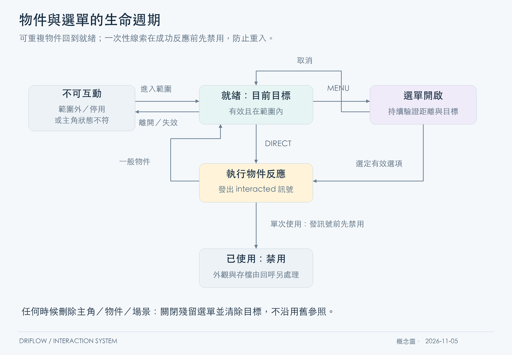

狀態圖：範圍外、就緒、選單、反應與一次性禁用。一次性物件在發出反應訊號前已先禁用。

`InteractionManager` 已登記為 Autoload。它集中處理 `interact` 動作、目標選擇與選單，物件不各自監聽按鍵。它使用 `_unhandled_input()`，讓一般 GUI 有機會先消耗輸入；這符合 [Godot 的輸入傳遞流程](https://docs.godotengine.org/en/4.6/tutorials/inputs/inputevent.html)。

- 同時在多個範圍內：`priority` 較高的先選中，同優先級取最近者，同距離保持群組遍歷順序。
- 按鍵與選單確認時都重新檢查距離、啟用狀態、可見性、主角與選項，避免沿用過期目標。
- 離開範圍、隱藏／停用／刪除物件、失去主角或 `blocked = true` 時關閉選單。
- 暫停 SceneTree 時停止互動。過場、對話、背包等狀態由呼叫端設定 `InteractionManager.blocked`；不自動猜測其他框架的狀態。
- 選單不暫停整棵 SceneTree。角色控制器可在 `InteractionManager.is_menu_open` 時停止讀取移動輸入，或監聽 `menu_state_changed`。示範場景已提供此接法。
- UI 可監聽 `target_changed(target)` 顯示自訂聚焦效果；目前內建簡單的按鍵提示，可用物件的 `show_prompt` 隱藏。
- 觸控按鈕可直接呼叫 `InteractionManager.try_interact()`，回傳是否成功處理。

Input Map 已有 `interact` 時完全沿用原設定；缺少時才於執行中建立 E／手把 Y。正式重新綁鍵請在 Project Settings → Input Map 建立 `interact`，並指定需要的按鍵。

角色可實作 `can_interact() -> bool` hook，加上自己的狀態條件；Driflow 已用它限制站穩且沒有懸掛／攀爬時互動。內建 ui_accept／ui_cancel／ui_up／ui_down 缺少手把映射時補上 A／B／方向鍵，保留原有鍵盤綁定。

目前距離是二維直線距離，不做穿牆遮擋、朝向或視線判斷；半徑不隨 Sprite 縮放改變。這讓設定單位固定。正式關卡若不允許隔牆互動，應另外加入視線條件。

## 檔案與修改位置

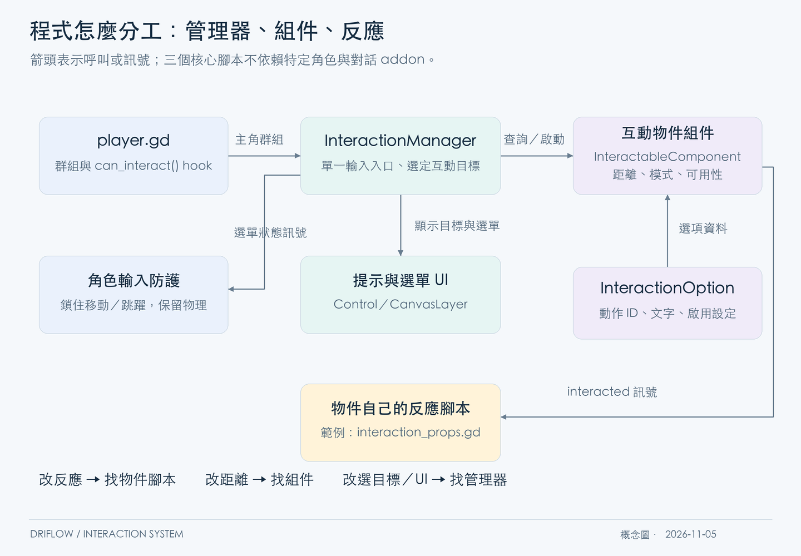

結構圖：管理器、主角、互動組件、選項資源與物件反應的責任邊界。訊號由組件發送，選項資源只提供資料。

| 檔案 | 責任／修改用途 |
| --- | --- |
| `scripts/interaction/InteractionManager.gd` | 目標選擇、全域封鎖、輸入、提示與選單 UI |
| `scripts/interaction/InteractableComponent.gd` | 每個物件的距離、可用條件、觸發模式與訊號 |
| `scripts/interaction/InteractionOption.gd` | 選單顯示文字、穩定 ID 與啟用設定 |
| `scenes/interaction_demo.tscn` | 可編輯的示範物件、半徑與選項資源 |
| `scripts/interaction_demo.gd` | 示範移動、燈光切換、選項反應與拿取線索 |
| `tests/interaction_smoke.gd` | 真實輸入分派、選單 GUI 與失效邊界回歸測試 |

## 驗證

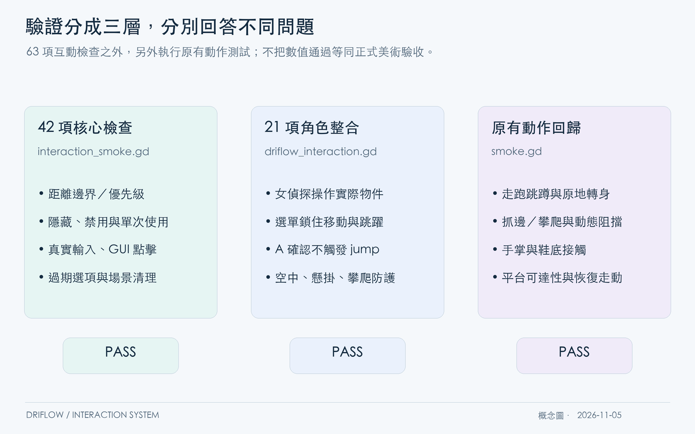

驗證範圍：42 項互動核心、21 項女偵探整合，以及另外執行的原動作回歸；不等同正式美術驗收。

從 monorepo 根目錄執行（將 `godot` 替換成你的 Godot 4.6 執行檔）：

```sh
godot --headless --path games/Driflow --editor --import --quit
godot --headless --path games/Driflow --script res://tests/interaction_smoke.gd
```

首次匯入用於建立 class_name 快取與素材。測試輸出應包含 `INTERACTION TESTS: PASS`，失敗則回傳非零 exit code。測試包含真實輸入分派與選單滑鼠事件，而不只呼叫組件方法。無頭視窗與專案邏輯解析度不同時，GUI 測試使用 `Viewport.push_input(event, true)` 送入本地座標，參考 [Godot Viewport 文件](https://docs.godotengine.org/en/4.6/classes/class_viewport.html#class-viewport-method-push-input)。

圖形模式可同時測試並擷取選單（不要加 `--headless`）：

```sh
godot --rendering-method gl_compatibility --path games/Driflow \
  --script res://tests/interaction_smoke.gd -- --capture=/tmp/interaction-menu.png
```

Driflow 另有實際角色整合與原有動作測試：

```sh
godot --headless --path games/Driflow --script res://tests/driflow_interaction.gd
godot --headless --path games/Driflow --script res://tests/smoke.gd
```

預期分別為 `DRIFLOW INTERACTION TESTS: PASS` 與 `MOTION TESTS: PASS`。整合測試覆蓋選單期間鎖住輸入、手把 A 不觸發跳躍、恢復移動、空中／懸掛／攀爬拒絕互動、平台單次線索，以及切場景清理。可將圖形擷取命令的測試腳本改成 `res://tests/driflow_interaction.gd`，輸出女偵探實際場景。

## 接入與維護範圍

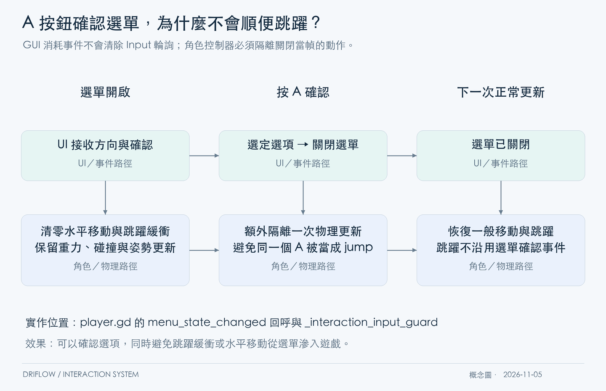

輸入時序：選單開啟、A 確認關閉、恢復操作三個階段；額外隔離一次物理輸入，避免確認同時觸發 jump。

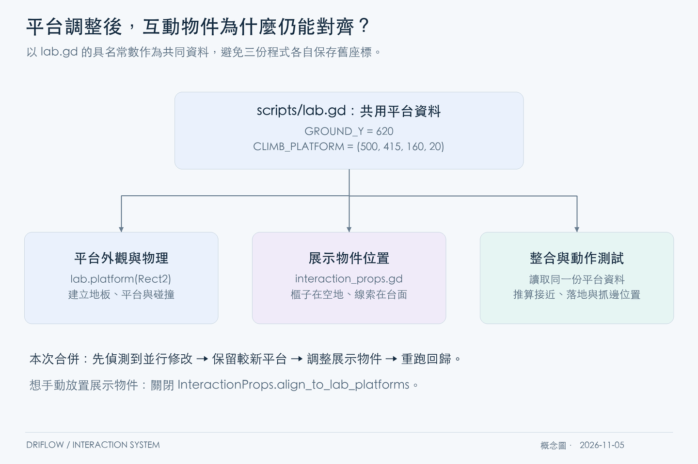

資料依賴圖：平台、展示物件與測試讀取同一份 lab.gd 平台常數；保留另一個對話更新的幾何配置。

- `project.godot`：新增 InteractionManager Autoload，原主場景、解析度與渲染方式維持原值。
- `scenes/lab.tscn`：新增 `InteractionProps` 實例，三個示範物件可在 `scenes/interaction_props.tscn` 編輯半徑、選項與外觀。
- `scripts/interaction_props.gd`：示範的燈光、櫃子與線索反應；正式內容請修改這裡或換成物件自己的腳本。
- `scripts/player.gd`：僅加入群組、互動狀態 hook、選單輸入鎖與關閉當幀防護；沒有重寫抓邊／攀爬函式。
- `scripts/rig.gd`、`scenes/rig.tscn`、平台配置與原動作測試維持原值。

兩個 Godot 專案各自保留互動核心，`res://` 不跨越專案根目錄；維護核心時需同步另一個專案的三個核心腳本。Driflow 沿用 `scripts/`、`scenes/` 佈局。

示範物件預設由 `scripts/interaction_props.gd` 讀取 `lab.gd` 的平台常數，讓櫃子留在兩平台之間、線索留在攀爬平台上。這些是展示物件的放置規則，不是互動核心的限制。若想在場景中手動移動展示物件，將 `InteractionProps` 的 `align_to_lab_platforms` 關閉；正式物件可直接使用組件自由放置。


## 本次開發紀錄

實作決策、程式結構、控制器整合、測試結果、併行修改處理與限制見 [開發日誌](devlogs/2026-11-05-interactions.md)。[Notion 閱讀版](https://app.notion.com/p/40fc42073e3381089418ff23b6833ac7) 已歸入 Game Lab；既有維護指南同步了互動摘要，repo 與技能檔仍為規則來源。


配圖來源、重新擷取與產圖方式見 [配圖維護說明](visuals/interaction/README.md)。概念圖不是編輯器截圖；範例距離與欄位值不代表每個展示物件的實際設定。
