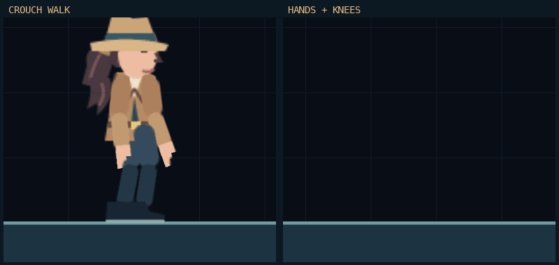
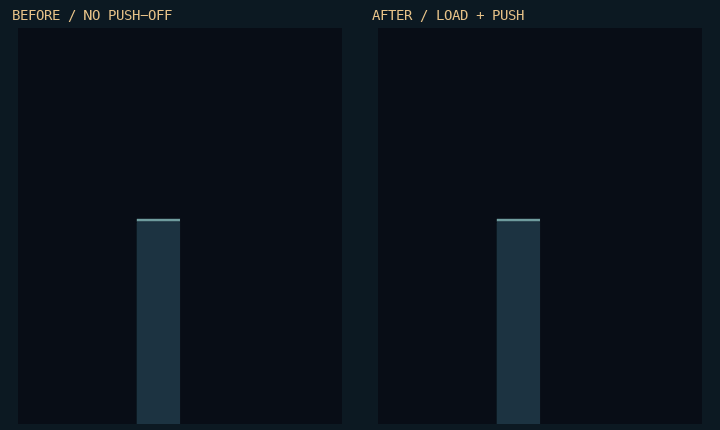
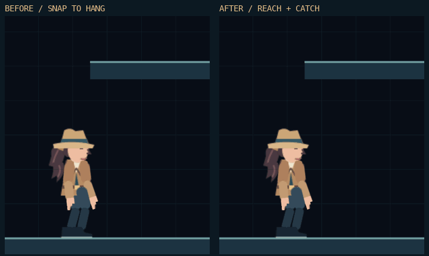
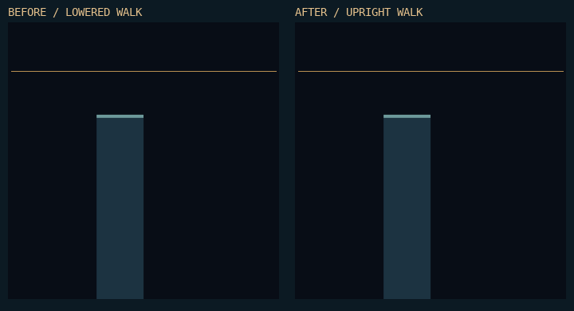

# Driflow｜蹲走、手膝爬行與跳躍維護指南

2026-11-05。Godot 4.6.2；現有 Motion Lab，GDScript 程序動畫。目標是可調整、可替換、可檢驗的流暢冒險動作。

## 操作與姿勢

| 動作 | 鍵盤 | 手把 | 速度／碰撞 |
| --- | --- | --- | --- |
| 站立走／跑 | A D／Shift | 左桿／RT | 220／380px/s；Capsule 高132、半徑13 |
| 蹲下／蹲走 | 按住 S／下＋方向 | 按住 B＋方向 | 85px/s；Rectangle 26×88 |
| 手膝爬行 | 按住 C＋方向 | 按住 LT＋方向 | 46px/s；Rectangle 132×64 |
| 起跳 | Space | A | 保留原有變高跳、空中控制與抓邊 |

放開低姿勢按鍵後，頭頂淨空足夠才站起；若只能蹲就維持蹲，連蹲也容不下則維持爬行。進入爬行前檢查完整寬度；碰撞擴張逐步預檢，避免穿牆或站穿天花板。爬行時需先起身再跳。既有 E／Y 互動、選單輸入防護、1.02s 攀爬保留。

右側蹲行通道為 94px 淨空，末端新增 68px 爬行區。平台座標集中在 lab.gd 的 CROUCH_CEILING／CRAWL_CEILING。

## 修改檔案與責任

```text
Driflow/
├── scripts/player.gd       low_pose、碰撞淨空、速度與狀態
├── scripts/controls.gd     crawl = C／LT；crouch = S／B
├── scripts/rig.gd          世界接觸點、IK、空中姿勢、掌面方向
├── scripts/lab.gd          94px 蹲行區／68px 爬行末端、操作提示
├── scenes/rig.tscn         22 Bone2D、Artwork 與接觸標記
├── art/forearm.svg         袖口／腕部，手掌已拆出
├── art/hand.svg            獨立掌面 12×6
├── tests/locomotion_smoke.gd
├── tests/locomotion_visual.gd
└── docs/
    ├── DEVELOPMENT.md     專案維護總入口
    ├── CLIMB_REFERENCE.md 攀爬、骨架與換圖契約
    ├── LOCOMOTION.md      本指南
    ├── devlogs/2026-11-05-locomotion.md
    └── visuals/locomotion/ 實際遊戲預覽
```

## 動作原理與調整順序

1. player.gd 的 low_pose 在 0（站）→1（蹲）→2（手膝）連續變化。posture_speed=4.0，crawl_transition_speed=2.8；前者一段約0.25s，後者一段約0.36s。動畫另有短暫姿勢追隨，不能把這些時間當作真人量測。
2. 身體先調骨盆與胸口。蹲姿目標 hip=(-8,-27)、胸口相對 hip=(23,-20)、胸口前傾0.78rad；手膝姿 hip=(-18,-27)、胸口=(38,-5)、前傾1.30rad。視線由 Neck／Head 補償。
3. 地面 ground_contact() 保留支撐期世界座標；擺動期短弧抬起，步態依實際位移推進，撞牆不會原地空走。起步與模式切換的接觸點由當前姿勢用0.12s 過渡；地面IK不再額外延遲關節角，以免腳底穿地。stand stride88–112、蹲56、爬行34px；調速度時一併重看步頻、可達距離與滑步。
4. 手膝爬行 phase：FrontPalm=0、BackPalm=0.5、FrontKnee=0.58、BackKnee=0.08，支撐比例0.76。對側手膝在接近時段前進，另側留在地面；不是腹部拖地，也不是抬膝的 bear crawl。
膝部下降前先折小腿並轉腳尖；折疊中依可替換靴子的四角預檢地面，必要時增加小腿折角。
5. 空中凍結地面 phase，捕捉起跳腿姿後在約0.16s 內過渡。垂直速度控制收腿到伸腿準備，水平輸入不再帶入 sin(phase) 的膝部擺動。落地再恢復地面接觸，骨盆短暫吸收衝擊。
6. 最後調肩、手與衣擺。蹲姿雙手放在身前，避免長手臂伸到地板下。掌面平放／放鬆由 point_hand() 控制；上下衣仍由 CoatJoin 連接。

碰撞收縮不快於上一幀可見帽頂；擴張必須通過空間查詢。fits_shape() 使用自身 collision_mask、排除自己並保留0.08px 地面查詢間隙。這是遊戲控制器的碰撞皮層，不是忽略實體天花板。

## 22 骨節與可替換附件

```text
Skeleton2D/Hip
├── BackThigh → BackShin
│                ├── KneeContact (Marker2D, 5,0)
│                └── BackBoot → SoleContact (0,13) / ToeContact (12,13) / HeelContact (-12,13)
├── Spine [Artwork: coat_lower.svg]
│   └── Torso [Artwork: coat_upper.svg; CoatJoin 0,26]
│       ├── BackShoulder → BackArm → BackForearm
│       │                              ├── WristContact (0,27); HandContact (相容標記)
│       │                              └── BackHand [Artwork: hand.svg; PalmContact (0,4)]
│       ├── Neck → Head → Hat / Ponytail → Tip
│       └── FrontShoulder → FrontArm → FrontForearm
│                                      ├── WristContact (0,27); HandContact (相容標記)
│                                      └── FrontHand [Artwork: hand.svg; PalmContact (0,4)]
└── FrontThigh → FrontShin
                  ├── KneeContact (5,0)
                  └── FrontBoot → SoleContact (0,13) / ToeContact (12,13) / HeelContact (-12,13)
```

每個畫面部件仍是 Sprite2D/Artwork，Texture 可直接替換 PNG／SVG；程式不會覆寫 Texture。Hand 骨節和 WristContact 位於 Forearm 下同一個腕部樞紐；Hand/PalmContact 定義掌面承重點。Forearm/HandContact 是相容查詢代理，執行時跟隨 PalmContact，接觸測試可保留原查詢路徑。要校準腕部請改 WristContact 與 Hand.position；要校準支撐點請改 PalmContact，不要編輯執行時會更新的代理位置。

手掌預設畫布12×6，Artwork 中心(1,1)，掌底與 PalmContact 均為 y=4；前臂14×27，Artwork (0,13.5)。換圖先調 Artwork，不更名骨節。改比例才改 Bone2D／rest，並重校 WristContact、PalmContact、KneeContact、SoleContact、碰撞與可達距離。爬行時大腿使用0.75–1.10的等比投影縮放；爬行退出及攀爬會復位，不改貼圖本身。

## 真人參考與改編邊界

- [MovNat：Beginner’s Guide to Efficient Crawling](https://movnat.com/intro-to-crawling/) 的 Knee-Hand Crawling 段：閱讀右手與左膝前進的對側模式、穩定軀幹與支撐轉移。
- [MovNat 真人 Knee Hand Crawl 示範](https://www.youtube.com/watch?v=PIn1J5TCq4Q)：已確認原作者影片入口，未逐格擷取或量測。保留供後續對照，未聲稱動捕還原。
- [Nationwide Children’s：How to Squat Safely](https://www.nationwidechildrens.org/family-resources-education/700childrens/2019/07/how-to-squat-safely)：閱讀腳跟接觸、髖部後移及軀幹控制的文字分解，作為遊戲姿勢原則。

本版是依角色比例重新設計的側視動畫，沒有把真人影片下載成素材；數值不是生物力學量測。滯空曲線是製作設計，不宣稱出自上述爬行／蹲姿來源。

## 驗證與畫面

```sh
/Applications/Godot.app/Contents/MacOS/Godot --headless --log-file /tmp/driflow-locomotion.log --path /Users/clydewang/GITHUB/godot-games/games/Driflow --script res://tests/locomotion_smoke.gd
/Applications/Godot.app/Contents/MacOS/Godot --log-file /tmp/driflow-locomotion-visual.log --path /Users/clydewang/GITHUB/godot-games/games/Driflow --fixed-fps 60 --script res://tests/locomotion_visual.gd -- /tmp/driflow-locomotion-frames
```

另跑 smoke.gd、driflow_interaction.gd、interaction_smoke.gd、climb_visual.gd；涵蓋既有攀爬、真正由地面起跳抓邊、動態障礙和選單關閉防誤跳。新測試涵蓋漸變姿勢、蹲走支撐腳防滑、左右爬行掌心／膝部、低頂保持、LT 軸輸入、空中步態隔離與落地。

圖形擷取含走、跑、蹲下、蹲走、左右爬行、垂直跳與跑跳。每張恰推進1/60s；timing.json 可核對。GIF 從60Hz 重取樣50fps，20ms／格；半速與四分之一速度以40ms／80ms延長。看正常速度的銜接，再看慢速的接觸與跳位，不以測試 PASS 代替主觀品質判斷。

## 技術棧與復用

Skill：repo godot_expert → self_improving_agent；Notion 閱讀版由 notion-knowledge-capture 維護。工具：Godot 4.6.2 CLI／圖形 renderer、GDScript、CharacterBody2D、Bone2D、Marker2D、Sprite2D、SVG、Git／SHA256；Python Pillow 只組合擷取 PNG，Notion MCP 保存文字與預覽。runtime 無新增外部依賴。

復用：開專案並匯入素材 → 讀 DEVELOPMENT.md → 修改 player／rig 分工內的參數 → 校準關節與可換圖部件 → 全部功能回歸 → 固定步長擷取 → 正常與慢速檢視 → 同步 README、指南、日誌和 Notion。仍受剛性圖塊與單一側面視角限制，沒有蒙皮、mocap 或物理肌肉模擬。


Notion 閱讀版：[基本動作與附件指南](https://app.notion.com/p/40fc42073e33815099c4d3a01ad72962)／[本輪開發日誌與動作預覽](https://app.notion.com/p/40fc42073e33810a8f8ce8e19c2243a8)。


## 後續修正：手肘方向與腕掌分離

使用者指出上一版手關節反折；檢查確認手臂共用了腿部 IK 分支，而手掌被固定世界朝向，導致手肘抬到頭前、手腕反折。solve_limb() 新增 bend_sign，腿 +1、手臂 -1；放鬆手指沿前臂，point_hand() 的相對腕角限制為本原型設計值±1.65rad，非人體量測標準。

手腕IK與掌面承重點分開。爬行由掌心世界錨點反推高4px的腕部目標；攀爬 solve_arm_contact() 同時調整可行腕角與掌心偏移，保留固定接觸。拉起時胸口略提高、稍留在邊緣外，避免腕部落進兩節骨長差造成的不可達區。前後肩在爬行時保留側向層次，避免隨胸口旋轉變成上下堆疊。

新增檢查：左右蹲走／爬行手肘方向、放鬆腕角、承重腕角、攀爬腕角及 HandContact 與實際 PalmContact 的一致性。最終動作檢查1659項通過，既有攀爬與互動回歸通過。數值之外另檢視放大前後對照及慢速連續幀。

```sh
/Applications/Godot.app/Contents/MacOS/Godot --path /Users/clydewang/GITHUB/godot-games/games/Driflow --fixed-fps 60 --disable-render-loop --disable-vsync --audio-driver Dummy --accessibility disabled --script res://tests/arm_visual.gd --log-file /tmp/driflow-arm-visual.log -- /tmp/driflow-arm-frames
```

擷取每次物理步長1/60s、每3步存一張20fps畫面；明確呼叫 RenderingServer.force_draw(false,1.0/60) 後讀回，不等待原生視窗的顯示交換。正常GIF每格50ms，四分之一速200ms；這與前面的50fps舊擷取不同，不能混用格距。




## 起跳發力修訂：快速下沉、蹬腿與離地

2026-11-05 同日後續。使用者指出上一版像直接飄起；原本接收到跳躍後就施加向上速度，沒有站地蓄力／腿部伸展的視覺過程。

player.gd 新增 jump_pending、jump_elapsed、jump_anticipation=0.06s、moving_jump_anticipation=0.03s。60Hz下原地約4步（67ms）、移動約2步（33ms）後離地；已蹲姿用原地時長直接伸腿，不再壓低一次。JUMP_LOAD／JUMP_PUSH為顯示狀態，主碰撞根節點在蓄力時維持地面，縮小身體只影響骨盆與軀幹視覺。蓄力中的距離互動暫不啟動。

rig.gd 的 begin_takeoff() 記錄當前骨盆、胸口、手臂、衣擺與腳尖世界座標；apply_takeoff_pose() 先下沉（原地9px／移動5px），再伸髖伸膝。腳跟以約0.17rad微抬，腳尖為固定支點；移動跳只固定承重腳，另一腳保留步態。低姿起跳直接伸腿。離地前完成最後推蹬姿勢，空中再由這個姿勢收腿，減少仍縮著腿就向上平移的感覺。

### 可替換腳部附件

每側 Boot 新增 ToeContact（Marker2D，預設12,13）；SoleContact仍為(0,13)。沒有增加Bone2D，仍22節；靴子的Artwork仍可直接換PNG／SVG。換鞋後先校準SoleContact與ToeContact到實際鞋底／前腳掌，再調肢體長度及碰撞；動畫讀取標記，不覆寫Texture。

```text
Hip/FrontThigh/FrontShin/FrontBoot
├── Artwork          可替換靴子圖
├── SoleContact      (0,13)，平常站走的鞋底
└── ToeContact       (12,13)，推蹬的前腳掌
Hip/BackThigh/BackShin/BackBoot
└── 同樣三個子節點
```

### 輸入與測試

短按在蓄力時放開仍產生小跳；落地跳躍緩衝會完成一次蓄力再離地。土狼跳不虛構地面蓄力，直接起跳。重置、選單輸入鎖或新增頭頂障礙會清除待起跳意圖；已爬行仍須先起身。移動跳保留水平速度。

新增 tests/jump_smoke.gd 的45項檢查：固定地面與腳尖、鞋圖四角淨空、膝蓋先彎再伸、短按小跳、蹲姿不二次下沉、左右跑跳、土狼、落地緩衝、新增阻擋與重置取消。原有MOTION、基本動作1659項、Driflow互動21項、通用互動42項均通過，包含兩座高台實際跳抓攀上。舊的中立跳4幀等待改為6幀以涵蓋蓄力；新增測試逐步驗證實際離地在3–5步內。滯空連續性仍用原角度門檻，在離地0.12s後取樣；快速地面伸腿由新測試獨立驗證。

```sh
/Applications/Godot.app/Contents/MacOS/Godot --headless --fixed-fps 60 --quit-after 5000 --path /Users/clydewang/GITHUB/godot-games/games/Driflow --script res://tests/jump_smoke.gd --log-file /tmp/driflow-jump-test.log
/Applications/Godot.app/Contents/MacOS/Godot --path /Users/clydewang/GITHUB/godot-games/games/Driflow --fixed-fps 60 --disable-render-loop --disable-vsync --audio-driver Dummy --accessibility disabled --script res://tests/jump_visual.gd --log-file /tmp/driflow-jump-visual.log -- /tmp/driflow-jump-frames
```

jump_visual.gd 以60Hz逐步擷取原地跳、短跳、左右跑跳與蹲姿起跳，另存timing.json；明確離屏繪製避免原生視窗等待。前後對照GIF由60Hz重取樣50fps，正常20ms／格、四分之一速80ms。這與arm_visual.gd的20fps輸出不同，不要混用格距。

技術棧：Godot4.6.2、GDScript、CharacterBody2D／Bone2D／Marker2D／Sprite2D、原生SVG；Godot CLI測試及renderer、Pillow組比較圖與GIF、Notion MCP同步日誌。Skill沿用godot_expert、self_improving_agent、notion-knowledge-capture。復用：調短蓄力時長與骨盆曲線 → 校準腳尖接點 → 驗證輸入邊界與高台可達 → 正常／慢速前後比對 → 更新文件。沒有commit／push。




起跳擷取僅保留地板及邊界，以免左右跑跳撞到原關卡天花板或自動抓邊；正式Motion Lab未移除平台。安裝版擷取中，原地／左右跑跳／蹲姿跳的腳底峰值約y=523.4，落地y≈620；短按小跳峰值約y=592，所有動作均完成落地。精確數值以timing.json為準。


## 伸手與扣邊修訂：接觸前抬臂、接觸後承重

2026-11-05 同日後續。使用者指出舉手攀附仍不細膩；原本try_grab_ledge成功後直接切成animate_ledge(0)，缺少接觸前抬手，以及接觸後的肩膀／骨盆緩衝。

### 流程與修改入口

```text
player.gd 物理更新
├── find_ledge_candidate()   共用平台側面／頂面碰撞幾何
├── update_reach()           預測可達邊緣，驅動接觸前抬臂
├── try_grab_ledge()         真正抓取前再查頂面高度與碰撞安全
│   └── rig.begin_catch()   先記錄世界姿勢，再固定物理根節點
└── update_ledge()
    ├── HANG：catch_elapsed < catch_duration → animate_catch()
    ├── HANG：承重完成 → 穩定懸掛；處理climb_requested
    └── CLIMB：原1.02s攀爬與完整碰撞路徑

rig.gd
├── begin_reach() / animate_reach()  肩前弧線、兩手延遲、視線
├── begin_catch() / animate_catch()  世界姿勢銜接、掌心固定與承重
├── solve_arm_contact()             腕部可行角度與掌心目標
└── finish_ledge_pose()             懸掛／攀爬共用馬尾次要運動
```

- 預測：前方reach_distance=64px、垂直偵測窗口190px；以當前垂直速度／剩餘跳高過濾不可達目標。這是預測窗口，不是把手臂變長。
- 抬臂：前手0–0.14s，後手0.025–0.18s。手腕沿肩前弧線移動，避開IK通過肩部的奇點；先抬肩／屈肘，再向上展臂，頸／頭略向邊緣看。後手保留小幅接近偏移，扣邊才合攏。
- 實際抓取：頂面相對腳底高度必須<=grab_height=130px，再執行原有clear_at與test_move。不能把側面掃描高度直接當頂面可達高度，否則會在手未碰到時吸附。
- 扣邊：前手約0.035s、後手0.025–0.07s完成最後接近與轉掌；之後掌心固定在世界邊緣。catch_duration=0.16s內，骨盆小幅承重下沉、肩胸緩衝、腿跟隨，保留接近慣性並逐步消散。
- catch仍屬ledge_mode="HANG"，物理根節點固定且碰撞持續啟用；骨架從接觸前的世界姿勢過渡。承重完成後才開始原本CLIMB；攀爬1.02s不包含前面的catch時間。

### 指令與邊界

接觸當幀已按住Up／W，或catch期間按下攀爬，會記住climb_requested，承重完成後接續。start_climb()現在只有HANG時接受要求；返回true可能表示已排入佇列，應檢查ledge_mode確認是否已進入CLIMB，不能只看返回值宣稱攀爬完成。真正開始前仍要通過目標空間與路徑預檢。

放手／重置會清除待攀爬意圖。目標消失或不可達時撤回伸手，短跳不會對無法碰到的高台揮手；drop期間與冷卻期不重抓。互動仍只在允許的地面狀態啟動。互動測試依catch_duration等待承重，再驗證實際CLIMB與完成。

### 骨架與替換

沿用既有22節的Shoulder／Arm／Forearm／Hand、頸與胸腰控制；Artwork Texture與WristContact／PalmContact／SoleContact／ToeContact不改。這輪增加的是動作路徑、時間、姿勢快照與承重交接，沒有逐指抓握動畫；手指仍隨手掌分件。若後續拆手指，需保留每件Artwork及相應接點，再補接觸與鏡像回歸。

### 驗證與重製

新增tests/reach_smoke.gd：560檢查通過，涵蓋兩個平台高度×兩朝向實際地面跳抓、多幀抬手連續性、肘／腕角、掌心承重固定、衣服接縫、提早輸入交接、非HANG拒絕攀爬、放手取消、目標消失和不可達短跳。既有MOTION、起跳45檢查、基本動作1659檢查、Driflow互動21檢查、通用互動42檢查通過。

```sh
/Applications/Godot.app/Contents/MacOS/Godot --headless --fixed-fps 60 --quit-after 5000 --path /Users/clydewang/GITHUB/godot-games/games/Driflow --script res://tests/reach_smoke.gd --log-file /tmp/driflow-reach-test.log
/Applications/Godot.app/Contents/MacOS/Godot --path /Users/clydewang/GITHUB/godot-games/games/Driflow --fixed-fps 60 --disable-render-loop --disable-vsync --audio-driver Dummy --accessibility disabled --script res://tests/reach_visual.gd --log-file /tmp/driflow-reach-visual.log -- /tmp/driflow-reach-frames
```

reach_visual.gd從地面錄製兩高度×兩朝向，另有提早按攀爬、承重後接續爬上的chain；沒有從空中傳送到HANG充當舉手驗證。60Hz逐步明確離屏繪製，timing.json保存模式、伸手／承重時間、骨盆與掌心座標。GIF從60Hz重取樣50fps，正常20ms／格、四分之一速80ms。

自審涵蓋接觸前後世界座標、只在真正可達時抓取、相容HandContact代理、左右IK方向、catch後姿勢與原攀爬首幀銜接、指令佇列取消及互動狀態。其他遊戲與原有素材替換能力保留；未commit／push。

技術棧：Godot4.6.2 GDScript／CharacterBody2D、PhysicsRayQuery、Bone2D／Marker2D／Sprite2D、雙節IK、CLI測試與renderer、Pillow組PNG／GIF、Notion MCP日誌。Skill：godot_expert、self_improving_agent、notion-knowledge-capture。復用：調預測與可達限制 → 肩前抬臂路徑 → 世界姿勢快照 → 分時掌心固定與承重 → 指令交接 → 兩高度兩朝向及取消回歸 → 正常／慢速對照 → 同步文件。





## 步行身高修訂：承重腿伸直與腳底滾動

2026-11-05 同日後續。使用者指出走路像半蹲，停下後高很多；不是錯覺。原本移動時骨盆固定從-60壓至-53（跑步-49），正常走路也一直保持較大的膝部彎曲。舊版固定相機實拍可見身高：站立平均約130.69、走路約124.50，相差約6.2px。

### 目前做法與修改入口

rig.gd不再用「只要移動就固定壓低」：步行骨盆在-56到-60之間週期移重，承重腿經過身體下方時伸直；跑步使用接地、壓縮、推蹬與小幅騰空的獨立高度曲線。站立仍約-60，沒有拉長腿或縮放正常步行骨骼。物理移動速度仍walk220／run380px/s。

- 完整步態週期距離：走88、跑112px；蹲走56、手膝爬行34沿用。縮短過大的支撐跨度，使腿能在較直立的身高保持接觸。
- 支撐比例：走0.58、跑0.42，低姿勢逐步混合到0.72。跑步有短暫雙腳擺動區間，不沿用走路固定壓低姿勢。
- ground_foot_pose()：腳跟落地 → 鞋底承重 → 前腳掌推進，擺動期平順轉向下一次腳跟接觸。solve_ground_foot()反推腳踝並解算雙節IK；舊normal_legs()已被這個主流程取代。
- 骨盆目標同時受承重腿實際可達距離限制，避免抬高身體後腳掌離地或靠拉長骨骼補償。穩定步態直接使用連續週期曲線，避免額外平滑造成相位落後；啟步／停止仍平順過渡。
- ground_contact()建立新支撐錨點時扣除已越過接觸時刻的stride*t，避免每次落腳多伸出一個物理步長。另記錄stance旗標，走跑切換時不把上一幀懸空的擺動點當成地面支撐。

### 新增腳跟接點與換圖

```text
每側Thigh/Shin/Boot（22骨節總數不變）
├── Artwork       可獨立替換鞋圖
├── SoleContact   (0,13)：平放鞋底
├── ToeContact    (12,13)：前腳掌推蹬
└── HeelContact   (-12,13)：腳跟落地
```

新增的是兩個Marker2D，不是延長或新增腿骨。換靴子PNG／SVG時，校準三個標記到鞋底／前腳掌／腳跟；程式讀接點與實際骨節長度，不覆寫Texture。正常走／跑的大腿scale保持Vector2.ONE；蹲走、手膝爬行、起跳與攀爬功能回歸通過。

### 驗證與前後對照

新增walk_height_smoke.gd共1230檢查通過：左右走跑的站走身高差、承重膝伸展、原骨長、接點固定、完整靴子淨空、骨盆高度連續、停止恢復與走跑切換不在空中落腳。另通過MOTION、起跳45、伸手扣邊560、基本動作1659、Driflow互動21及通用互動42檢查。

固定垂直相機的實拍，新版正常走路平均可見身高約129.47，與同一段站立約130.69相差1.2px；高低週期約127.48–131.47。頭頂與骨盆只是量測此角色的製作指標，不是人體標準。獨立左右測試的承重接點誤差<0.011px，鞋圖矩形底部穿入量<0.38px（貼圖邊緣的次像素範圍）；停止後骨盆平順回到站姿。

```sh
/Applications/Godot.app/Contents/MacOS/Godot --headless --fixed-fps 60 --quit-after 5000 --path /Users/clydewang/GITHUB/godot-games/games/Driflow --script res://tests/walk_height_smoke.gd --log-file /tmp/driflow-walk-height-test.log
/Applications/Godot.app/Contents/MacOS/Godot --path /Users/clydewang/GITHUB/godot-games/games/Driflow --fixed-fps 60 --disable-render-loop --disable-vsync --audio-driver Dummy --accessibility disabled --script res://tests/walk_height_visual.gd --log-file /tmp/driflow-walk-height-visual.log -- /tmp/driflow-walk-height-frames
```

walk_height_visual含站→左右走跑→停與蹲走對照；相機垂直座標固定，不能用跟隨頭部的鏡頭判斷身高。擷取僅移除測試場景的障礙，正式Lab平台不變。60Hz PNG與timing.json，GIF重取樣50fps：正常20ms／格，四分之一速80ms；金色橫線是初始站姿帽頂參考。

自審涵蓋移動／低姿勢分支、步態相位越界、走跑切換、腳跟／腳尖世界座標與鞋圖淨空；角色比例、換圖能力和其他遊戲保留，沒有commit／push。技術棧：Godot4.6.2 GDScript／Bone2D／Marker2D／Sprite2D、雙節IK、CLI與renderer、Pillow、Notion MCP；Skill：godot_expert、self_improving_agent、notion-knowledge-capture。復用：量測站走高度 → 協同調步幅／支撐比例／骨盆曲線 → 校準三個鞋底接點 → 支撐可達界限與切換回歸 → 固定相機正常／慢速比較 → 同步文件與日誌。





## 人體附件前後順序修訂（2026-11-05）

已將20個Artwork設為明確的相對Z：遠臂0、遠腿1、馬尾2、近腿3、衣身4、頭5、帽6、近臂7。22骨節與獨立換圖能力保留，轉向鏡像不交換遠近；衣襬蓋住腿根。修改Inspector位置、完整層表、結構與像素回歸方式見[人體附件繪圖順序](RENDER_ORDER.md)。本次54項圖形遮擋測試與既有動作／互動回歸通過。
