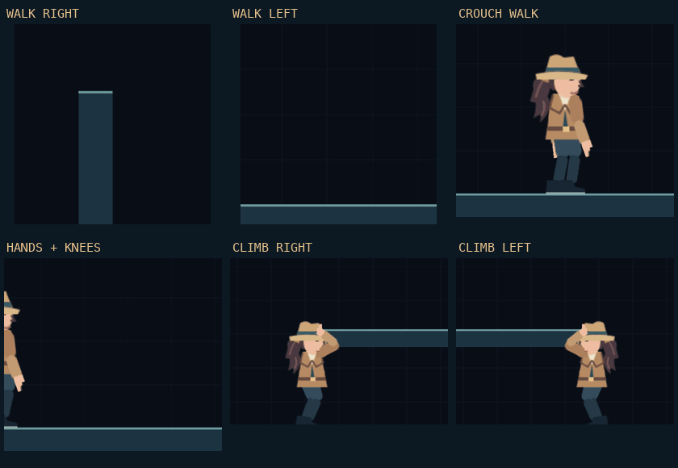
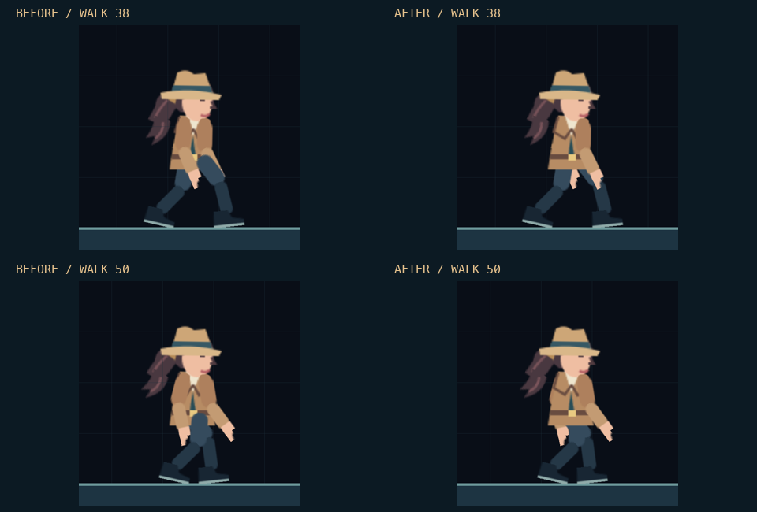

# 人體附件繪圖順序

2026-11-05 修訂。骨架父子關係負責帶動關節；繪圖前後由每個 Sprite2D／Artwork 的 `z_index` 決定，不依賴節點在樹裡的先後。

| 從後到前 | Artwork 所屬部位 | 相對 Z |
| --- | --- | --- |
| 1 | BackShoulder／BackArm／BackForearm／BackHand | 0 |
| 2 | BackThigh／BackShin／BackBoot | 1 |
| 3 | Ponytail／Tip | 2 |
| 4 | FrontThigh／FrontShin／FrontBoot | 3 |
| 5 | Spine 下衣襬、Torso 上衣 | 4 |
| 6 | Head | 5 |
| 7 | Hat | 6 |
| 8 | FrontShoulder／FrontArm／FrontForearm／FrontHand | 7 |

遠側手腳在衣身後；近側手臂在衣身前。近側腿在遠側腿前，但腿根仍在衣襬後。Back／Front表示遠近側，不是畫面左／右，也不是角色解剖學左／右；轉向採整體鏡像，不能因 `facing` 改變便交換Z。這是目前側視剪影的固定層次；若以後做正背面轉身，需另做側別交接，不能只靠此表表示3D繞轉。

## 怎麼修改與替換

1. 開啟 `scenes/rig.tscn`，在骨節下選 `Artwork`。Inspector → Ordering → Z Index 設表中值；Z As Relative保持啟用。
2. 換造型只替換 Artwork 的 Texture（PNG／SVG），再校準位置／縮放；不用搬動骨節，也不用修改 `scripts/rig.gd`。本輪沒有新增runtime依賴或動畫狀態。
3. 各 Bone2D 與中間容器的Z維持0。原本Ponytail骨節的-1已移除，避免和附件Z疊加。需要新增袖口、手指等分件時，在相應骨節下新增 Artwork，繼承該側部位的層次並保持可換Texture。
4. 改整個角色相對場景的前後，調 DetectiveRig 根節點Z；內部層次會整體位移。預設角色附件占根Z+0至+7，場景前景若要蓋住全身應使用更高的有效Z或獨立CanvasLayer。不要用內部手臂Z修正場景前景。
5. 改比例時另依 LOCOMOTION 的腕／掌／膝／鞋底接點契約校準；Z只控制遮擋，不會修復IK、接觸點或碰撞。

```text
scenes/rig.tscn                  22 Bone2D：運動學；20 Artwork：Texture + 相對Z
scripts/rig.gd                  姿勢、IK與鏡像；不覆寫Texture或Z
 tests/render_order_smoke.gd     用真實場景附件渲染重疊像素，檢查前後
 docs/RENDER_ORDER.md            本規格與修改入口
 docs/devlogs/2026-11-05-locomotion.md  當日修訂、驗證、預覽
 docs/visuals/locomotion/layer-*  實際renderer擷取與前後對照
```

## 驗證與重製

新增圖形測試 `tests/render_order_smoke.gd`：54項PASS，包括22骨節、20獨立Texture槽、8層實際像素遮擋×左右鏡像×根Z=0／20。測試在暫時實例中將附件換為單色圖、重疊在同一點，逐層隱藏檢查實際讀回顏色；不只檢查Z數字。viewport初始化並等待physics_frame後才force_draw讀回，避免未初始化的空白畫面。

```sh
/Applications/Godot.app/Contents/MacOS/Godot --path /Users/clydewang/GITHUB/godot-games/games/Driflow --fixed-fps 60 --disable-render-loop --disable-vsync --audio-driver Dummy --accessibility disabled --script res://tests/render_order_smoke.gd --log-file /tmp/driflow-render-order.log
```

原有MOTION、walk_height_smoke1230、jump_smoke45、reach_smoke560、locomotion_smoke1659、Driflow互動21與通用互動42項均PASS。圖形擷取使用既有arm_visual、walk_height_visual、reach_visual、jump_visual，依序運行單一renderer；放大檢視站走跑、蹲走、左右手膝爬行、跳躍、左右伸手／攀上。arm輸出20fps；本輪六面板GIF為50ms／格正常速度、200ms／格四分之一速，其他60Hz擷取依時間重取樣；較短片段在末幀停留。





技術棧與依賴：Godot4.6.2／GDScript、Skeleton2D／Bone2D／Sprite2D、原生SVG、CLI Compatibility renderer、Python Pillow（僅組擷取圖）、Notion MCP。Skill：`.agents/skills/godot_expert/SKILL.md` → `.agents/skills/self_improving_agent/SKILL.md`；Notion閱讀鏡像用notion-knowledge-capture。復用：開場景 → 校準Artwork層表 → 保持骨節Z中立及Texture槽 → 實際像素測試 → 左右動作放大檢視 → 同步文件與日誌。自審確認骨架路徑、rest、Texture、接觸Marker、動畫與互動邏輯不變。
