# 2026-11-05｜Driflow 距離式全域物件互動開發日誌

記錄日期：2026-11-05（Asia/Taipei）。記錄時間：2026-11-05T17:40:07+08:00。專案：godot-games / games/Driflow。環境：macOS、Godot 4.6.2。

## 成果與適用範圍

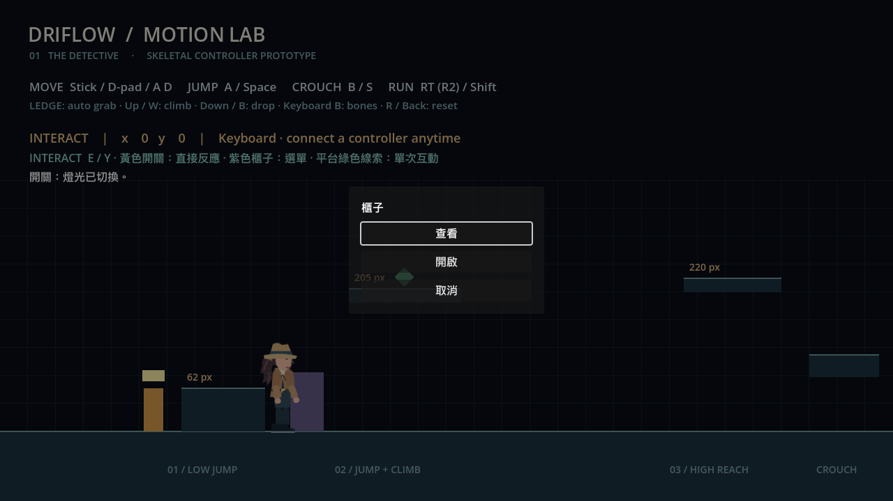

實際遊戲畫面：按動作鍵後開啟櫃子選單，玩家可查看、開啟或取消；背景仍維持原關卡。

為現有女偵探 Motion Lab 加入「走近物件 → 按動作鍵 → 直接反應或開選單」的全域機制。每個物件可在 Inspector 調整距離、優先級、選項與單次使用設定；實際反應透過訊號連接，不寫入玩家控制器或互動管理器。

本次正式安裝位置為 `/Users/clydewang/GITHUB/godot-games/games/Driflow`。`2d-avg` 的對應版本保留在本對話工作樹 `/Users/clydewang/.codex/worktrees/3037/godot-games/games/2d-avg`；沒有將舊 worktree 的 2d-avg 檔案覆蓋到主 checkout 的較新探索版本。

這是功能原型：互動流程與控制整合已驗證，沒有宣稱正式美術、劇情內容、視線遮擋或存檔整合已完成。

## 需求與設計決策

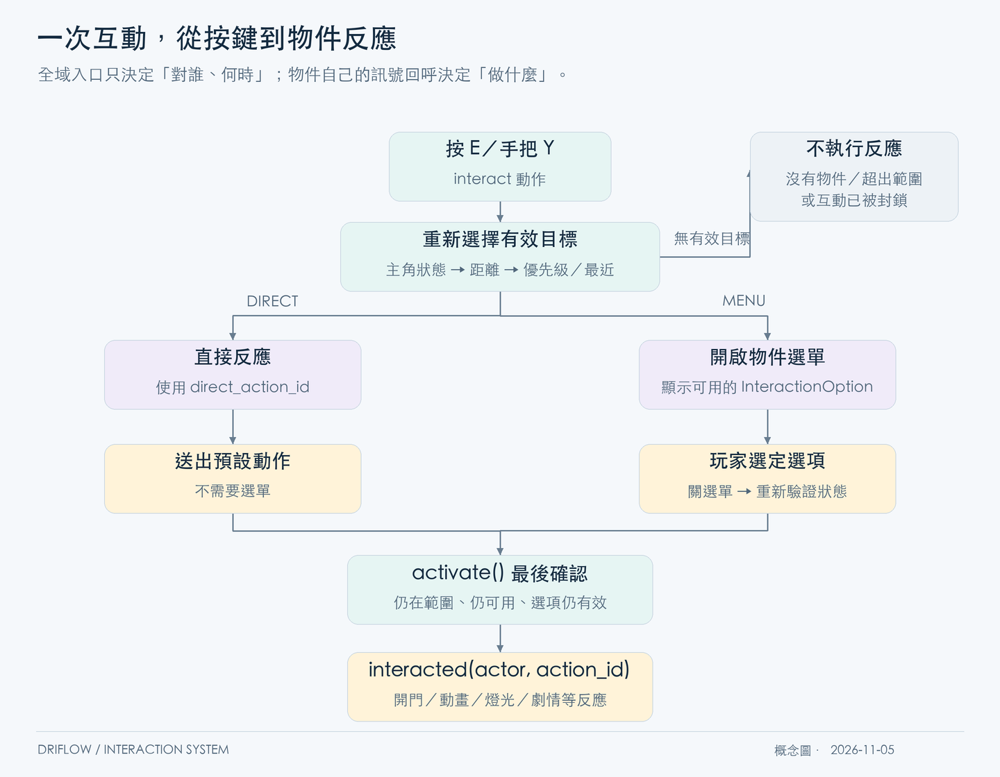

概念圖：按鍵 → 重新選擇有效目標 → 直接反應或選單 → 最後驗證 → 發送物件反應訊號。

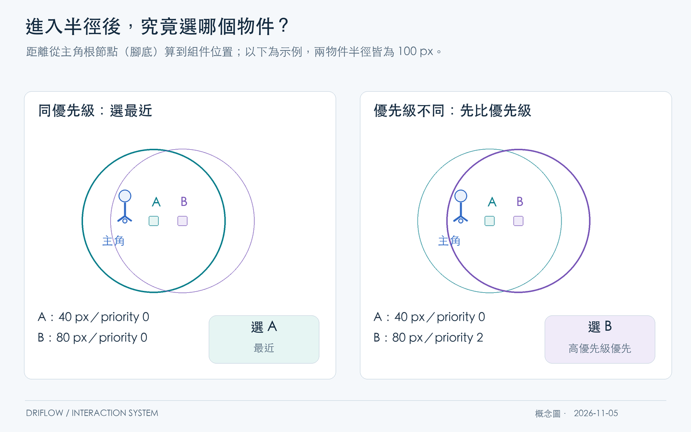

距離示意：兩個物件都在範圍內時，同級選最近；較高 priority 可以優先於較近物件。示例半徑均為 100 px。

- 每個物件以自身組件位置為圓心，以世界座標像素計算可調半徑。
- 全域管理器統一處理按鍵與目標；重疊範圍先比較 `priority`，同級選最近物件，一次按鍵只處理一個目標。
- `DIRECT` 直接發送反應訊號；`MENU` 顯示物件自訂選項。選項用穩定 `action_id` 辨識，顯示文字可以獨立修改。
- `disable_after_use` 支援單次線索；是否隱藏、刪除、加入背包或保存旗標由反應腳本決定。
- 核心不依賴 Dialogic、Popochiu 或特定玩家腳本。Driflow 保留既有 `scripts/`、`scenes/` 佈局，不跨遊戲使用 `res://`。
- 玩家以 `interaction_actor` 群組註冊；可選的 `can_interact()` hook 提供控制器自己的狀態條件。

## 程式與文件結構

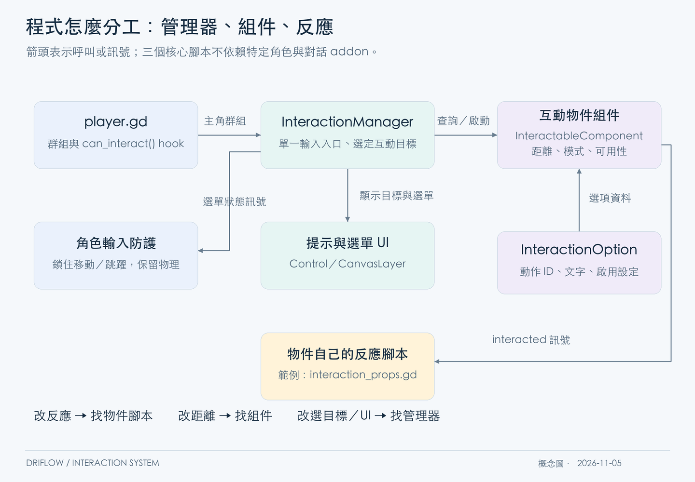

結構圖：管理器、主角、互動組件、選項資源與物件反應的責任邊界。訊號由組件發送，選項資源只提供資料。

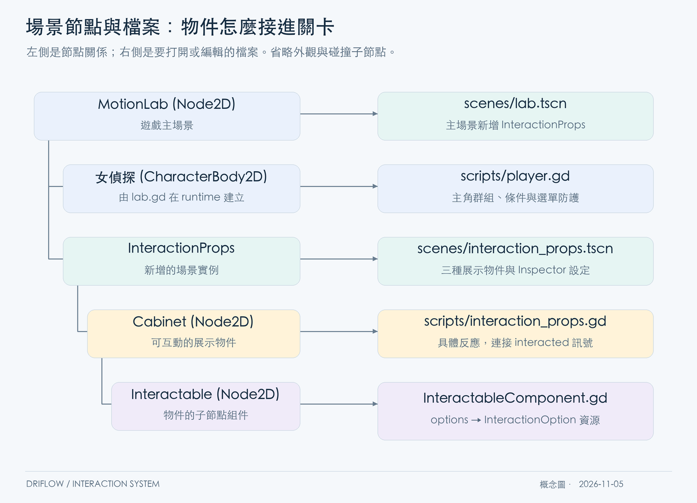

結構圖：場景節點與應編輯的檔案對照；角色由 lab.gd 在 runtime 建立，展示物件以場景實例加入。

```text
games/Driflow/
├── project.godot                         新增 InteractionManager Autoload
├── scripts/
│   ├── player.gd                         群組、狀態 hook、選單輸入鎖與當幀防護
│   ├── lab.gd                            沿用另一個對話最新的平台常數與配置
│   ├── rig.gd                            原骨架及攀爬動畫，本次未修改
│   ├── interaction_props.gd              三種展示物件的具體反應與平台對齊
│   ├── interaction_demo.gd               獨立範圍測試台的移動與反應
│   └── interaction/
│       ├── InteractionManager.gd         集中輸入、選目標、提示與選單
│       ├── InteractableComponent.gd      物件距離、可用條件及 interacted 訊號
│       └── InteractionOption.gd          action_id、label、enabled 資源
├── scenes/
│   ├── lab.tscn                         加入 InteractionProps 實例
│   ├── interaction_props.tscn           可編輯的開關、櫃子與線索
│   └── interaction_demo.tscn            可獨立執行的範圍測試台
├── tests/
│   ├── interaction_smoke.gd             互動核心與 GUI：42 項檢查
│   ├── driflow_interaction.gd           真實女偵探與關卡：21 項檢查
│   └── smoke.gd                        沿用原動作／攀爬回歸測試
└── docs/
    ├── INTERACTIONS.md                  完整設定、接入、修改與驗證指南
    ├── DEVELOPMENT.md                   追加互動結構與維護接點
    └── devlogs/2026-11-05-interactions.md 本日誌
```

`project.godot` 保留原主場景 `res://scenes/lab.tscn`、1280×720、`canvas_items` 與 `gl_compatibility`；只新增互動 Autoload。原 `rig.gd`、`rig.tscn`、素材、平台程式與動作測試沒有由本次改寫。

## 角色控制整合與輸入

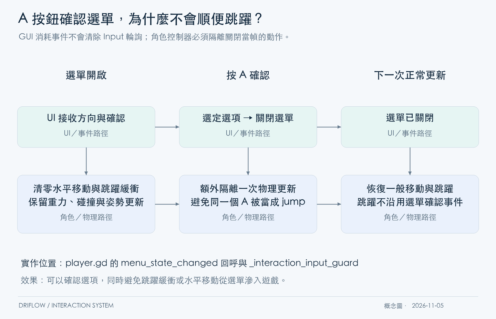

輸入時序：選單開啟、A 確認關閉、恢復操作三個階段；額外隔離一次物理輸入，避免確認同時觸發 jump。

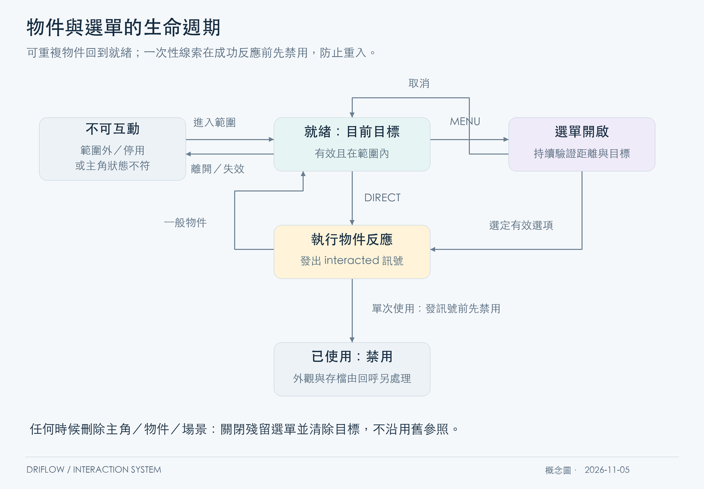

狀態圖：範圍外、就緒、選單、反應與一次性禁用。一次性物件在發出反應訊號前已先禁用。

E／手把 Y 為互動預設；已有 `interact` Input Map 時沿用，缺少才在 runtime 補上。選單使用上下方向、Enter／A 確認、Esc／B 取消，也可滑鼠點擊；缺少標準手把 UI 綁定時才補上，保留原有鍵盤設定。

Driflow 的 `can_interact()` 要求角色站穩且 `ledge_mode` 為空；空中、懸掛和攀爬期間不可開啟互動。選單期間清除水平移動與跳躍緩衝，保留重力、碰撞與靜止姿勢更新，不暫停整棵 SceneTree。關閉選單後額外隔離一次物理更新的動作輸入，避免手把 A 同時確認選單與跳躍。

按鍵、選單選定與實際反應前都重新驗證主角、距離、物件、選項與封鎖狀態。離開範圍、停用／隱藏／刪除目標或刪除場景會清理選單。`InteractionManager.blocked` 提供過場／對話等外部狀態使用；其他系統需自行接入。

## 三個可試玩的展示物件

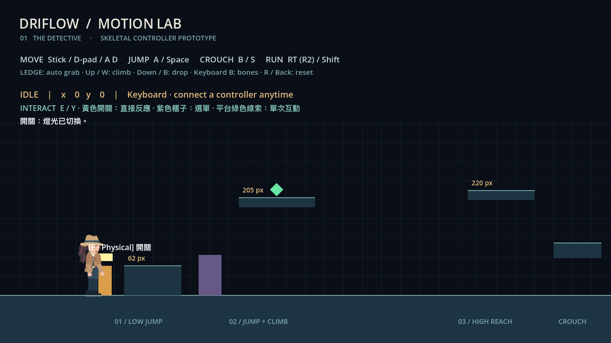

實際遊戲畫面：主角在開關範圍內互動，黃色燈亮起；反應直接執行，不開選單。

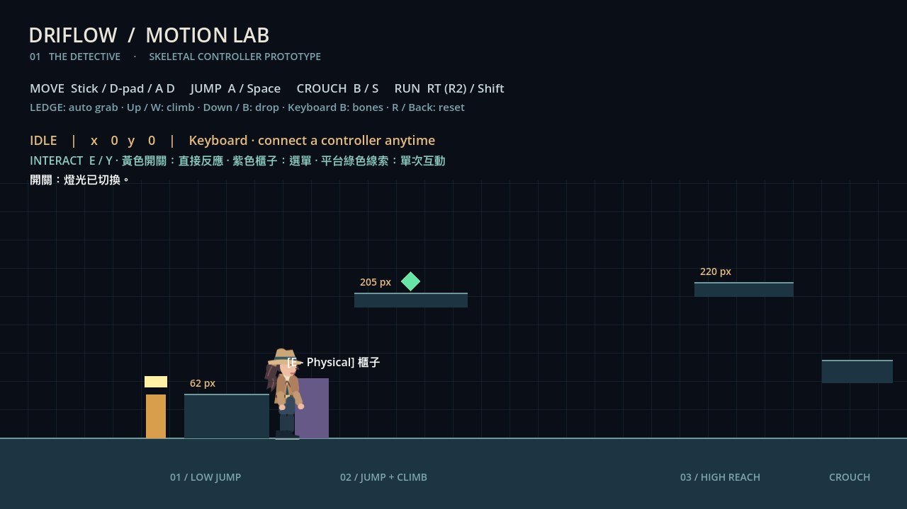

實際遊戲畫面：女偵探走近櫃子後，出現 E 動作提示；此時尚未執行櫃子反應。

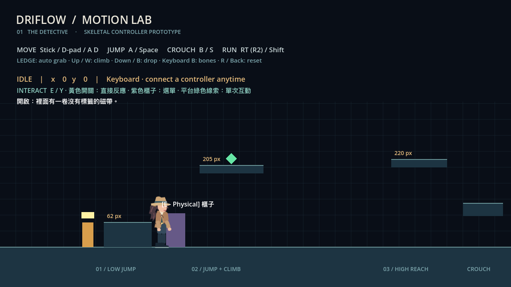

實際遊戲畫面：選擇「開啟」後選單關閉，畫面顯示櫃子的具體反應；角色可恢復操作。

| 物件 | 目前位置 | 反應 |
| --- | --- | --- |
| 黃色開關 | 地面 x=220 | 直接切換燈光 |
| 紫色櫃子 | 地面 x=440 | 選單「查看／開啟／取消」，回傳動作 ID |
| 綠色線索 | 攀爬平台 x=580、y=415 | 站穩後拿取一次，隱藏外觀並禁用組件 |

展示物件讀取 `lab.gd` 的 `GROUND_Y`、`LOW_PLATFORM`、`CLIMB_PLATFORM`，讓櫃子位於平台間空地、線索位於攀爬平台頂端。若手動編輯位置，將 `InteractionProps.align_to_lab_platforms` 關閉。這是展示物件的放置便利功能，不限制正式物件的擺放方式。

## 與另一個對話併行修改的處理

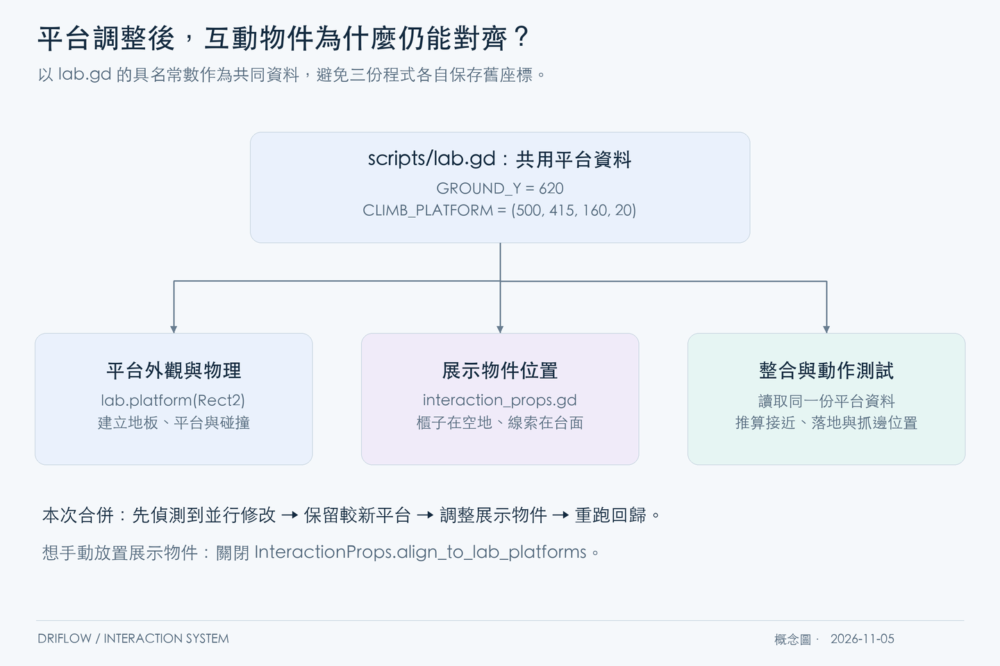

資料依賴圖：平台、展示物件與測試讀取同一份 lab.gd 平台常數；保留另一個對話更新的幾何配置。

首次準備寫回 Driflow 時，雜湊檢查發現 README 已被另一個對話更新；安裝在任何寫入前停止。進一步檢查確認平台改為具名 Rect2 常數，低台、兩座高台與蹲行區的位置均已調整。

保留較新的平台程式、原動作測試與文件內容，將本次互動文件改為追加合併；展示物件與整合測試改讀同一份平台資料，再重跑功能、動作及圖形驗證。最終安裝前後皆核對來源內容，避免把較舊的平台配置、骨架或測試副本覆蓋回去。

## 實際驗證與證據

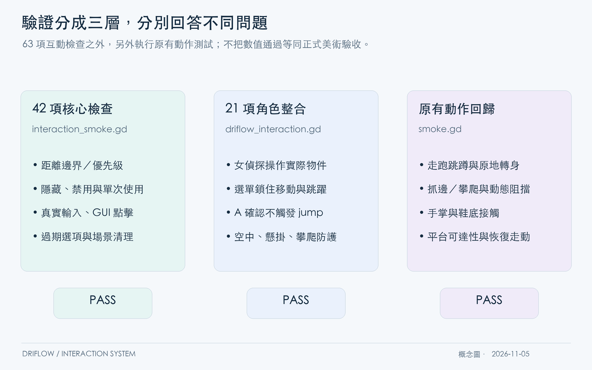

驗證範圍：42 項互動核心、21 項女偵探整合，以及另外執行的原動作回歸；不等同正式美術驗收。

| 驗證 | 結果 | 涵蓋範圍 |
| --- | --- | --- |
| 互動核心 | `INTERACTION TESTS: PASS (42 checks)` | 距離外／邊界、半徑即時修改、最近者與優先級、隱藏／禁用、單次觸發、按鍵重複、選項失效、GUI 點擊與鍵盤確認、場景清理 |
| 女偵探整合 | `DRIFLOW INTERACTION TESTS: PASS (21 checks)` | 原關卡實際物件、選單鎖住移動／跳躍、A 確認不觸發跳躍、關閉後恢復、空中／懸掛／攀爬拒絕互動、平台線索、刪除場景清理 |
| 原動作回歸 | `MOTION TESTS: PASS` | 原有走跑跳蹲、轉身、抓邊、攀爬、手腳支撐與碰撞邊界 |
| 圖形模式 | 女偵探整合測試 PASS，輸出實際選單 PNG | 最新平台配置、女偵探、展示物件與互動選單共同渲染 |
| 安裝後比對 | PASS | 指定目錄的程式與測試來源一致；保留較新平台、骨架與原測試 |

這些測試已從正式指定的 Driflow 目錄執行，不只在暫存副本通過。程式審查重點為失效物件參照、訊號回呼改變狀態、重複觸發、關閉選單的輪詢輸入與跨場景清理；未發現阻斷目前原型流程的問題。實體手把手感及正式內容的主觀體驗仍需後續試玩。

本機驗證 log 位於 `/tmp/driflow-interaction/installed-core.log`、`installed-integration.log`、`installed-motion.log`；暫存檔不保證長期保留。

## 排查經驗與沉澱

1. **無頭 GUI 座標**：headless 視窗可能只有 64×64，Control 仍以邏輯解析度佈局。測試以 `Viewport.push_input(mouse_event, true)` 送入本地座標，驗證真正的按鈕回呼；不能只 emit pressed 取代 GUI 測試。
2. **事件消耗不等於禁止輪詢**：GUI 消耗事件後，角色的 `Input.is_action_just_pressed()` 仍可能讀到同一個 A／跳躍動作；因此加入關閉當幀防護與清除跳躍緩衝。
3. **不假設 UI 已綁手把**：檢查 InputMap 實際事件，補上缺少的標準 A／B／方向鍵綁定。
4. **測試傳送與地面相交**：腳底精確傳送至平台頂面，可能讓站立膠囊的形狀查詢把地面視為重疊，造成跳躍預檢失敗。測試改從表面上方 1px 自然落地，沒有為傳送誤差改寫既有控制器。

上述通用經驗已追加至 Godot 技能，保留既有內容：主 checkout 的 `.agents/skills/godot_expert/SKILL.md` 與本機共用技能來源 `/Users/clydewang/GITHUB/ai-agent-skills/skills/godot_expert/SKILL.md`。

## 如何繼續修改

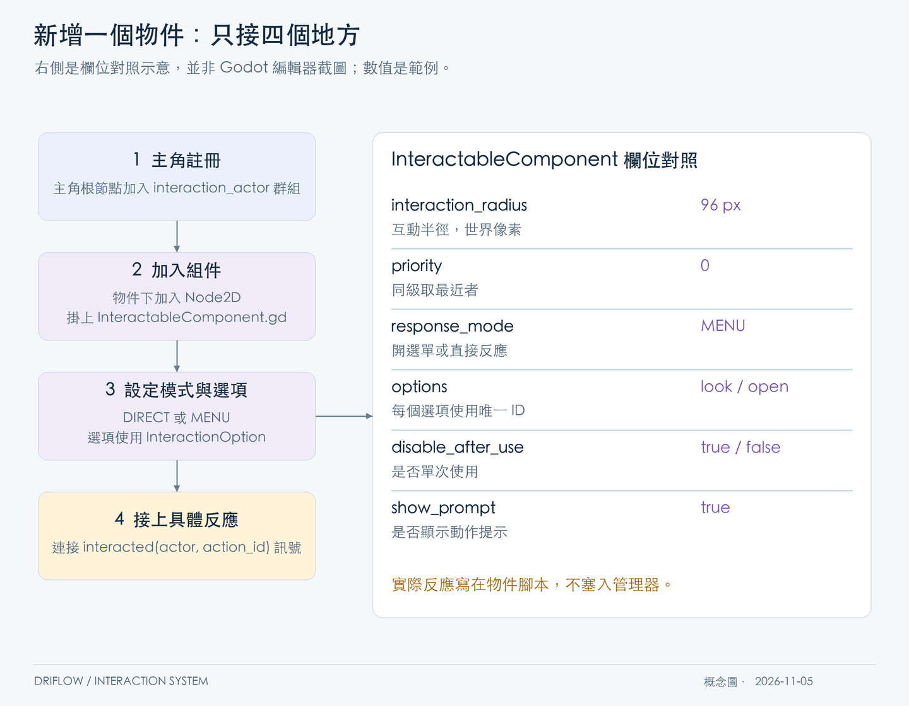

操作示意：主角群組 → 加入組件 → 設定模式與選項 → 連接反應。欄位面板是對照示意，不是編輯器截圖。

1. 改單一物件距離：在 `interaction_props.tscn` 選取該物件的 Interactable，修改 `interaction_radius`。
2. 改選單：選 `MENU`，編輯 `options` 中的 `InteractionOption`；每個選項使用唯一 `action_id`。
3. 改物件反應：修改 `interaction_props.gd` 的 `interacted` 回呼；正式物件也可連到自己的腳本。
4. 改主角允許條件或選單鎖定：修改 `player.gd` 的 `can_interact()`／選單防護區塊，不改寫攀爬動畫。
5. 改全域目標或 UI：修改 `scripts/interaction/InteractionManager.gd`；核心物件條件則在 `InteractableComponent.gd`。
6. 改平台：沿用 `lab.gd` 的具名常數，重驗展示物件落點、互動整合與原動作測試。

從 monorepo 根目錄執行：

```sh
/Applications/Godot.app/Contents/MacOS/Godot --headless --path games/Driflow --editor --import --quit
/Applications/Godot.app/Contents/MacOS/Godot --headless --path games/Driflow --script res://tests/interaction_smoke.gd
/Applications/Godot.app/Contents/MacOS/Godot --headless --path games/Driflow --script res://tests/driflow_interaction.gd
/Applications/Godot.app/Contents/MacOS/Godot --headless --path games/Driflow --script res://tests/smoke.gd
```

圖形驗證不能加 headless：

```sh
/Applications/Godot.app/Contents/MacOS/Godot --path games/Driflow \
  --script res://tests/driflow_interaction.gd -- --capture=/tmp/driflow-interactions.png
```

## 技術棧、Skill、工具與依賴

- 規則／Skill：先讀 repo `AGENTS.md`、`.agents/rules/core_directives.md` 與 `godot_expert`；通用排查經驗依 `self_improving_agent` 的沉澱方式保存；本日誌使用 `notion-knowledge-capture` 同步人類閱讀版。
- 遊戲 runtime：Godot 4.6.2、GDScript、Node2D／CharacterBody2D、Resource、Autoload、InputMap、Control／CanvasLayer。無新增第三方 addon。
- 工具：Godot CLI 無頭回歸與圖形擷取、Git 狀態、Python 雜湊／來源比對、Notion MCP fetch／search／create-pages／update-page。
- 環境：macOS；圖形擷取需要正常桌面 renderer，無頭模式用於邏輯與 GUI 事件測試。
- 複用：開啟專案 → 先匯入 → 將主角加群組 → 加組件、設定距離與模式 → 連訊號 → 跑兩組互動測試及原動作測試 → 圖形驗證 → 更新指南與日誌。

## 限制與後續

- [ ] 依正式關卡需要加入視線／穿牆遮擋或朝向條件；目前只有二維直線距離。
- [ ] 將一次性物件狀態接入存檔；目前重新載入場景會重置。
- [ ] 替換展示物件與選單美術，接入正式劇情、對話與物品反應。
- [ ] 以實體手把與更多平台幾何試玩；目前手把事件為程式模擬驗證。
- [ ] 若兩個遊戲都繼續使用此核心，修改三個核心腳本時同步各專案；目前各自保留完整 `res://` 根目錄。

## 版本與產物位置

本次沒有 git commit 或 push。記錄時主 repo HEAD 為 `a76e3ad`，但 Driflow 仍為未追蹤資料夾，因此該 commit 不是本次互動機制的版本，也不能以 GitHub 網址推定已上傳。

完整設定指南為 `docs/INTERACTIONS.md`，維護總覽為 `docs/DEVELOPMENT.md`；本日誌不取代 repo 的規則來源。

本機產物位於：

```text
/Users/clydewang/.codex/visualizations/2026/11/05/01a1aaf5-bd21-75b3-a56b-f340a44789b3/
├── Driflow-interactions.patch
└── driflow-interaction-menu.png
```

補丁是本次安裝前後的差異留底，已修改的專案不要盲目重複套用。原始補丁仍保存在本機。本次圖文補充已將 4 張實際遊戲截圖與 9 張說明圖上傳為 Notion 圖片；可編輯 SVG 與產圖／擷取來源另存於 `docs/visuals/interaction/`。


## Notion 閱讀版

- [本篇開發日誌](https://app.notion.com/p/40fc42073e3381089418ff23b6833ac7)
- [程式、骨架與文件維護指南](https://app.notion.com/p/40fc42073e3381db838cf7b1696b274a)


## 圖文補充與維護（2026-11-05）

本篇以 4 張實際擷取畫面與 9 張原創概念／流程／結構圖補充說明。截圖未經生成式改畫；概念圖依目前程式繪製，與真實畫面分別標示。圖片、可編輯 SVG、擷取腳本與產圖腳本保留於 `docs/visuals/interaction/`；再製方法見 [配圖維護說明](../visuals/interaction/README.md)。本次只更新文件與圖片，沒有改動遊戲行為。
