# 2026-11-05｜Driflow 基本動作：蹲走、手膝爬行與滯空

## 需求與範圍

使用者希望流暢冒險遊戲的基本動作自然連貫：改善蹲下／蹲走，新增手掌、膝蓋著地的爬行，跳躍滯空時腿不要亂擺。若動作需要更細的架構，須一併增加可替換附件，保留換角色部件的能力。

實際修改主 checkout 的 games/Driflow；其他遊戲與互動核心保留。沿用1.02s 攀爬，沒有套回舊補丁或重建另一個遊戲。

## 根因與決策

- 原空中分支雖改了大腿角度，膝蓋仍含 sin(phase) 地面步態項；水平速度繼續推動相位，造成空中擺腿。改為起跳快照＋垂直速度曲線，地面相位在空中凍結。
- 原蹲姿只是抬高骨盆22px、固定折腿，腳無接觸約束，手臂也可能穿過地面。改用短步與世界支撐點，重做骨盆／胸口／視線與手部平衡。
- 過度壓低軀幹會把膝蓋擠到臉前。最終保留較完整軀幹長度，蹲姿碰撞88px；右側通道改94px淨空，而非犧牲人體比例硬塞舊78px空間。
- 爬行需手膝真正承重，故新增獨立低姿勢、132×64px 碰撞、KneeContact 與兩個 Hand 骨節。22節仍使用可替換 Sprite2D；沒有烘焙整體動畫圖。
- 起步接觸若沿用靜止世界錨點，第一段支撐會超出膝部可達範圍。重新初始化起步週期，加入左右多週期承重測試，確認後再交付。
- 慢速檢查發現轉為跪地時靴尖短暫穿地；以貼圖矩形四角檢查折疊淨空，先折小腿／翻腳尖，再放膝。新測試逐幀覆蓋此過程。起步加入0.12s接觸點過渡，地面IK改為精確跟隨已平滑的目標。

## 實作

速度：走220／跑380維持；蹲走85／爬行46px/s。按住S／手把B蹲；按住C／LT手膝爬行。low_pose 在站→蹲→手膝連續過渡，空間不足時保留可容納姿勢；碰撞高度收縮不得早於可見頭頂。右側末端另設68px低頂供爬行。

地面 IK 以世界座標固定支撐腳、掌心及膝部。對側手膝錯開擺動，移重留在兩側支撐間。衣服接縫維持 CoatJoin，蹲姿下擺收束；爬行手掌平放、攀爬推撐也會轉掌。起跳姿勢逐步收腿、滯空保持，下降時準備落地，落地骨盆短暫吸收。

## 程式與文件結構

修改 scripts/player.gd、rig.gd、controls.gd、lab.gd；scenes/rig.tscn；art/forearm.svg，新建art/hand.svg。新增tests/locomotion_smoke.gd、locomotion_visual.gd，更新smoke.gd的姿勢與22骨節預期。

新增 docs/LOCOMOTION.md（目前修改方法／完整樹／換圖契約）、本篇日誌與 docs/visuals/locomotion/；同步 README、DEVELOPMENT 與 CLIMB_REFERENCE。互動指南、互動場景與其他遊戲未被覆寫。參數與修改範例以 LOCOMOTION.md 為準。

## 驗證

實際主 checkout 測試通過：MOTION TESTS: PASS；LOCOMOTION TESTS: PASS（1143 checks）；DRIFLOW INTERACTION TESTS: PASS（21 checks）；INTERACTION TESTS: PASS（42 checks）。左右攀爬圖形擷取 PASS；基本動作圖形擷取 PASS。新測試檢查兩側手掌／膝部承重、蹲走防滑、低頂阻擋、LT輸入、空中腿部獨立及起跳落地連續性；既有攀爬與互動回歸保留。

## 技術棧與依賴

Skill：godot_expert、self_improving_agent、notion-knowledge-capture。Godot4.6.2／GDScript、CharacterBody2D、PhysicsShapeQueryParameters2D、Skeleton2D／Bone2D／Marker2D／Sprite2D、原生SVG。Godot CLI 做功能測試與固定步長圖形擷取，Python Pillow 組GIF／姿勢表，Notion MCP保存日誌與維護說明。遊戲 runtime 沒有新增外部依賴。

復用步驟：先讀 DEVELOPMENT／LOCOMOTION → 改對應物理或視覺參數 → 如需要新增關節並保留 Artwork → 接觸／淨空／互動回歸 → 正常及慢速擷取檢視 → 同步文件與 Notion。參考來源與實際閱讀範圍見 LOCOMOTION.md，不宣稱真人逐格動捕。

## 狀態與限制

本輪沒有 commit／push。先前商業品質、蒙皮與真人逐格對齊尚未完成的限制仍存在；這次是基本動作一輪具體調整及回歸。接下來應依實際遊戲速度和正式角色比例繼續調關鍵姿勢，而非只增加骨節數。


Notion 閱讀版：[基本動作與附件指南](https://app.notion.com/p/40fc42073e33815099c4d3a01ad72962)／[本輪開發日誌與動作預覽](https://app.notion.com/p/40fc42073e33810a8f8ce8e19c2243a8)。

## 最終視覺檢查與程式自審

正常與慢速連續幀、左右爬行、多個過渡時刻及左右攀爬已擷取；檢查蹲姿比例、掌膝支撐、鞋尖折疊淨空、空中腿部、站起銜接與換圖入口。自審涵蓋擴張前淨空、自身RID排除、碰撞mask、重置姿勢、攀爬後縮放復位、選單輸入隔離及其他遊戲邊界。無GDScript解析／資源／執行錯誤；無頭沙盒有macOS CA讀取訊息，圖形擷取正常。

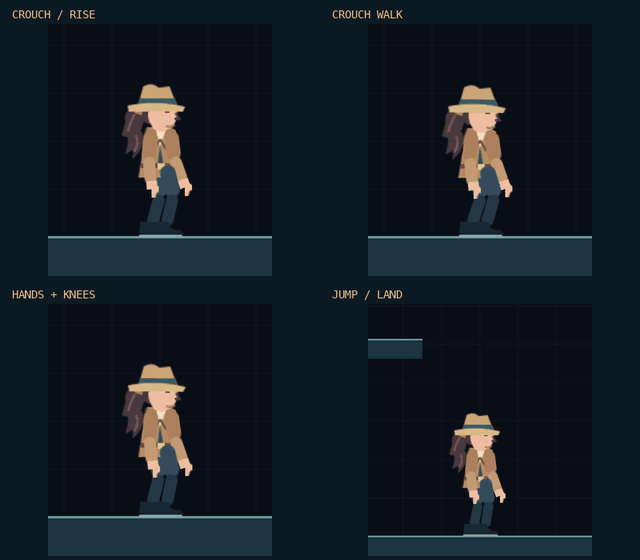

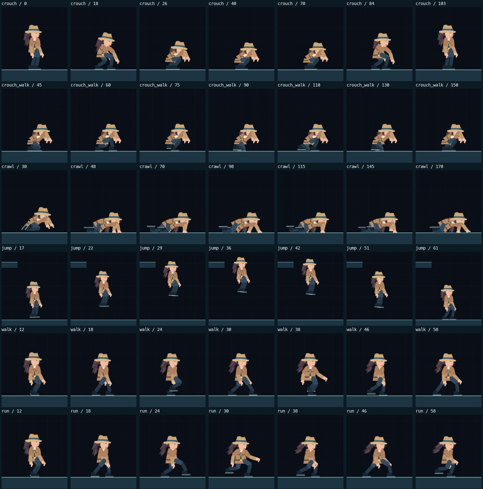


## 同日後續修正｜手的關節反了

使用者由預覽指出手部反折，上一輪的數值接觸測試與縮小預覽漏掉了這個問題。根因：手臂共用腿部的IK彎曲分支、手掌固定世界方向，且手腕與掌面支撐點合併。這是已確認的製作錯誤，不把舊PASS當作自然度保證。

修正：solve_limb 增加 bend_sign，手臂用-1、腿維持+1；放鬆手掌沿前臂，承重才轉掌；WristContact=(0,27)、Hand/PalmContact=(0,4)、手圖中心(1,1)。HandContact保留相容查詢，位置跟隨真實掌心。爬行肩部不隨胸口旋轉成上下堆疊，掌心位置重新配合肩部；攀爬同時計算可行腕角與掌心錨點，胸口拉起姿勢避開兩節最小可達距離。

變更 scripts/rig.gd、scenes/rig.tscn、tests/smoke.gd、tests/locomotion_smoke.gd，新增tests/arm_visual.gd；相關結構／換圖文件同步。沒有更改其他遊戲、移動速度或互動核心。仍22節，Sprite2D Texture可逐件替換；新增的是可編輯腕／掌Marker。

實際安裝版：MOTION TESTS PASS；LOCOMOTION TESTS PASS（1659檢查）；Driflow互動21檢查PASS；通用互動42檢查PASS。左右攀爬與蹲走／爬行放大擷取已檢視。新測試覆蓋肘部符號、放鬆及承重腕角、掌面接觸和代理標記一致性。

圖形擷取遇到原生視窗等待停滯，停止本輪臨時程序後，改成單一程序明確離屏繪製並檢查PNG內容。arm_visual每1/60s模擬、每3步輸出20fps，GIF50ms／格，慢速200ms；不以舊50fps的格距匯出。技術棧沿用Godot4.6.2／GDScript／Bone2D／Marker2D／Sprite2D、CLI、Pillow與Notion MCP；技能godot_expert記錄IK分支與腕掌分離做法，self_improving_agent復盤，notion-knowledge-capture同步閱讀版。未commit／push。

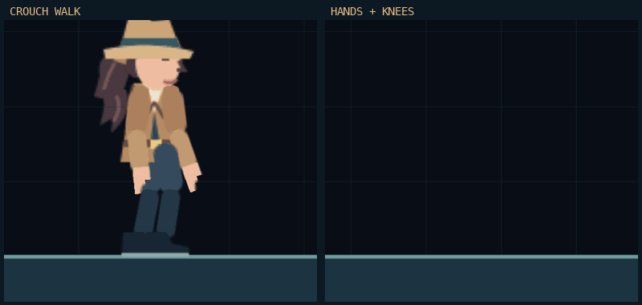

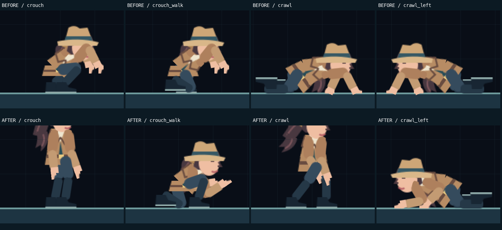


## 起跳發力修訂：快速下沉、蹬腿與離地

2026-11-05 同日後續。使用者指出上一版像直接飄起；原本接收到跳躍後就施加向上速度，沒有站地蓄力／腿部伸展的視覺過程。

player.gd 新增 jump_pending、jump_elapsed、jump_anticipation=0.06s、moving_jump_anticipation=0.03s。60Hz下原地約4步（67ms）、移動約2步（33ms）後離地；已蹲姿用原地時長直接伸腿，不再壓低一次。JUMP_LOAD／JUMP_PUSH為顯示狀態，主碰撞根節點在蓄力時維持地面，縮小身體只影響骨盆與軀幹視覺。蓄力中的距離互動暫不啟動。

rig.gd 的 begin_takeoff() 記錄當前骨盆、胸口、手臂、衣擺與腳尖世界座標；apply_takeoff_pose() 先下沉（原地9px／移動5px），再伸髖伸膝。腳跟以約0.17rad微抬，腳尖為固定支點；移動跳只固定承重腳，另一腳保留步態。低姿起跳直接伸腿。離地前完成最後推蹬姿勢，空中再由這個姿勢收腿，減少仍縮著腿就向上平移的感覺。

### 可替換腳部附件

每側 Boot 新增 ToeContact（Marker2D，預設12,13）；SoleContact仍為(0,13)。沒有增加Bone2D，仍22節；靴子的Artwork仍可直接換PNG／SVG。換鞋後先校準SoleContact與ToeContact到實際鞋底／前腳掌，再調肢體長度及碰撞；動畫讀取標記，不覆寫Texture。

```text
Hip/FrontThigh/FrontShin/FrontBoot
├── Artwork          可替換靴子圖
├── SoleContact      (0,13)，平常站走的鞋底
└── ToeContact       (12,13)，推蹬的前腳掌
Hip/BackThigh/BackShin/BackBoot
└── 同樣三個子節點
```

### 輸入與測試

短按在蓄力時放開仍產生小跳；落地跳躍緩衝會完成一次蓄力再離地。土狼跳不虛構地面蓄力，直接起跳。重置、選單輸入鎖或新增頭頂障礙會清除待起跳意圖；已爬行仍須先起身。移動跳保留水平速度。

新增 tests/jump_smoke.gd 的45項檢查：固定地面與腳尖、鞋圖四角淨空、膝蓋先彎再伸、短按小跳、蹲姿不二次下沉、左右跑跳、土狼、落地緩衝、新增阻擋與重置取消。原有MOTION、基本動作1659項、Driflow互動21項、通用互動42項均通過，包含兩座高台實際跳抓攀上。舊的中立跳4幀等待改為6幀以涵蓋蓄力；新增測試逐步驗證實際離地在3–5步內。滯空連續性仍用原角度門檻，在離地0.12s後取樣；快速地面伸腿由新測試獨立驗證。

```sh
/Applications/Godot.app/Contents/MacOS/Godot --headless --fixed-fps 60 --quit-after 5000 --path /Users/clydewang/GITHUB/godot-games/games/Driflow --script res://tests/jump_smoke.gd --log-file /tmp/driflow-jump-test.log
/Applications/Godot.app/Contents/MacOS/Godot --path /Users/clydewang/GITHUB/godot-games/games/Driflow --fixed-fps 60 --disable-render-loop --disable-vsync --audio-driver Dummy --accessibility disabled --script res://tests/jump_visual.gd --log-file /tmp/driflow-jump-visual.log -- /tmp/driflow-jump-frames
```

jump_visual.gd 以60Hz逐步擷取原地跳、短跳、左右跑跳與蹲姿起跳，另存timing.json；明確離屏繪製避免原生視窗等待。前後對照GIF由60Hz重取樣50fps，正常20ms／格、四分之一速80ms。這與arm_visual.gd的20fps輸出不同，不要混用格距。

技術棧：Godot4.6.2、GDScript、CharacterBody2D／Bone2D／Marker2D／Sprite2D、原生SVG；Godot CLI測試及renderer、Pillow組比較圖與GIF、Notion MCP同步日誌。Skill沿用godot_expert、self_improving_agent、notion-knowledge-capture。復用：調短蓄力時長與骨盆曲線 → 校準腳尖接點 → 驗證輸入邊界與高台可達 → 正常／慢速前後比對 → 更新文件。沒有commit／push。


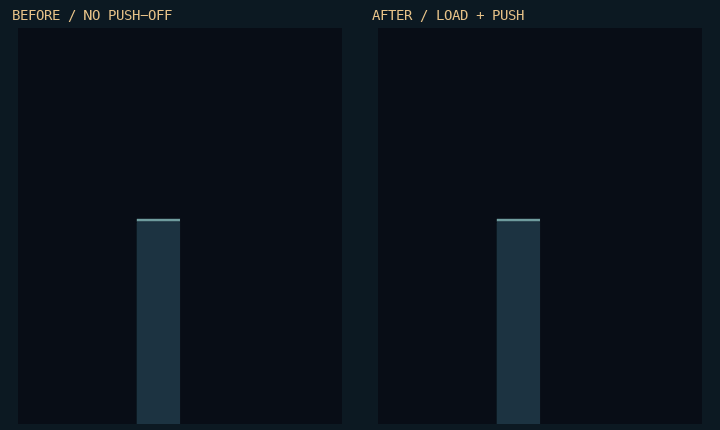

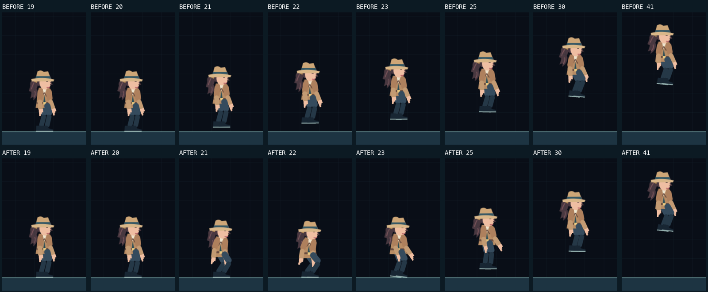

起跳擷取僅保留地板及邊界，以免左右跑跳撞到原關卡天花板或自動抓邊；正式Motion Lab未移除平台。安裝版擷取中，原地／左右跑跳／蹲姿跳的腳底峰值約y=523.4，落地y≈620；短按小跳峰值約y=592，所有動作均完成落地。精確數值以timing.json為準。


## 伸手與扣邊修訂：接觸前抬臂、接觸後承重

2026-11-05 同日後續。使用者指出舉手攀附仍不細膩；原本try_grab_ledge成功後直接切成animate_ledge(0)，缺少接觸前抬手，以及接觸後的肩膀／骨盆緩衝。

### 流程與修改入口

```text
player.gd 物理更新
├── find_ledge_candidate()   共用平台側面／頂面碰撞幾何
├── update_reach()           預測可達邊緣，驅動接觸前抬臂
├── try_grab_ledge()         真正抓取前再查頂面高度與碰撞安全
│   └── rig.begin_catch()   先記錄世界姿勢，再固定物理根節點
└── update_ledge()
    ├── HANG：catch_elapsed < catch_duration → animate_catch()
    ├── HANG：承重完成 → 穩定懸掛；處理climb_requested
    └── CLIMB：原1.02s攀爬與完整碰撞路徑

rig.gd
├── begin_reach() / animate_reach()  肩前弧線、兩手延遲、視線
├── begin_catch() / animate_catch()  世界姿勢銜接、掌心固定與承重
├── solve_arm_contact()             腕部可行角度與掌心目標
└── finish_ledge_pose()             懸掛／攀爬共用馬尾次要運動
```

- 預測：前方reach_distance=64px、垂直偵測窗口190px；以當前垂直速度／剩餘跳高過濾不可達目標。這是預測窗口，不是把手臂變長。
- 抬臂：前手0–0.14s，後手0.025–0.18s。手腕沿肩前弧線移動，避開IK通過肩部的奇點；先抬肩／屈肘，再向上展臂，頸／頭略向邊緣看。後手保留小幅接近偏移，扣邊才合攏。
- 實際抓取：頂面相對腳底高度必須<=grab_height=130px，再執行原有clear_at與test_move。不能把側面掃描高度直接當頂面可達高度，否則會在手未碰到時吸附。
- 扣邊：前手約0.035s、後手0.025–0.07s完成最後接近與轉掌；之後掌心固定在世界邊緣。catch_duration=0.16s內，骨盆小幅承重下沉、肩胸緩衝、腿跟隨，保留接近慣性並逐步消散。
- catch仍屬ledge_mode="HANG"，物理根節點固定且碰撞持續啟用；骨架從接觸前的世界姿勢過渡。承重完成後才開始原本CLIMB；攀爬1.02s不包含前面的catch時間。

### 指令與邊界

接觸當幀已按住Up／W，或catch期間按下攀爬，會記住climb_requested，承重完成後接續。start_climb()現在只有HANG時接受要求；返回true可能表示已排入佇列，應檢查ledge_mode確認是否已進入CLIMB，不能只看返回值宣稱攀爬完成。真正開始前仍要通過目標空間與路徑預檢。

放手／重置會清除待攀爬意圖。目標消失或不可達時撤回伸手，短跳不會對無法碰到的高台揮手；drop期間與冷卻期不重抓。互動仍只在允許的地面狀態啟動。互動測試依catch_duration等待承重，再驗證實際CLIMB與完成。

### 骨架與替換

沿用既有22節的Shoulder／Arm／Forearm／Hand、頸與胸腰控制；Artwork Texture與WristContact／PalmContact／SoleContact／ToeContact不改。這輪增加的是動作路徑、時間、姿勢快照與承重交接，沒有逐指抓握動畫；手指仍隨手掌分件。若後續拆手指，需保留每件Artwork及相應接點，再補接觸與鏡像回歸。

### 驗證與重製

新增tests/reach_smoke.gd：560檢查通過，涵蓋兩個平台高度×兩朝向實際地面跳抓、多幀抬手連續性、肘／腕角、掌心承重固定、衣服接縫、提早輸入交接、非HANG拒絕攀爬、放手取消、目標消失和不可達短跳。既有MOTION、起跳45檢查、基本動作1659檢查、Driflow互動21檢查、通用互動42檢查通過。

```sh
/Applications/Godot.app/Contents/MacOS/Godot --headless --fixed-fps 60 --quit-after 5000 --path /Users/clydewang/GITHUB/godot-games/games/Driflow --script res://tests/reach_smoke.gd --log-file /tmp/driflow-reach-test.log
/Applications/Godot.app/Contents/MacOS/Godot --path /Users/clydewang/GITHUB/godot-games/games/Driflow --fixed-fps 60 --disable-render-loop --disable-vsync --audio-driver Dummy --accessibility disabled --script res://tests/reach_visual.gd --log-file /tmp/driflow-reach-visual.log -- /tmp/driflow-reach-frames
```

reach_visual.gd從地面錄製兩高度×兩朝向，另有提早按攀爬、承重後接續爬上的chain；沒有從空中傳送到HANG充當舉手驗證。60Hz逐步明確離屏繪製，timing.json保存模式、伸手／承重時間、骨盆與掌心座標。GIF從60Hz重取樣50fps，正常20ms／格、四分之一速80ms。

自審涵蓋接觸前後世界座標、只在真正可達時抓取、相容HandContact代理、左右IK方向、catch後姿勢與原攀爬首幀銜接、指令佇列取消及互動狀態。其他遊戲與原有素材替換能力保留；未commit／push。

技術棧：Godot4.6.2 GDScript／CharacterBody2D、PhysicsRayQuery、Bone2D／Marker2D／Sprite2D、雙節IK、CLI測試與renderer、Pillow組PNG／GIF、Notion MCP日誌。Skill：godot_expert、self_improving_agent、notion-knowledge-capture。復用：調預測與可達限制 → 肩前抬臂路徑 → 世界姿勢快照 → 分時掌心固定與承重 → 指令交接 → 兩高度兩朝向及取消回歸 → 正常／慢速對照 → 同步文件。


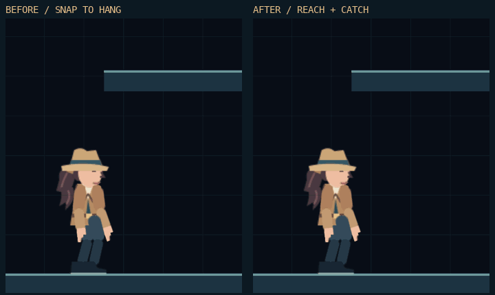

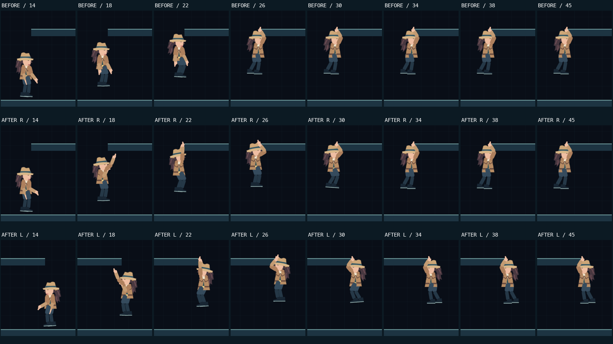


## 步行身高修訂：承重腿伸直與腳底滾動

2026-11-05 同日後續。使用者指出走路像半蹲，停下後高很多；不是錯覺。原本移動時骨盆固定從-60壓至-53（跑步-49），正常走路也一直保持較大的膝部彎曲。舊版固定相機實拍可見身高：站立平均約130.69、走路約124.50，相差約6.2px。

### 目前做法與修改入口

rig.gd不再用「只要移動就固定壓低」：步行骨盆在-56到-60之間週期移重，承重腿經過身體下方時伸直；跑步使用接地、壓縮、推蹬與小幅騰空的獨立高度曲線。站立仍約-60，沒有拉長腿或縮放正常步行骨骼。物理移動速度仍walk220／run380px/s。

- 完整步態週期距離：走88、跑112px；蹲走56、手膝爬行34沿用。縮短過大的支撐跨度，使腿能在較直立的身高保持接觸。
- 支撐比例：走0.58、跑0.42，低姿勢逐步混合到0.72。跑步有短暫雙腳擺動區間，不沿用走路固定壓低姿勢。
- ground_foot_pose()：腳跟落地 → 鞋底承重 → 前腳掌推進，擺動期平順轉向下一次腳跟接觸。solve_ground_foot()反推腳踝並解算雙節IK；舊normal_legs()已被這個主流程取代。
- 骨盆目標同時受承重腿實際可達距離限制，避免抬高身體後腳掌離地或靠拉長骨骼補償。穩定步態直接使用連續週期曲線，避免額外平滑造成相位落後；啟步／停止仍平順過渡。
- ground_contact()建立新支撐錨點時扣除已越過接觸時刻的stride*t，避免每次落腳多伸出一個物理步長。另記錄stance旗標，走跑切換時不把上一幀懸空的擺動點當成地面支撐。

### 新增腳跟接點與換圖

```text
每側Thigh/Shin/Boot（22骨節總數不變）
├── Artwork       可獨立替換鞋圖
├── SoleContact   (0,13)：平放鞋底
├── ToeContact    (12,13)：前腳掌推蹬
└── HeelContact   (-12,13)：腳跟落地
```

新增的是兩個Marker2D，不是延長或新增腿骨。換靴子PNG／SVG時，校準三個標記到鞋底／前腳掌／腳跟；程式讀接點與實際骨節長度，不覆寫Texture。正常走／跑的大腿scale保持Vector2.ONE；蹲走、手膝爬行、起跳與攀爬功能回歸通過。

### 驗證與前後對照

新增walk_height_smoke.gd共1230檢查通過：左右走跑的站走身高差、承重膝伸展、原骨長、接點固定、完整靴子淨空、骨盆高度連續、停止恢復與走跑切換不在空中落腳。另通過MOTION、起跳45、伸手扣邊560、基本動作1659、Driflow互動21及通用互動42檢查。

固定垂直相機的實拍，新版正常走路平均可見身高約129.47，與同一段站立約130.69相差1.2px；高低週期約127.48–131.47。頭頂與骨盆只是量測此角色的製作指標，不是人體標準。獨立左右測試的承重接點誤差<0.011px，鞋圖矩形底部穿入量<0.38px（貼圖邊緣的次像素範圍）；停止後骨盆平順回到站姿。

```sh
/Applications/Godot.app/Contents/MacOS/Godot --headless --fixed-fps 60 --quit-after 5000 --path /Users/clydewang/GITHUB/godot-games/games/Driflow --script res://tests/walk_height_smoke.gd --log-file /tmp/driflow-walk-height-test.log
/Applications/Godot.app/Contents/MacOS/Godot --path /Users/clydewang/GITHUB/godot-games/games/Driflow --fixed-fps 60 --disable-render-loop --disable-vsync --audio-driver Dummy --accessibility disabled --script res://tests/walk_height_visual.gd --log-file /tmp/driflow-walk-height-visual.log -- /tmp/driflow-walk-height-frames
```

walk_height_visual含站→左右走跑→停與蹲走對照；相機垂直座標固定，不能用跟隨頭部的鏡頭判斷身高。擷取僅移除測試場景的障礙，正式Lab平台不變。60Hz PNG與timing.json，GIF重取樣50fps：正常20ms／格，四分之一速80ms；金色橫線是初始站姿帽頂參考。

自審涵蓋移動／低姿勢分支、步態相位越界、走跑切換、腳跟／腳尖世界座標與鞋圖淨空；角色比例、換圖能力和其他遊戲保留，沒有commit／push。技術棧：Godot4.6.2 GDScript／Bone2D／Marker2D／Sprite2D、雙節IK、CLI與renderer、Pillow、Notion MCP；Skill：godot_expert、self_improving_agent、notion-knowledge-capture。復用：量測站走高度 → 協同調步幅／支撐比例／骨盆曲線 → 校準三個鞋底接點 → 支撐可達界限與切換回歸 → 固定相機正常／慢速比較 → 同步文件與日誌。


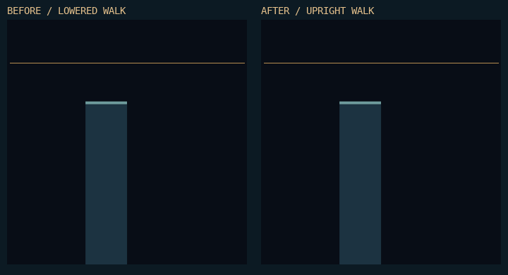

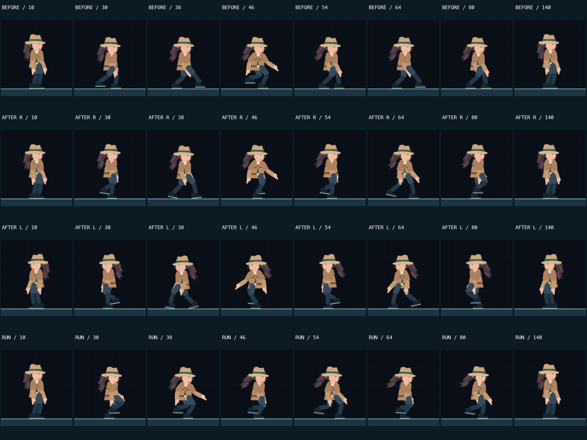


## 人體附件前後順序修訂

2026-11-05 同日後續。使用者指出手腳與身體堆疊奇怪。根因：除馬尾外，附件幾乎全為Z=0；遠側手臂是Torso子節點，依樹序繪在衣身前，近側大腿也可能蓋過衣襬。

只修改scenes/rig.tscn的20個Artwork相對Z，取消Ponytail骨節-1；順序為遠臂0→遠腿1→馬尾2→近腿3→衣身4→頭5→帽6→近臂7。骨架、rest、接點與Texture保留；不靠移動骨節改遮擋，鏡像也不交換遠近。仍22骨節、20可換圖件，沒有增加人體分件需求。

新增tests/render_order_smoke.gd，實際renderer讀回重疊像素：54項PASS，含所有8層、左右鏡像與整體根Z。原有MOTION、步行1230、起跳45、伸手560、基本動作1659、Driflow互動21與通用互動42均PASS。已擷取並放大檢視左右走跑、蹲走、手膝爬行、跳躍、伸手抓邊、攀上；相同步態舊新對照確認遠手不再蓋外套、腿根不再穿到衣襬前。

新增[RENDER_ORDER.md](../RENDER_ORDER.md)，說明完整層表、Inspector設定、如何換圖／新增附件、根Z與場景前景的關係、如何重跑像素測試。README、DEVELOPMENT、CLIMB_REFERENCE、LOCOMOTION及預覽索引同步。其他遊戲和互動文件保留；自審確認只有繪圖層次變更，沒有commit／push。

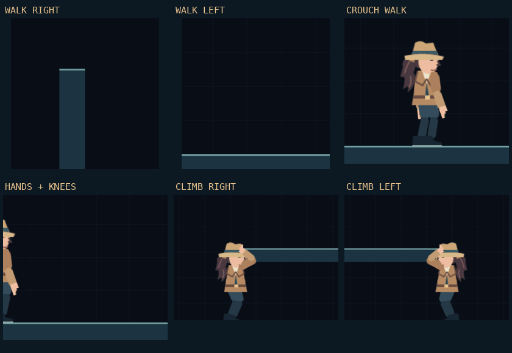

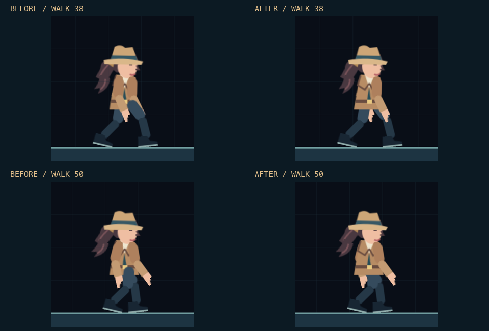

技術棧：Godot4.6.2 GDScript／Bone2D／Sprite2D相對Z、CLI Compatibility renderer、Pillow、Notion MCP；沿用godot_expert、self_improving_agent與notion-knowledge-capture。arm_visual為60Hz模擬／20fps輸出；六面板正常50ms、四分之一速200ms，60Hz走路按時間重取樣，短片段末幀停留。復用：附件層表 → 只改Artwork → 像素／鏡像／根Z回歸 → 正常素材動作檢視 → 同步維護指南與當日日誌。


## 今日收尾｜2026-11-05T20:28:31+08:00

完成攀爬發力與可替換人體分件、蹲走／手膝爬行、空中腿姿、腕掌接點、快速蓄力蹬腿、提前伸手與承重、正常步行身高，以及遠近側附件遮擋修正。最新維護入口為DEVELOPMENT、LOCOMOTION、RENDER_ORDER；角色保留22骨節及20個Artwork換圖槽。已執行圖形像素54、步行1230、起跳45、伸手560、基本動作1659、互動21／42項與MOTION測試，並用實際renderer正常／慢速擷取核對。

已開啟正常互動遊戲供使用者試玩，啟動正常；使用者尚未提供本輪實機手感結論，因此不將自然度記為已獲驗收。下次先收集走路、跳躍與攀爬的操作回饋，依具體動作階段調整；若增加人體細節，分件、接點、換圖契約與測試同步更新。

依收尾規則，以獨立codex/driflow-motion-2026-11-05分支備份Driflow和本對話的可複用動作心得，不移動主分支、不改現有index、不包含其他遊戲與其他對話的技能改動。技術棧與重製指令沿用上節；Notion保存閱讀日誌，Git與本機文件保存程式／規格。
