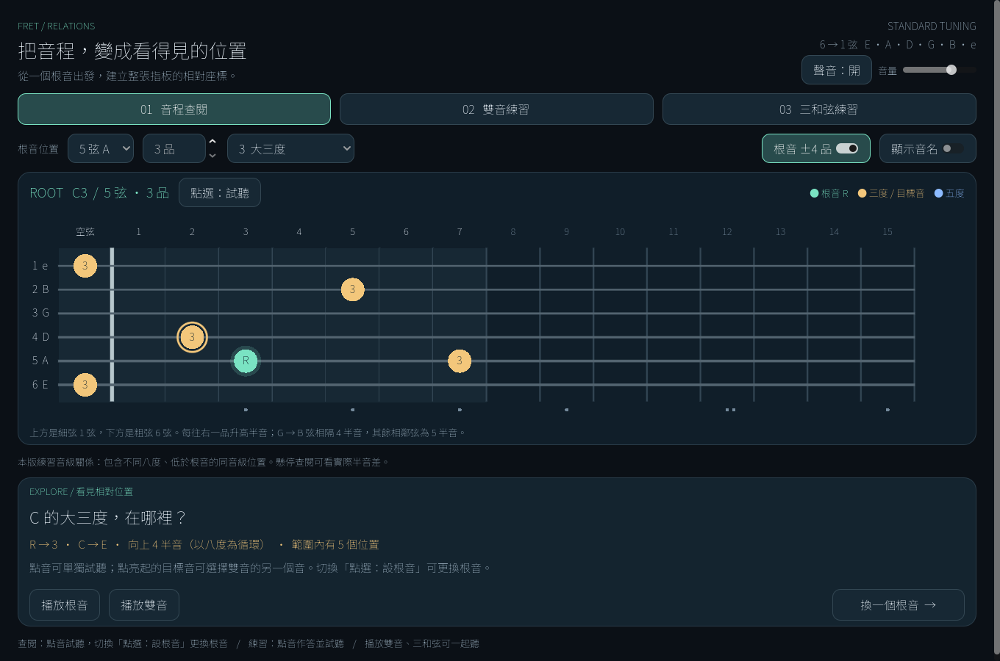
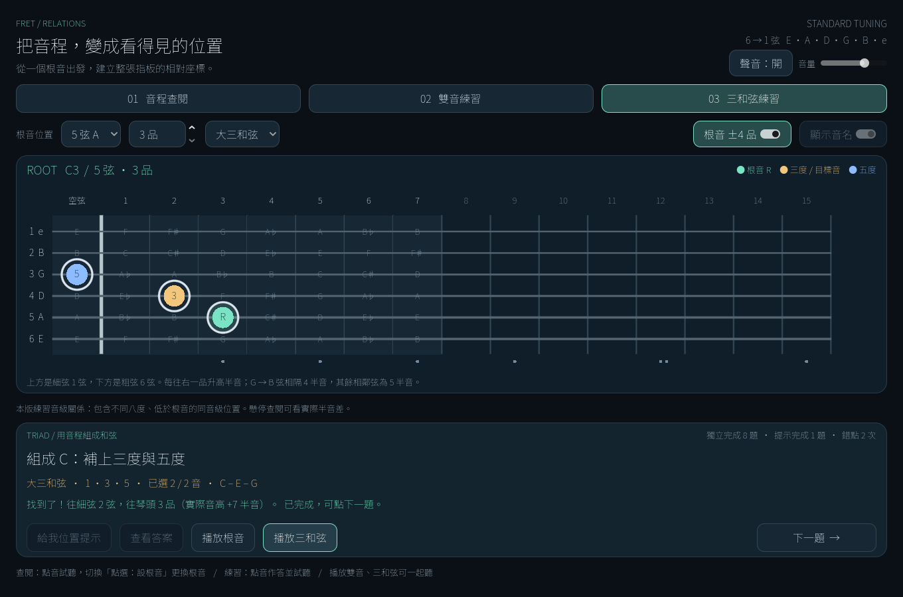

# 2026-11-05｜吉他指板相對音程：查閱、練習與聲音原型

記錄時間：2026-11-05T18:04:33+08:00。環境：macOS／Apple M2 Pro、Godot 4.6.2。專案工作名稱：Fret Relations。

## Session 摘要

從「根據根音快速推斷附近三度、六度等音程位置」的需求，建立獨立 Godot 專案 `games/guitar-intervals/`。使用者明確選擇先實作可操作原型，接著追加單音試聽、雙音與三和弦同時播放。本次收尾記錄原型與驗證成果；後續正式教學內容與平台匯出尚未開始。

## 已完成

| 模式／功能 | 本次行為 |
| --- | --- |
| 音程查閱 | 任意根音、12 種相對音級、標準六弦調弦、0–15 品；可限制根音左右各 4 品 |
| 雙音練習 | 保留根音，點出指定音程；錯答可重試，提供位移提示與揭答 |
| 三和弦練習 | 補上三度與五度，支援大、小、減、增三和弦；可先選任一聲部，完成前可取消 |
| 單音 | 三種模式點音皆可試聽；錯答、完成或揭答後也可比較位置 |
| 雙音／三和弦播放 | 依所選位置的實際音高同時播放；部分三和弦可先聽雙音 |
| 音訊控制 | 音量、靜音；播放位置有白色外圈，結束／切題／靜音時清除 |
| 當次統計 | 分別記錄獨立完成、提示後完成、錯點次數；重播不影響成績 |





[C3–E3–G3 三和弦聲音範例](../../artifacts/triad-c-e-g.wav)

## 決策與理由

1. **獨立專案**：自身 `project.godot` 與完整 `res://`，不依賴其他遊戲、Dialogic 或 Popochiu。
2. **先訓練相對音級**：以 `(目標 MIDI − 根音 MIDI) mod 12` 判題，包含不同八度與低於根音的同音級位置；在畫面持續說明。指定向上／向下／限定八度的題型未實作。
3. **調弦計算而非固定形狀**：使用 E2–A2–D3–G3–B3–E4 的實際音高；G→B 弦的 4 半音差自然反映在位置結果。
4. **三和弦必須能組成三弦指型**：每弦一音，非空弦最高／最低品差最多 4 品；每次選音都必須仍可延伸成完整答案。此為初步篩選，未評估個別手指配置或手掌大小。
5. **試聽與設根音分開**：查閱預設點音試聽，保留根音作比較；「點選：設根音」設定一次後自動回到試聽，也保留弦／品控制項。
6. **聲音保留實際排列**：C3 與 E2 就播放 C3＋E2，不把 E2 折到 E3；聲音與所點位置一致。練習未選音前不提供完整答案合奏。
7. **合成參考音色**：離線十二平均律、A4 = 440 Hz，以加法合成與包絡產生撥弦參考聲，非錄製的吉他取樣；雙音／三和弦混成同一 PCM，聲部同時開始。

## 技術棧、依賴與維護入口

- **技能**：開工先讀 `godot_expert`；收尾參考 `self_improving_agent`，Notion 日誌依 `notion-knowledge-capture` 保存。當前工作樹的 `.agents` 未初始化，規則與技能由本機來源倉庫 `/Users/clydewang/GITHUB/ai-agent-skills/` 讀取；Notion 僅為人類閱讀紀錄。
- **工具**：Godot CLI、GDScript、OpenGL Compatibility renderer、CoreAudio／Dummy、Notion 連接器；不需要額外套件或網路音訊。
- **依賴**：Godot 4.6.2；隨附 Noto Sans TC 字型及 SIL OFL 授權，避免依賴電腦預裝中文字型。
- **樂理模型**：`src/theory/fretboard_theory.gd`，含 MIDI、音級、音名拼寫、範圍與三和弦候選。
- **指板呈現**：`src/fretboard/fretboard.gd`，負責繪製、命中、懸停與播放外圈。
- **練習流程**：`src/trainer/trainer.gd`／`trainer.tscn`，負責模式、題目、選音、回饋與統計。
- **聲音**：`src/audio/tone_player.gd`，使用 AudioStreamWAV／AudioStreamPlayer，44.1 kHz、16-bit mono PCM、1.6 秒參考音，含快取、音量與停止清理。

## 實際驗證

| 驗證 | 最終結果 | 範圍 |
| --- | --- | --- |
| Headless | `RESULT: 65094 checks, 0 failures` | 全部 96 根音 × 12 音級 × 2 範圍、四種三和弦、真實 viewport 點選與音訊測試 |
| 圖形／音訊模式 | `RESULT: 65102 checks, 0 failures` | 同上，加上實際 renderer 截圖與 WAV 輸出 |
| PCM 頻率 | PASS | A4／E2 頻率、和弦各聲部在起音視窗同時存在、八度音高、峰值及包絡 |
| 引擎音訊匯流排 | PASS | AudioEffectCapture 取得非零樣本，涵蓋單音、雙音與三和弦 |
| 聲音與作答整合 | PASS | 根音固定、正確與錯答位置試聽、揭答後更換雙音位置、部分三和弦、靜音、零音量、重播不重複計分與發聲白圈清理 |
| 程式／畫面審查 | 通過目前原型範圍 | 調弦邊界、全空弦和弦、重複作答、音量隔離、中文排版及播放狀態 |

測試採實際 `Viewport.push_input()` 滑鼠事件；音訊除檢查聲部狀態外，也檢查 PCM 頻譜與引擎匯流排，不以 `playing` 旗標作為唯一依據。測試數字包含迴圈內的不變條件檢查，不代表同等數量的獨立使用情境；未進行使用者教學成效或真實吉他音色驗收。

完整測試輸出已保存於 `artifacts/validation/headless.log`、`artifacts/validation/graphical-audio.log`。

### 從零重現

在 monorepo 根目錄執行：

```sh
/Applications/Godot.app/Contents/MacOS/Godot --path games/guitar-intervals
/Applications/Godot.app/Contents/MacOS/Godot --headless --path games/guitar-intervals --script res://tests/test_runner.gd
/Applications/Godot.app/Contents/MacOS/Godot --path games/guitar-intervals --script res://tests/test_runner.gd -- --capture-dir=/tmp/fret-relations-audio
```

也可用 Godot 4.6 開啟本專案 `project.godot`，按 F5。

## 自我進化沉澱

- 中文 UI 隨附有再散布授權的 FontFile；macOS 受限 headless 環境的 SystemFont 曾取得空字型路徑並回報 FreeType 錯誤。
- ScrollContainer 內的點選測試先 `ensure_control_visible()`、等待 layout，再送 viewport 本地座標事件，避免將畫面外按鈕未觸發誤認為功能故障。
- `AudioStreamPlayer.stop()` 不送出 `finished`，因此靜音／切題需自行清除播放位置標示。
- Godot CLI 的 Parse Error 曾伴隨 exit code 0，驗證必須同時確認錯誤日誌與 `RESULT` 完成標記。

可復用規則已追加至本機來源倉庫的 `skills/godot_expert/SKILL.md`。

## 待接續事項

以下為候選方向，尚未由使用者排定下一階段範圍：

- [ ] 實際試玩三度／六度練習，觀察是否能遷移到不同根音與跨 G／B 弦。
- [ ] 依試玩結果選擇弱項重複、混合出題、限定弦組或進度存檔。
- [ ] 需要更進階時，另做指定音高方向／八度與三和弦轉位題型。
- [ ] 視需求加入真實吉他取樣、聽辨題、左手模式或其他調弦。
- [ ] 手機版、麥克風辨識、匯出安裝檔未實作。

## 版本留底

本日誌與本次原型一併提交至 `codex/guitar-intervals-prototype` 分支；確切提交與遠端結果記在 Notion 開發日誌中。開發說明見本專案 `README.md`，monorepo 索引見根目錄 `AGENTS.md`／`CLAUDE.md`。
